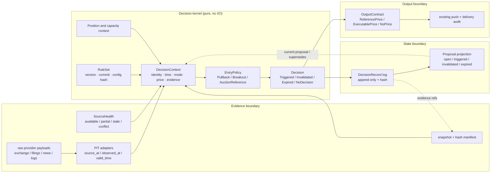
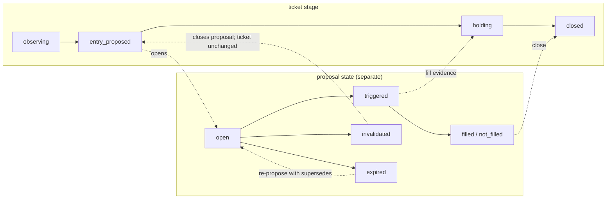
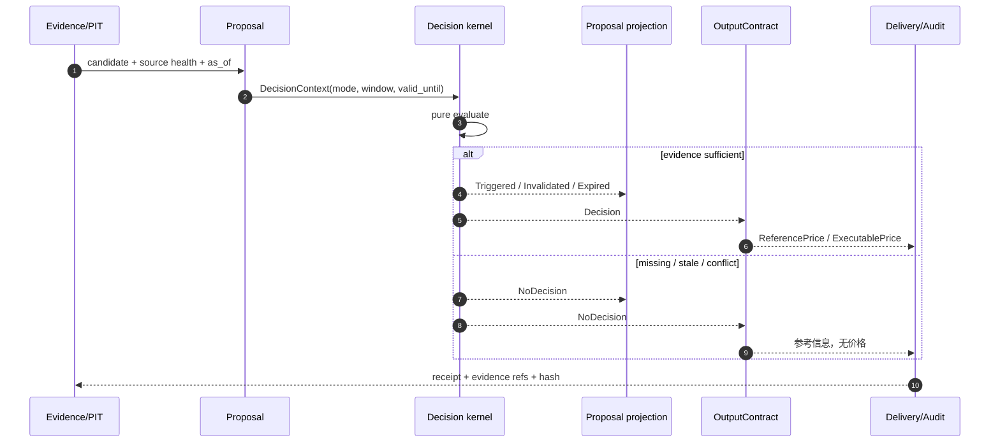
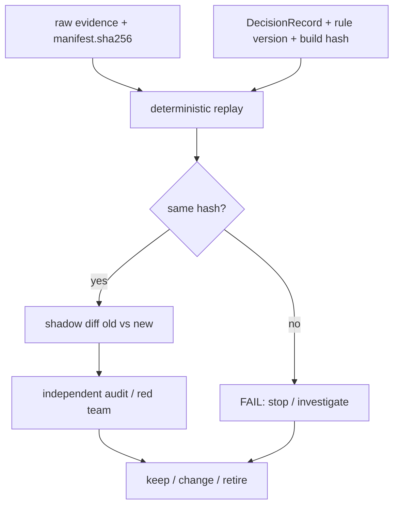

# 单票完整生命周期（ticket）实施方案

状态：进行中（2026-10-17 起草）
依据：operator 2026-10-17 给出的五条诉求 + 当日代码/数据实测
定位：这是**方案**，不是承诺。每阶段都写明"能验证什么"和"做不到什么"。

## 演化史

- 2026-10-17：起草，定 P1~P6 阶段与顺序原则。
- 2026-10-18：定位 P4 停供真因（schema v10 表缺失 + `{e}` 空渲染），探针法确立；观察池定向监控、竞价观测、淘汰规则上线。
- 2026-10-19：P1.1 调度上线；P3.1/P3.3、T+1 禁卖、P5 轮动信号与选票入口、P6 二层归因（CLI）完成；HoldingPlan 恢复投递。
- 2026-10-20：观察池选股表现存档（perf_log 16:05）上线——**本文件此前漏记，2026-10-22 补**。
- 2026-10-21：选票入口扩到 4 个（+P01 +持仓）；板块选票优先级（涨停>龙头>涨幅）；P1.4 P01 自动开票（推荐价=昨收）；P2 可买价完成；下游 stage 查询同步修（buy_zone_dispatch.rs:304 / ticket_eviction.rs:98）。
- 2026-10-22：P-02 stage 按时间切换（c7102301c）；`no_last_traded_price` 隔离重试（e014bb75f，未经过真实流量）；第一轮全面评审（见「调整记录」）。
- 2026-10-23：批 0 入库（eddb6d49e）；批 1 分型体系全部落地 + 批 2 七项接线 + 批 4.1/4.2 口径修正（621ea15cf，见「1.7 实施记录」）。
- 2026-10-24：批 2 补 2.5 概念扩展、2.6 龙虎榜归档接线；批 5 两项探源出结论（5.1 商品源可用、5.2 提案零成交）；2.4 探针证明降级不成立。
- 2026-10-24（下午）：日线改走**通达信盘后文件**（`tdx_day_import`），6,187,698 行进库、覆盖 5,229 只、2021-08 起（0.11）；桥内补齐 Tencent 7 字段并重启（见 0.12）。
- 2026-10-26：华瓷股份(001216)案例触发“机制归因不等于判断正确”评审；新增第十一节专家级证据与验证方案（P0 高位门/streak 口径、原始证据包、独立复核、预先登记结果）。

## 调整记录

### 2026-10-22 第一轮全面评审（代码 + 数据对账）

对账方法：`scripts/phase_acceptance.py` + 生产库直查 + 日志字节锚点 + 回测。

**A. 状态修正（文档与实际不符）**

| 项 | 原文 | 实际 | 处理 |
|---|---|---|---|
| P6 归因 benchmark | 已完成 | CLI-only，main.rs 零调度，表停 10-16 缺 3 个交易日 | 降级为未达标，待接调度 |
| 关联公司 | 未做 | 15:52 作业每日在跑（花 DeepSeek 费用），产出 object_code 153/153 全 NULL 不可用 | 改为「产出不可用」 |
| ticket_priority | 未提 | 15:44 每日计算但只落日志，无表无推送无消费者 | 记入缺陷清单 |
| perf_log | 未提 | 16:05 每日 D+1/D+3/D+5 存档，是唯一在跑的选股效果跟踪 | 补记（演化史） |

**B. 缺陷立案（待修，按优先级）**

1. 同 code 多活跃票无防护：002696/002724/603278 各 2 张活跃；find_active_ticket 只取最新 → 旧票逃逸淘汰规则成孤儿；明日计划查询不按 code 去重。
2. entry_proposed 价位一次性：propose 只扫 observing（ticket_entry_proposal.rs:96），32 张票价位冻结在 10-21；归因锚定价口径未定。
3. 提案与淘汰规则矛盾：603096 同日收到买入提案（18.71-19.08）与淘汰（-22.6%）。
4. position 事件幂等缺失：603915「新建仓 500 股」重复写 6 次。
5. 明日计划绕过投递库直推：无 L5 门禁、无审计归档、P1.2 永远记不到它。
6. P3.3 行情断时空转刷 WARN（88 次）无升级出口；P3.1 新闻事件 0 条，该路径从未被真实数据验证。
7. 板块资金流信号链断裂（分三段，实证）：
   ① 盘中推送链一直活——2026-10-20 11:27 Delivered「机器人概念 主力+65.95 亿」；
   ② 盘后 f62 落库 2026-10-21 才通（10-16/19/20 只有 f3 涨幅榜，f62 零行；
   10-21 起 f62 有真实数据，当日 top=电子 +58.35 亿）；
   ③ 消费端零接线——观察池选股只用 f3 涨幅排名，f62 资金流 top 板块不进任何选股/复盘/thesis。
   后果实证：10-20 资金流第 1 名的机器人概念因涨幅排名第 11 差一名未进选股，两信号无交叉。
   历史回填说明：10-21 之前的资金流只能从投递归档 rendered_content 解码补，f62 表补不了。
8. **全市场日线自 10-17 起断更（正在发生）。** stock_daily 每日行数：10-16 = 1248 只，
   10-19 = 54、10-20 = 53、10-21 = 47——只剩观察池/持仓/涨停池碰过的票。
   连锁后果：① 板块轮动选票的「上一完整交易日」判定退化为 `HAVING COUNT(*)>=50`
   （ticket_watch_pool.rs:228），54 行技术过线但候选面塌缩——10-21 实锤 boards=30
   候选只有 7 只（30 板块×3 只应约 90）；② attribution_benchmark 的市场基准
   （需样本≥50）从此不可信；③ perf_log 的胜率没有同日基准可对照，超额算不出；
   ④ 新进池票若日线未刷新，P2 提案 no_data 跳过。修复：补 daily_bars_build 全市场
   10-17 至今，并把全市场日线纳入调度或加覆盖度告警。
9. **P1.1 观察池判重用进程内 static（WATCH_POOL_LAST），重启即重放。** 10-21 同一晚跑了
   3 轮，catalyst 事件 24 条 = P01 3 条 + 轮动 7 只×3 轮——同一批票的「首次入池」事件
   重复写 3 遍。明日计划在 10-20 已因同款教训改用文件 marker，P1.1 没跟着改。
10. **涨停阈值 9.85 不分板。** 20cm 板（300/301/688）涨 9.85~19.5% 不是涨停，但被
    pct_chg>=9.85 计为涨停：实测 151 个样本 / 93 只票（占 20cm 板全部 >=9.85 样本的
    58%）。同一阈值同时用于：分型规则（近 5 日有涨停）、P1.1 涨停优先选票、两块回测。
    主板（002/600/603/000/605/001/601）无此问题（>=19.5% 为 0）。
11. **perf_log 基准口径不统一。** 16:05 存档统一用 open_date 收盘作基准
    （watch_pool_perf.rs:11）——对 15:40 开票的观察池票合理（次日才能买），
    但 P01 票 09:00 开票、当日可买，D+1 指标系统性地晚算一天。
12. **D3 预算层只有总量没有集中度。** 30%/周 限总额，不限同板块集中度——轮动入口的票
    天然同板块扎堆（10-19/20 批次 34 只全是板块来源），同时触发时预算会全部压进一个板块。

**C. 运营决策（operator 拍板）**

| 编号 | 决策 | 结果 |
|---|---|---|
| D1 | 情绪型票允许突破买，超买门对情绪型豁免 | 通过 |
| D2 | 持股周期不定全局值，按票的趋势分型（每日重算，型变参数变） | 通过 |
| D3 | 组合预算 = 单周新增仓位上限 + 优先级排序花钱，只标注不拦截 | 通过，30% |
| Q2 | 情绪票入场价 | 竞价价 + 盘中突破确认，两者都给 |

**D. 数据否决（回测推翻原提议）**

原拟「竞价低开 >2% 放弃」→ 全库 1977 个涨停次日样本回测否决：
低开 >2% 子集是唯一正期望分组（开盘买→收盘 +1.16%、胜率 47.7%、n=304）；
高开 >6% 才是死亡区（-1.97%、胜率 28.4%、n=338）。
**改为：不设低开放弃线；高开帽 >6% 不给买价。**

**E. 回测证实**

- 回踩模型对情绪票不适用：涨停次日盘中触及 ma10(±1%) 仅 15.4%（221/1436）。
- 10-21 实发 33 个提案中 18 个（55%）按新分型是情绪型——发的是统计上不会成交的价。
- 竞价/开盘买情绪票裸基线为负期望（均值 -0.36%，n=1977；连板 -0.40%/首板 -0.35%）：
  D1 解决「价能成交」，不保证「成交能赚」，正期望要靠高开帽 + 板块热度过滤的子集规则，
  该规则上线前无数据支持，先观察记录两周。
- 边界：样本来自 stock_daily（约 1200+ 只），生存者偏差未排除；竞价维度用开盘价近似，
  历史竞价数据从未落库。

**F. 拓展立项**

见 8.5：拓 1.1 / 1.3 / 2.1 / 2.3 / 3.1 / 4.1 / 5.1 / 5.2 / 6 可直接排期；
拓 2.2 / 3.2 需先探源或定口径。实施批次：批 0 修复 B.1/B.5 → 批 1 分型体系（Q2 已拍）
→ 批 2 纯接线拓展 → 批 3 预算层（Q3 已拍）→ 批 4 探源。可复用资产盘点见 8.6。

## 一、目标（operator 原话拆解）

1. 以周为周期（按板块轮动而非固定周），周末/周初用新闻催化 + 上周板块轮动迹象，
   在周一开盘与集合竞价找出热点板块最热的票，给出**可买入价格**；T+1 当天不考虑卖出。
2. 盘中密切关注该票：新闻、盘中数据、公司公告，以及**直接/间接关联公司**。
3. 次日集合竞价 + 盘中，判断**持有 / 加仓 / 做 T**，且每个动作要有**明确价格**。
4. 同时关注板块轮动，准备下一个板块的股票。
5. 无论盈利亏损都要有**复盘归因**：为什么赚、如何继续；为什么亏、如何避免。

## 二、现状（2026-10-17 实测，不含推测）

已完成（地基）：

- `ticket_lifecycle` / `ticket_event` 两张表 + `(code, open_date)` 唯一索引。
- `stage` 为 TEXT 无 CHECK 约束（枚举可演进）。
- 手工工具：`bin ticket_open` / `bin ticket_show`。
- 观察池生成器：`monitor/ticket_watch_pool.rs`（新闻催化路），`bin watch_pool_build --dry-run`。
- op 67 解析层：`data_gateway/provider_observed_trading_facts.rs`（8 单测）+ 请求构造
  `build_external_native_query_request::QualifiedTradingFacts`。

未接（缺口，按实测）：

- **monitor 零 ticket 调度**：`grep ticket src/bin/monitor/main.rs` = 0 处。
- **推送 → ticket_event 零接线**：`append_event` 只有观察池生成器与手工 CLI 调用。
- **生产库 0 行**：ticket_lifecycle 0 / ticket_event 0。
- **无"可买价"**：`PoolCandidate` 只有 code / note，没有价格字段。
- **板块轮动路未接**：`save_board_rotations` 零生产调用，`board_rotation_daily` 停在 2026-07-16。
- **关联公司未做**（直接/间接都没有）。
- **HoldingPlan 停供**（2026-09-23 起 owner 读取拒绝）。
- **逐票归因未做**：`advice_outcome_tracking` 只接 T0Advice 一种 push_kind。

## 三、阶段设计

### P1 让票真的被跟踪（一切的前置）

P1.1 monitor 每日调度观察池 — **已完成（2026-10-19 上线，10-21/10-22 两轮加固）**

- 位置：`src/bin/monitor/main.rs::market_loop`，按 `static X_LAST: Mutex<Option<NaiveDate>>` 模式。
- 时机：交易日 15:40 之后（盘后，新闻评估已产出），每日一次。
- 动作：`ticket_watch_pool::build_watch_pool(db, date, lookback=5, dry_run=false)`。
- **四个选票入口（2026-10-21 扩到 4 个）**：

  | 入口 | source | 数据来源 | 状态 |
  |---|---|---|---|
  | 新闻催化 | `news_catalyst` | `news_ai_assessment` | **断供**（停 10-14，见已知约束 6.2） |
  | 板块轮动 | `board_rotation` | 当日板块榜 top10 的成分股 | 已通 |
  | P01 盘前热点 | `p01_preopen` | `LimitPools`（前一交易日涨停池） | 已通 |
  | 实际持仓 | `holding` | `stock_position` | 已通 |

- **板块轮动的选票优先级（2026-10-21 改，`8b41528ae` + `7e1f13b3f`）**：

  ```
  今日涨停 > 板块龙头 > 日线涨停 > 涨幅降序 > 涨幅缺失（BR-222 不补 0）
  ```

  - `LIMIT_UP_PCT = 9.85`，用 `pct_chg` 判涨停，**不依赖 `stock_daily.is_limit_up`**
    （该列在 `kline.rs:650` / `repository.rs:92,254` 硬编码 false，不可信）。
  - 板块龙头取实时 `BoardFlows.leader_code`，不落库（避免触发 BR-159 验链）。
  - **板块成分股必须用东财 BK 码**：`board_ranking_daily`（东财 `BK1512 生猪养殖`）与
    `board_member`（TDX `tdx:industry:融资融券`）**名字和代码交集都是 0**，语义也不同
    （行业细分 vs 风格题材）。所以 `BoardConstituents` 按 BK 码走 ExternalV1 通道。
- 验证：日志 `[观察池] boards=N board_candidates=M board_added=K total=T opened=O appended=A`。
  **`opened=0` 不等于失败** —— 选中的票已在库里时会走 `appended` 补事件路径。
  判"有没有产出"看 `board_candidates > 0`。
- 做不到：输入源断供时（`news_ai_assessment` 无新增）只会开存量票，日志必须如实报 0。

P1.2 推送 → ticket_event 自动记账（best-effort）

- 位置：T0Advice / HoldingPlan / CloseCall 推送成功后（durable delivery 已确认 Delivered）。
- 动作：`append_event(ticket_id, event_at, event_kind, push_kind, occurrence_identity, summary)`。
- 约束：**best-effort**——写失败只 `log::warn`，绝不影响推送；票不存在则跳过（不自动开票）。
- 验证：推一条 T0Advice 后，对应 ticket 的事件时间轴多一行。
- 做不到：只覆盖"有 ticket 的票"；没有 ticket 的推送不回溯补建。

P1.3 op 67 价格带每日落库

- 原因：对端明确"价格带只在观测快照日有值"，错过当天就永久丢失（不能用时再查）。
- 动作：每交易日盘后查一次 `QualifiedTradingFacts`（include=lifecycle+price_band），
  落 `stock_daily` 或独立表（字段：code / date / limit_up / limit_down / price_band_source / evidence）。
- 验证：表中每个交易日的行数 = 当日查询成功的票数；`price_band_source` 非空。
- 做不到：非快照日返回 null（按 BR-222 保持 NULL，不补值）。
- **前置**：op 67 当前只有请求构造，没有业务调用点；本项即第一个调用点。

### P1.4 P01 推送 → 自动开票（第三个开票入口，2026-10-21 新增）

- 原因：P01「盘前热点」每天 09:00 推 3 只昨日涨停股，但 P1.2 的记账范围只有
  `T0Advice / HoldingPlan / CloseCall`，且明确「票不存在则跳过（不自动开票）」。
  结果是推完就断——不进观察池、不留推荐价、无法算 D+1/D+3，也无法验证选股是否有效。
  实测 10-21 推的 002696/002724 当日续板，但库里没有任何记录能追溯这次推荐。
- 动作：`run_p01_once_with_ports` 在 `P01RunOutcome::Delivered` 之后调用
  `record_p01_tickets`，对每只入选票 `open_ticket(stage='observing', source='p01_preopen')`
  + `append_event(kind='catalyst', push_kind='PreopenNewsHot')`。
- 记账字段：`P01BoundHead` 新增 `recommend_price / streak / sealed_amount / turnover / break_count`，
  在 `bind_p01_sources` 里按 code 从 `LimitPools` 的 `LimitPoolEntry` 取。
  **这些字段不进 `canonical_source_bytes`**，所以不影响 source binding hash 和 decision identity。
- 推荐价口径：**前一交易日收盘价**。P01 在 09:00 推送，集合竞价尚未结束，拿不到当日实时价，
  涨停池的 `price` 是唯一可锚定的价格。note 里写明「推荐价」来源，避免被当成当日成交价。
- 约束：
  - best-effort：取连接/写库失败只 `log::warn`，绝不回滚已完成的推送
  - `open_ticket` 是 `INSERT OR IGNORE` + `(code, open_date)` 唯一索引，同票同日重复推送不产生第二张票
  - 票已有活跃 ticket 时（如 003029 由板块轮动先开），只补事件，不新开
- 验证：日志出现 `[P-01][bookkeeping] opened ticket#N <code> <name> price=Some(..)`；
  `SELECT COUNT(*) FROM ticket_lifecycle WHERE source='p01_preopen'` 增长。
- 做不到：**历史回填拿不到推荐价**——`delivery_decisions.envelope` 里只有
  `ordered_limit_pool_record_hashes`，没有价格字段。回填脚本
  (`backfill_p01_tickets.py`) 只能写 NULL，按 BR-222 不补推导值。
  另：2026-08 ~ 2026-10-09 的 15 个业务日推送正文格式不同，解析不出股票代码，未回填。

### P2 可买价（观察池 → 入场参考）— **已完成（2026-10-21，`32628135f`）**

- 实现：`src/monitor/ticket_entry_proposal.rs::propose_for_observing`
  **复用 `buy_zone::compute`**，不另写价位算法。
- 输出：**参考区间 + 触发条件**，不是单一价格。实测产出例：
  `22.82-23.28｜回踩 ma10 23.05 附近可买；确认条件：量比>1.2｜放弃 19.34`
- 分型给区间（按 `buy_zone` 的均线判型）：
  - **多头**：`entry = ma10 ±1%`，放弃价 `max(ma20, 20日低) × 0.99`
  - **空头 / 纠缠**：上沿 `min(close×1.01, ma5)`，下沿不低于 20 日低
  - **已在 20 日低附近**：只报放弃价，不报买入区间
- 跳过规则（不推进，写日志说明原因，**不编区间**）：
  - 连板 / 近 5 日涨幅过大 / 偏离 ma5 超买 → `skipped_overheat`
  - 数据不足（无 `stock_daily`）→ `skipped_no_data`（BR-222）
  - 已在支撑位 → `skipped_at_support`
  - 同日同票已有 `entry_proposed` → `skipped_duplicate`
- 写入：`ticket_event(kind=entry_proposed)` + `ticket_lifecycle.stage='observing' → 'entry_proposed'`。
- **下游必须同步改 stage 查询**（2026-10-21 修）：
  `buy_zone_dispatch.rs:304` 与 `ticket_eviction.rs:98` 由 `stage = 'observing'`
  改为 `stage IN ('observing','entry_proposed')`，否则票推进后从明日计划消失、且永不淘汰。
- 验证：日志 `[入场参考] scanned=N proposed=P overheated=O at_support=S no_data=D duplicate=U errors=E`；
  `SELECT COUNT(*) FROM ticket_event WHERE event_kind='entry_proposed'` 增长。
- 实测（2026-10-22 10:24 验收）：`entry_proposed` 事件 33 个、状态 32 个，`observing` 从 40 降到 10。
- 做不到：不预测涨停；无 `stock_daily` 覆盖的票不给区间（只标注"数据不足"）。
  P01 回填那批（603096/603533/605058/002343/600825/000530/002696/002724）就是这一类，
  它们的 `observing` 会一直停着，直到补齐日线。

### P3 定向监控（观察池的票）

- **P3.1 新闻/公告按 ticket 的 code 过滤 — 已完成（2026-10-19）**
  - 盘后回溯（`main.rs::post_close_news_review`）：标的从「只持仓」扩到
    「持仓 ∪ `ticket_lifecycle` 活跃票」。以前观察池的票根本没有新闻数据，
    优先级打分里的「新闻催化」维永远 0 分。
  - 盘中扫描（`watch_pool_monitor::scan`）：新增第三条规则——查 `news_items`
    最近 10 分钟、未被 `news_dedup` 标记的新闻，命中就报「新闻：{标题}」。
  - 去重：通知后写 `news_dedup` key=`watch_news:{id}`，30 秒一轮不会重复。
  - 边界：新闻票必须在行情批次里才报（拿不到价格就没有意义）。
- **P3.3 盘中同板块关联票异动 — 已完成（2026-10-19）**
  - `watch_pool_monitor::scan` 第四条规则：观察池的票属于哪些板块（`board_member`），
    这些板块里今天涨幅 >= 5% 的其他票就报，文案「同板块「风电」000099 XX +6.2%」。
  - 每个板块只保留涨幅最高的一只，挂在主票的 `reason` 里，不单独成条。
  - 阈值 5% 而非 3%：板块内每天一堆 3% 的票，报出来是噪音。
  - 单轮最多查 200 只关联票行情（`PEER_QUERY_LIMIT`），保护行情接口。
- **关联公司（直接/间接）仍然做不到，原因是数据不是代码**：
  `chain_relation_candidate` 77 条记录 `object_code` **全部为 NULL**，
  `object_name` 是「钢材」「原料药」「航空煤油」这类产业环节——`chain_ai` 的
  系统提示词明确要求写「具体的大宗商品或原材料」而不是公司（理由：只有具体到
  商品才能盯价格）。所以这一路盯的是**商品价格**，不是关联公司股价。
  要做「直接关联公司」得改提示词让它输出上市公司代码，或接股权/供应链数据源。
- **T+1 当日买入禁卖 — 已完成（2026-10-19）**
  - `position_change_detect::t1_locked_quantities`：当前快照 vs 上一份的
    `quantity` 增量 = 当日买入股数（系统拿不到券商「可用数量」字段，
    `UserPositionItemInput` 只有 quantity / cost_price）。
  - `holding_plan`：整仓都是当日买入时，浮盈 > 5% 不给减仓，降级 `Hold`，
    文案「浮盈 X% 但当日买入 N 股 T+1 锁定，今日不可卖」。
  - 读锁定量失败时 `warn` 并出声，不静默退化成「可以卖」。
  - 边界：两次快照之间买入的都算锁定；隔多日才导入一次会多锁一天（偏保守）。
  - 只挡 `Reduce`，不挡 `StopLossReview`（止损是核查提示，不是卖出指令）。
- 验证：某票当天新闻命中时，事件时间轴出现 `news_catalyst` / `announcement` 行；
  持仓票在买入当日浮盈 >5% 时，HoldingPlan 应输出「T+1 锁定」而不是减仓价。

### P4 次日动作 + 价格

- 路径 A（推荐）：修 HoldingPlan（真因已有观测，待盘中 tick）→ 复用其动作与价格。
- 路径 B（备选）：`ticket` 专属次日决策模块，复用 T0Advice 的价位计算，但**不新造一套风控**。
- 验证：次日 9:25-9:35 对观察池票输出 `hold/add/t0` + 价位；写入 ticket_event。
- 做不到：HoldingPlan 未修好前，"减仓/止损"类结论只有 T0Advice 一条腿。

#### 排查记录（2026-10-18）

**现象**：2026-09-23 09:46 之后，每日 5 只持仓票全部
`[I-04][T-03] code=xxx 原 owner 读取拒绝: holding_plan_owner_read_failed`，
HoldingPlan 决策不再写入。

**证据**：

```
delivery_decisions  HoldingPlan 按日：
  2026-09-21  290
  2026-09-22    5
  2026-09-23    5     ← 全部 Delivered，时间 09:46-09:47（北京时间）
  之后          0

state 分布：RejectedDurable 2859 / Delivered 161 / ManualResolvedRejected 6
```

错误消息只有前缀，`{e}` 渲染为空 —— 底层错误没有 Display 文本。

**已排除**（逐条实测）：

| 假设 | 证据 | 结论 |
|---|---|---|
| 表缺失 | `immutable_audit_outbox` / `delivery_disposition_payloads` / `task_transition_payloads` 都在 `durable_delivery.sqlite3`（19 张表） | ✗ |
| 多进程争用 shm | `lsof` 显示只有 monitor 打开该库（2 main + 3 shm fd） | ✗ |
| schema 版本不符 | `PRAGMA user_version=9`，代码用 `open_existing_monitor_schema9`；启动时 catalog 校验通过 | ✗ |
| `OccurrenceContext` 校验 | 该函数各分支错误都有具体消息（`ticket_not_equity` / `ticket_code_invalid`） | ✗ |
| 当日无决策导致失败 | `load_strict_owner` 无记录时返回 `Ok(None)` → `Missing`，走 fresh 分支，不报错 | ✗ |
| database_binding 缺失 | 只在 teardown 时为 `None`；进程正常运行是 `Some` | ✗ |

**待定**：真实错误在 `with_connection` 或 `capture_sql_binding` 内部，
但 Display 为空，无法从日志判断。

**已做**：把 5 处 `format!("...: {e}")` 改成 `{e:#}`（anyhow alternate 输出完整因果链），
位于 `src/bin/monitor/durable_delivery_runtime/holding_plan.rs:40,65,102,204,235`。

**验证时点**：周一 10:30 I-04 首次触发时，日志会带完整错误链。
拿到真实错误后按错误类型修（结构问题改 SQL/校验；状态问题改流程）。

### P5 板块轮动接力

- **P5 轮动信号 — 代码完成（2026-10-19），等数据**
  - `src/monitor/board_rotation_signal.rs` + CLI `board_rotation_build`
  - 表 `board_rotation_signal`（不动旧 `board_rotation_daily`，
    后者要求 `news_title` 非空，硬塞空串等于造假）
  - 三态：`mainline`（连续在 top10）/ `new`（今天新进 top10）/ `fading`（昨天在、今天掉出）
  - 判定用**名次**不用涨跌幅：涨幅可能因复权/口径差异不可比
  - 单日保护：`has_comparable_days` 检查，只有一个交易日时直接报错退出
  - **2026-10-16 实测**：报「之前没有第二个交易日的板块榜，无法判断轮动」✓
  - **数据缺口**：`board_ranking_daily` 目前只有 10-16 一天真实数据。
    2026-10-18 那 175 行是周日手工跑 CLI 写入的 10-16 副本（逐行相同），已删除。
- **P5 选票入口 — 已接通（2026-10-19）**
  - 桥接 `BoardConstituents` 新增 `board_code` 口径。此前 `fetch_board_constituents`
    只能调 `gateway.memberships(code)`，方向是「个股→板块」；provider 的
    `BoardConstituentRequest { board_code, limit }` 本来就支持按板块查成分，但
    `BoardDataGateway` 没有公开入口（`board_constituents_raw` 是 `pub(super)`，
    `board.rs::board_constituents` 要 `VerifiedBoardBinding`，而 binding 是空列表）。
    改法：`board_runtime::constituents_by_board()` 复用 `board_constituents_raw`
    + 与 `fetch_memberships` 同一套 evidence 校验（改校验返回的 `board_code` 一致），
    `delegate::fetch_board_constituents` 优先读 `board_code`，保留 `codes` 兼容路径。
    提交在 `.worktrees/tdx-local-provider-20260923` 的 `479e761d2`。
  - 新表 `board_member(board_code, board_name, kind, instrument_code)`，
    CLI `board_member_build --from-ranking --date <日> --top 10`。板块名先试
    `tdx:concept:<名>`，失败再试 `tdx:industry:<名>`（新浪概念榜与 TDX 分类不同）。
  - 观察池 `ticket_watch_pool::collect_board_rotation` 接第二路：当日板块榜 top10 →
    `board_member` 成分股 → 按**上一完整交易日**涨幅取每板块前 3（`BOARD_PER_BOARD=3`）。
    用上一交易日而非当日：`stock_daily` 当日只有活跃票样本（10-19 仅 9 只），
    拿它排序会把 1241 只里的强票挡在外面。
  - monitor 15:40 调度：先 `build_from_ranking(10, 10_000)` 再 `build_watch_pool`。
  - **2026-10-19 实测**：top10 板块里 5 个成功、5 个报「服务端内部错误」
    （海上丝路/海工装备/氢燃料/军工航天/抗癌）；成功的是国产软件 261、风电 400、
    仿制药 73、民营医院 78、草甘膦 17 只，共 829 行。观察池 16 候选
    （2 新闻 + 14 板块），开票 14 只 `source=board_rotation`。
  - **已知限制**：约一半新浪概念名在 TDX 板块里对不上（返回内部错误而非空），
    目前只能记 `failures` 跳过。板块覆盖不全 = 选票面偏窄。
  - 桥接重启后**首次监听要等约 140–260 秒**（`DatabaseManager::init` 跑 migrations），
    这段时间内所有数据调用报 `unavailable`。重启桥接要留足观察窗口，
    不要在这个窗口里判定启动失败。
- 每日产出"下一个板块"的候选，进观察池（source=board_rotation）—— 已接。
- 验证：`board_rotation_build --date <日>` 输出「主线/接力/退潮」各几个板块；
  `watch_pool_build --date <日> --dry-run` 能看到 `[board_rotation]` 行。
- 做不到：板块轮动的"早期信号"本质滞后；只能做提示，不能当买入依据。

### P6 逐票复盘归因

- **P6 二层归因 — 已完成（2026-10-19）**：`src/monitor/attribution_benchmark.rs`
  + CLI `attribution_benchmark_build`，落表 `attribution_benchmark_daily`。
  - `stock_pct`    `stock_daily.pct_chg`
  - `market_pct`   当日全市场等权平均，**样本 >= 50 才采纳**，否则 NULL（BR-222）
  - `excess_pct`   `stock_pct - market_pct`，即选股超额
  - `board_pct`    **留 NULL**：板块日线只有 2026-10-16 一天（新浪概念快照），
    D3 板块成分映射未落地，填一个估出来的值比 NULL 更糟。
  - 实测 2026-10-09：817 只全部带基准，市场 +0.69%，
    300413 超额 +19.29 / 300340 +15.20 / 688561 +10.52。
  - 实测 2026-10-16：18 只，样本不足 → `market_pct` / `excess_pct` 全 NULL。
  - 补样本：`daily_bars_build --codes` 可显式指定标的，
    `stock_concepts` 里有 1265 个代码，补完全市场后基准即可采纳。
- 已有的 `paper_attribution_daily` 是**按 signal_family 统计 PnL/胜率**，
  停在 2026-08-28、`attribution_run_audit` 0 行，与本轮的二层拆分不冲突。
- 验证：`attribution_benchmark_build --date <日> --show` 能看到个股/市场/超额三列。
- 做不到：归因是统计相关，不是因果；报告必须写明"假设执行、非真实收益"。

## 四、顺序原则

1. **P1 必须最先**——没有自动化，后面每个阶段都只有 dry-run 能跑。
2. **P1.3 与 P1.1 并行**——价格带错过当天永久丢，时间敏感。
3. **P2 依赖 P1.1 的票**，P4 依赖 P1.2 的时间轴，P6 依赖 P4 的动作记录。
4. **P5 可独立**——不依赖 ticket，是另一个数据源接线。
5. **P3 的弱关联版可以晚做**——它有替代品（人看新闻），P2/P4 没有替代品。

## 五、明确不做

- 不自动改规则/不自动调参（AGENTS §2.10、`performance_feedback.rs:4`）。
- 不补 0、不推导涨跌停价（BR-222 / BR-205）。
- 不给"保证盈利"的单一买价；只给区间 + 触发条件。
- 不做股权穿透式的关联公司分析（无数据源）。

## 六、P4 停供真因（2026-10-18 定位并修复）

### 现象

`HoldingPlan` 自 2026-09-23 09:47 之后 0 决策，累计 103 次：

```
[I-04][T-03] code=xxx 原 owner 读取拒绝: holding_plan_owner_read_failed
```

`{e}` 渲染为空，看不到真实原因。

### 真因

`src/durable_delivery/coordinator_holding_plan.rs` 的 `authority_sha()` 遍历
`AUTHORITY_TABLES`（17 张表）时**无条件** `SELECT rowid,* FROM {table}`：

```rust
for table in AUTHORITY_TABLES {
    let sql = format!("SELECT rowid,* FROM {table} WHERE ...");
    let mut query = c.prepare(&sql)?;   // ← 表不存在就到这里炸
```

而第 8 张 `delivery_correlation_observations` 是 **schema v10 才加的**表
（`schema.rs:357`，注释写着「Correlation is an audit edge, not a delivery authority」）。

monitor 用 `open_existing_monitor_schema9` 打开生产库，生产库 `user_version=9`，
**没有这张表** → `prepare` 报 `no such table` → 被上层包装成
`holding_plan_owner_read_failed`。

### 为什么之前排查没找到

`open_existing_monitor_schema9` 的 `monitor_schema9::verify()` **不检查这张表**
（它只校验 v9 的表），所以 coordinator 能正常打开、日志显示一切正常，
只有在真正读 occurrence 时才炸。而且错误被 `{e}` 空渲染吞掉了。

### 怎么提前定位的（不用等交易时段）

写了一个探针 `src/bin/holding_plan_probe.rs`：

- `inspect_holding_plan_occurrence` 是 lib pub；
- `CoordinatorConfig::production()` 接受任意 owner identity
  （不匹配的 owner 走 `Ok(None)` → `Missing`，不是错误）；
- 所以任意时刻都能复现同一条读取路径，不必等 10:30 的 I-04。

第一次跑就拿到：

```
sqlite durable-delivery failure: no such table: delivery_correlation_observations
```

### 修复

`authority_sha()` 里对缺失表跳过，并 frame 一个 `"absent"` 标记：

```rust
if !table_exists(c, table)? {
    frame(&mut h, b"absent");
    continue;
}
```

理由：schema.rs 自己写明这张表只是审计边、不是投递权威，缺失合法；
frame `"absent"` 保证哈希仍随 schema 状态变化（表被创建后哈希会变，
`binding.validate` 会正确报 `exact_owner_sql_witness_changed`）。

其他 16 张表缺失仍然报错（fail-closed 不变）。

### 验证

```
$ holding_plan_probe 601811 2026-10-16
[probe] coordinator 已打开
[probe] OK: Missing        ← 修复前是 no such table
```

### 未验证的部分

- 生产库（v9）上的真实读取：要等运行根部署后跑 probe 确认。
- `Owned` 分支从未被测到过（生产库里 9-23 之前的 HoldingPlan 记录也不会有
  correlation 观测，所以历史决策读出来都是 `Missing`）。
- 修复后能不能真的产生新决策：要等下一个交易日的 I-04 触发。

## 七、已知约束（2026-10-22 补，此前散落在代码注释和排查记录里）

这一节记的不是"待做项"，是**已经确认的系统性约束**。每条都改变了某段代码的正确写法，
但之前没有写进任何文档，导致同一类问题反复被当成新故障排查。

### 7.1 DataMode 是全局的，L5 用它判所有推送 —— 会误伤不依赖行情的推送

```
push_l5/governance.rs:181
  ctx.data_mode > profile.data_mode_min → Deny("data_quality")

v14_adapter.rs:1515  is_live_trading_kind() 里的 16 个 PushKind → data_mode_min = Degraded
                     其余 → Down
```

`DataMode` 由**全局能力集**决定（`data_mode.rs`：Quote staleness > 120s → Unsafe），
但**推送的数据来源各不相同**：

| 推送 | 实际数据源 | L5 依据 |
|---|---|---|
| P-02 竞价量能 | op 61 `CurrentAuctionObservations` | 全局 DataMode |
| HoldingPlan / T0Advice | `RealtimeQuotes` | 全局 DataMode |
| 收盘总结 / 复盘 | 日线 + 账户快照 | 全局 DataMode |

2026-10-22 实测：op 61 `outcome=available accepted=50`，数据完全正常，但因为
`RealtimeQuotes` 失败导致 `DataMode=Unsafe`，P-02 被 `Deny(data_quality)` 拒推。

**结论**：L5 的 `data_mode_min` 与推送真实数据源之间没有映射关系。
要修有两步：短期把不依赖实时报价的 kind 移出 `is_live_trading_kind`；
长期建 `PushKind → 所需数据能力` 的映射表。**这两步都还没做。**

### 7.2 `RealtimeQuotes` 是价格型功能的共同上游，它一断全断

2026-10-22 实测：`Sina` 与 `Tencent` 双 provider 同时返回
`no_verified_batch / 服务端内部错误`，连锁后果：

```
P3.3 同板块关联票        62 次「关联票查询失败」→ 规则空转
[竞价][Scanner]          consumer_unavailable=scanner_realtime_quote_not_acquired
P-02 竞价量能            DataMode=Unsafe → L5 Deny(data_quality)
持仓价格检测             「持仓价格检测暂停」
```

**排查顺序**：任何"价格型推送没发""票没被跟踪"的现象，**先看 RealtimeQuotes 通不通**，
再往下看业务逻辑。直接查业务层会绕远。

### 7.3 集合竞价的量比只有 final 有，live 只有 09:15 首段

```
AuctionStage::for_now()   （2026-10-22，c7102301c）
  < 09:25  → Live
  >= 09:25 → Final
```

- `live` 阶段的 `auction_volume_ratio` 只在 **09:15 首段**有值，其余时点返回 null。
  convert 层对此是宽容的（`auction_volume_ratio: Option<f64>`，`numeric` 校验用
  `.flatten()` 跳过 None），**不判失败**。
- 但 `prepare_auction_volume_snapshot:8546` 仍把无量比的票整条丢弃
  （2026-10-22 09:20 实测 `valid_rows=0 / missing_volume_ratio_rows=50`）。
  **这条没改**——量能榜没有量比就没有排序依据，改成"照收"需要先定
  09:25 前的排名口径。
- 结论：**09:25 前 P-02 不该产生量能榜**，这是数据属性决定的，不是 bug。

### 7.4 `no_last_traded_price` 的隔离逻辑尚未经过任何真实流量

`e014bb75f` 加了 `KnownReasonCode::NoLastTradedPrice` 和
`GrpcSource::realtime_quotes_with_isolation()`（二分隔离坏票）。
但截至 2026-10-22，生产日志里该 reason_code 出现 **0 次**——Windows 还没开始发这个码。

**这行代码是空转的**。验证方法：等日志出现
`[观察池] RealtimeQuotes 被 no_last_traded_price 拒绝, 二分隔离后 取到 N 只 / 隔离 M 只`
才算真正跑过。

另：proto 的 `ErrorDetail`（全部 35 份版本）都**没有** instruments 列表字段，
所以"按消息里的票列表剔除"在现有契约下无法实现，二分是唯一可行解。
要和列表方案，需要 Windows 在 `ErrorDetail` 加 `repeated string instruments = 12`。

### 7.5 个股新闻通道断供（2026-10-14 起）

`news_ai_assessment` 最后一条 **2026-10-14**，之后 7 天零新增。
后果：观察池的 `news_candidates=0`，四个选票入口里的"新闻催化"这一路
**七天没有进过一张票**。

排查入口（未查）：`main.rs:9333` 的 `admitted` 过滤。

**注意区分**：全球新闻路径正常（`news_ai_global_critical_v1` 一直在跑，
`seq` 持续增长），断的只是个股那条。

## 八、运营决策与拓展（2026-10-22 拍板）

### 8.1 三项已拍板

| 决策 | 内容 | 影响面 |
|---|---|---|
| D1 | 情绪型票**允许突破买**：超买门（连板/近 5 日涨幅/偏离 ma5）对情绪型豁免，放弃条件改为市场信号（竞价弱）而非涨幅计数 | P2 入场模型、P01 链路 |
| D2 | 持股周期**不定全局值**，按票的趋势分型：情绪型短周期、趋势型长周期；型每日盘后重算，型变参数切换 | 淘汰规则、复盘窗口、候选 TTL |
| D3 | 组合预算 = **单周新增仓位上限 + 优先级排序花钱**，超出只标注不拦截（不接熔断） | position_sizing、明日计划 |

### 8.2 分型规则（草案）

- 情绪型：`source='p01_preopen'` 或 近 5 个交易日内出现过涨停
  （`stock_daily.pct_chg >= 9.85`，与 P1.1 的涨停口径一致，不依赖 `is_limit_up`）。
- 趋势型：其余，走 `buy_zone` 现有回踩模型。
- 每日盘后重算一次分型，型变则生命周期参数当日切换。

### 8.3 分型参数表

| 参数 | 情绪型 | 趋势型 |
|---|---|---|
| 入场方式 | 竞价价 / 突破确认（待 Q2 定） | ma 回踩区间（现有 buy_zone） |
| 超买门 | 豁免涨幅与偏离门 | 保留现状 |
| 放弃条件 | 竞价弱（建议低开 >2%） | 击穿放弃价（现有） |
| 淘汰 | 5 自然日 | 10 自然日（不变） |
| 复盘窗 | D+1 / D+3 | D+5 / D+10 |

### 8.4 待拍板参数（均已拍定，2026-10-22）

- Q2 情绪票入场价口径：**已拍 = 两者都给**。09:25 竞价价直给
  + 盘中突破确认价提醒（依赖 RealtimeQuotes，断供时降级为只发竞价价）。
  **执行参数按 2026-10-22 回测修订**：不设低开放弃线（涨停次日低开 >2% 子集是
  唯一正期望分组：开盘买→收盘均值 +1.16%、胜率 47.7%，n=304）；改为**高开帽**——
  竞价涨幅 >6% 不给买价（该子集均值 -1.97%、胜率 28.4%，n=338，是唯一的死亡区）。
- Q3 单周新增仓位上限：**已拍 = 30% 总资产**，超出部分只标注排队、不拦截。
- Q4 竞价上浮保成交：**默认 0.5%**（待 operator 可改）。
- Q5 突破确认基准：**默认昨日最高价**（分钟锚点可靠性未验证，不采用）。

### 8.5 拓展项清单（2026-10-22 评审结论）

能直接排期（无需决策）：竞价板块热度榜（拓 1.1）、买入理由存档 + 理由失效出池（拓 1.3）、
监控事件分级（拓 2.1）、板块内地位变化（拓 2.3）、止盈/目标价侧（拓 3.1）、
fading × 持仓逐票预警（拓 4.1）、按入口归因周报（拓 5.1）、亏损票对照组归因（拓 5.2）、
财报排雷标注 + 归因加业绩维（拓 6，见下）、资金流消费接线（拓 7，2026-10-22 operator 批准，排批 2）。

拓 7 板块资金流消费接线（对应缺陷 B.7）：f62 盘后落库 10-21 已通，**剩的是消费**——
① 观察池选股加一路「f62 资金流 top 板块」入口（与涨幅榜并行，资金来源标注进 ticket note）；
② thesis 存档（拓 1.3）理由可写「主力净流入第 N」；③ 复盘周报加资金流维度。
历史缺口（10-21 前）只能解投递归档补，不回填 f62 表。

拓 6 财报/盈利的角色定位（2026-10-22 评审）：**排雷 + 归因，不进选票打分**。
短线票行情由资金/情绪驱动，财报是季度低频信息，打分只会系统性错过最强票；
但 T+1 下买入当日不能纠错，暴雷是唯一不能自愈的风险——排雷是标注（不挡买入）。
现状：F10 文本已 100% 覆盖活跃票（stock_f10_profile 44/44，四类定性文本，无结构化数字）；
实锤 002076 文本含「退市」、002131/002421 含「立案」（002131 还是持仓票）、多只含减持/解禁，
无人消费。pe/eps/roe 槽位存在但硬编码 None（outcome_daily_bars.rs:2535 / review.rs:3005）。
d15 券商研报/盈利预测 op 合同里有定义，生产可调性未验证（探针同 holding_plan_probe 思路）。
时效：10 月底三季报披露窗口，业绩变脸/预增是当前最强催化与雷，个股新闻通道断供正堵死此窗口。
代价声明：关键词抽取会误报（「退市」常现于模板化风险提示），需抽上下文 + 两周调词表。

需先探源/定口径：商品行情源（拓 2.2，chain_relation_candidate 已有商品名但无价格源）、
推荐价 vs 实际成交偏差复盘（拓 3.2，摊薄成本归因口径未验证）。

明确不做：自动调参、股权穿透式关联公司、开盘集合竞价自动执行。

### 8.6 可复用资产盘点（2026-10-22 代码全扫，含死活证据）

**A 类（活着，可直接接入）**

1. `candidate_trigger_selection` 表 + `render_candidate_triggered/invalidated` 模板
   （0 行/0 调用，骨架在）→ 触发确认闭环（批 1，模板复用不重写）。
2. `catalyst_watchlist_daily`（258 行至 10-20）+ `catalyst_watchlist_outcome`
   （135 行，含次日涨跌/是否续板/streak_today）→ 情绪票复盘（批 1）。
   注意：与 ticket 是并行两套打板跟踪，开工前先定「合并（推荐）还是分工」。
3. `entity_linker.rs`（规则消解新闻→股票，零 LLM 成本，零调用）→ P3.1 新闻断供降级（批 2）。
4. `concept_peers.rs`（stock_concepts 1265 只概念标签，覆盖比 board_member 广）
   → 拓 2.3 板块内地位变化（批 2）。
5. `render_auction_volume` 板块聚合版 + op 61 → 拓 1.1 竞价板块热度榜（批 2）。
6. ReviewLhb 推送链路活着（10-19/10-21 Delivered，网关直取，不依赖死于 7-12 的 lhb_daily 表）
   → 情绪票复盘「谁在买」席位维度（批 2）。
7. `render_event_calendar` 模板（从未接线）+ event_calendar/economic_calendar 网关
   → 2026-10-24 核查：ExternalV1 只有 `EconomicReleaseSchedule`（FRED 美国宏观发布日期，
   只有日期没有时间/国别，也不是 A 股解禁/财报日历）。**没有对的源，故不接线**，不是遗漏。
   → 排雷日历（批 2，拓 6 配套）。

**B 类（死了，设计可挖）**

- `prediction_*` 全家（samples/verifier/outcome_tracker，76 行死于 7-17）：
  「预测 vs 结果」验证框架的完整结构 → 拓 5 归因口径参考，别重新发明。
- WatchlistTracking 推送（死于 9-24）：证据——「只跟踪不行动的观察表推送」价值低，不复活。
- SectorTop / SectorAnomaly 模板（8-14 后未投递）：板块榜推送要复活时可用。

**C 类（明确不做，现阶段）**

- 多 agent 买卖指标辩论系统：项目不存在此类设施（LLM 仅在 news_ai / chain_ai / g5b
  三处做文本分析与口径治理）。规则指标的归因还没跑顺，现阶段加 LLM 信号只会多一条
  无法归因的线。若未来立项，DeepSeek 通道与 g5b 治理是现成地基。

## 十、执行细节（逐步）

> 通用前提：
> - 所有新增一次性调度用**文件 marker 判重**（`data/<feature>/<date>`），不用进程内 static；
> - 所有新增推送走 `notify::push_wechat` + 本地归档（`data/<feature>_archive/<date>.txt`），
>   **暂不新建 durable push_kind**（避免 v14 指纹 / L5 门禁变更），后续批次再收编；
> - 每批部署按规则 3：主仓 release 编译 → `diff -rq 主仓/src 运行根/src` 对齐 →
>   运行根 release 编译 → **盘后/深夜重启**（盘中不重启）；
> - 每批验收 = 连续 3 个交易日日志出现专属成功行 + 表/文件产出可查（规则 22）。

### 批 0 前置修复（当天可动）

**0.1 全市场日线补齐与调度（修 B.8）**

- 手工补数（今晚盘后，盘中禁止）：`STOCK_DB=<运行根>/data/stock_analysis.db daily_bars_build
  --codes <stock_concepts ∪ board_member.instrument_code ∪ ticket ∪ 持仓>`；HistoricalBars
  返回全历史，一次补齐 10-17 至今。
- 代码：`daily_bars_indicators.rs` 新增 `collect_full_universe_codes()`；新增调度块 **21:30**，
  marker `data/daily_bars_full/<date>`；完成后 `SELECT COUNT(*) FROM stock_daily WHERE date=<today>`，
  `<800` → `log::warn` + push_wechat「日线覆盖异常：今日 N 只」。
- 验证：次日 `stock_daily` 当日行数 ≥800；日志 `[日线全量] targets=N written=M failed=K`。

**0.2 同 code 多活跃票防护（修 B.1）**

- 位置：`database/ticket_lifecycle.rs::open_ticket`。
- 动作：INSERT 前先 `find_active_ticket(code)`；命中且 stage ∈ {observing, entry_proposed}
  → 不新开，`append_event(kind='catalyst', summary='重复入选（已有 ticket#N）')` 并返回旧 id。
  stage=holding/exited 不拦（持仓票归快照管）。
- 配套：`buy_zone_dispatch.rs:302` 观察池查询改 `SELECT code, MIN(source), MIN(open_date) …
  GROUP BY code`（去重）。
- 验证：日志 `[观察池] opened=0 appended=N` 的 N 含重复入选；SQL 同 code 活跃票 ≤1。

**0.3 明日计划归档 + 去重（修 B.5 缺口）**

- 位置：`main.rs:12757` 推送成功后。
- 动作：写 `data/buy_zone_archive/<date>.txt` 全文（字符数=日志 `[可买价] 明日计划生成 N 字`），
  写失败 `log::warn`；去重见 0.2 配套。
- 验证：归档文件存在且字数一致；正文同 code 只出现一次。

**0.4 P1.1 marker 化（修 B.9）**

- 位置：`main.rs:12135` 观察池块。marker `data/watch_pool/<date>`，成功（含 opened=0、appended>0）
  后写；失败不写、保留重试。static 只留作当日快速跳过缓存。
- 验证：当晚重启多次，日志 `[观察池] boards=` 每交易日只出现一次。

**0.5 position 事件幂等（修 B.4）**

- 位置：`main.rs:12068` 快照比对写事件前。
- 动作：`SELECT 1 FROM ticket_event WHERE ticket_id=? AND event_kind=? AND date(event_at)=?
  AND summary=?`，存在则跳过。
- 验证：同摘要同日重复事件（603915 式 ×6）消失。

**0.6 实施记录（2026-10-22，代码已改）**

| 项 | 落地位置 | 实际动作 |
|---|---|---|
| 0.1 | `monitor/daily_bars_indicators.rs:86` | 新增 `collect_full_universe_codes()`：`stock_concepts ∪ board_member.instrument_code ∪ 活跃 ticket ∪ open 持仓`；今日实测口径 **2965 只** |
| 0.1 | `bin/monitor/main.rs`（15:55 块之后） | 新增 21:30 全量块：marker `data/daily_bars_full/<date>`；成功写 `[日线全量] targets= written= coverage_today=`；`coverage < 800` → `log::warn` + push_wechat 告警 |
| 0.1 | `bin/daily_bars_build.rs` | 新增 `--all`（与 21:30 同一口径），作为手工补数 / 21:30 路径的验证入口 |
| 0.2 | `database/ticket_lifecycle.rs:135` | 同 code 命中活跃票 → 直接返回既有 id，并补写 `catalyst` 事件「重复入选（已有 ticket#N）」（同日幂等） |
| 0.2 | `monitor/buy_zone_dispatch.rs:302` | 观察池查询改 `MIN(source)/MIN(open_date) … GROUP BY code` |
| 0.3 | `bin/monitor/main.rs`（明日计划推送前） | 正文归档 `data/buy_zone_archive/<date>.txt`，写失败 `log::warn` |
| 0.4 | `bin/monitor/main.rs`（观察池块） | marker `data/watch_pool/<date>`，内容 `news_candidates/board_candidates/total/opened/appended`；成功才写、失败保留重试 |
| 0.5 | `ticket_lifecycle.rs::event_exists_same_day` + `monitor/position_change_detect.rs:269` | 写事件前查 `(ticket_id, event_kind, date(event_at), summary)`，命中跳过 |
| 附 | `bin/monitor/main.rs`（板块成分循环） | `gn_` 板块成分失败不再逐条 warn（预期缺口），合并成一行 info；BK 码失败仍 warn |

与方案原文的偏差（以代码为准，后续不再回改方案）：

1. **0.2 原文「holding/exited 不拦」，实现为「任何 `close_date IS NULL` 的活跃票都复用」**（含 holding）。
   理由：一只票同一时间只应有一张票；持仓票的加仓/减仓走 HoldingPlan，不需要第二张 observing 票，
   而选股信号以 `catalyst` 事件落在原票上，不丢信息。exited 的票 `close_date` 非空，自然不拦，可重新开票。
2. 0.1 的 marker 内容写覆盖数（`<date>` 文件里就是 coverage），日志行同时打印，便于次日不查库也能判断。
3. 21:30 块放在 `market_loop` 盘后段（15:55 轻量轮之后），与 19:00 严格复盘、16:00 明日计划互不阻塞；
   2965 只串行拉取在同一 loop 内约需数分钟，21:30 之后该 loop 无其它调度。

改前现网实测（2026-10-22 盘后只读查询）：

- `stock_daily` 逐日行数：10-14/15/16 = **1248**；10-19 = **54**；10-20 = **53**；10-21 = **49**；10-22 = **45**。
- 同 code 多活跃票 3 组：`002696`（#62 #64）、`002724`（#63 #65）、`603278`（#37 #66）。
- ticket 55（603915）`position_opened` 在 2026-10-20 有 **6 条**。
- 明日计划观察池：44 行 → 按 code 去重后 **41** 行（修好当天即少 3 行重复）。

**0.7 验证与容量实测（2026-10-22）**

编译 / 单测：

| 检查 | 命令 | 结果 |
|---|---|---|
| 类型检查 | `cargo check --bin monitor` | 通过（仅存量 unused import 警告） |
| debug 构建 | `cargo build --bin daily_bars_build` | `Finished dev in 9m40s`，891 条警告全部为存量 |
| 运行根 release | `cargo build --release --bin daily_bars_build --bin monitor` | `Finished release in 14m28s`；改事务后重建 `8m35s` |
| 单测（新增） | `cargo test --lib ticket_lifecycle` | `open_ticket_reuses_active_ticket_and_records_repeat_selection ... ok`（1 passed / 0 failed，5622 filtered out） |

单测覆盖的行为（B.1 回归）：同 code 第二次入选复用既有票 id、不新增行；重复入选写一条
`catalyst`「重复入选（已有 ticket#N）」；同日再入选不重复写事件；票关闭（`close_date` 非空）后可重新开票。

SQL 级改动在现网只读库上逐条验证：`event_exists_same_day` 查询可执行、`GROUP BY code` 去重
（44→41）、全市场口径查询（2965）。

容量实测（`--all` 2965 只，运行根 release，串行 HistoricalBars）：

- 正常段约 **66 次请求/分钟**，平均 1.55 次/只（含 provider 回退）；
- 失败码走 `router_sources_exhausted`，单只 30~60 秒，尾段退化到 **约 2 次/分钟**；
- 请求结果分布：`available` 4373 / `partial` 115 / `unavailable` 115（≈5% 非 available）；
- 写入：原实现每条 INSERT 独立隐式事务，实测 **≈1500 行/分钟**（2965 只 × 30 天 ≈ 8.9 万行 ≈ 1 小时）；
  已改单事务 `BEGIN IMMEDIATE … COMMIT`，中断整批回滚，写入降到秒级。

结论与待办：**全量一轮 40 分钟起步，失败码越多越长**，21:30 那一班必须给单只设硬超时
（建议 10s）并跳过已知失败码，否则会拖到 22:10 以后；写入已不再是瓶颈。

**0.8 容量三项修正（2026-10-22 夜，operator 选「先修再跑」）**

| 问题 | 改法 | 位置 |
|---|---|---|
| 21:30 全量占住 `market_loop`，把同链路的盘后块顶住（10-22 实测 15:55 那班被挤到 21:16 才结束，且多只票 `HistoricalBars 服务端内部错误`） | 拆成独立长驻任务 `full_universe_bars_loop()`：`tokio::spawn` 后挂进 `background_tasks` 生命周期；`market_loop` 里只留注释指向它 | `bin/monitor/main.rs` |
| 失败码每只 30~60 秒，尾巴把一轮拖到 90 分钟 | 单只硬超时 `FETCH_TIMEOUT = 10s`，超时计 `failed` 并跳过；失败明细只留前 20 条，其余只计数 | `monitor/daily_bars_indicators.rs` |
| 「全部拉完再一次性事务」——中途被杀一条都不写 | 每 `PERSIST_CHUNK = 200` 只一个事务提交，批间打 `[日线均线] 进度 i/N fetched= failed=`；失败批回滚、已提交批保留 | 同上 |
| 单轮没有上限，桥被挤住时会跑通宵 | `FETCH_BUDGET = 45 分钟`：到点停止取数，把已拿到的批次提交后返回，剩余留给下一轮或 CLI 补 | 同上 |
| 观察池块重放会重复写 catalyst（10-22 重启后 ticket 18/22/54 各多一条） | 新增 `append_catalyst_once()`：同日同票同摘要只写一次，`report.appended` 只统计真正写入的 | `monitor/ticket_watch_pool.rs` |

`DailyBarsReport` 增加 `failed` 字段，`log()` 改为
`targets= fetched= persisted_bars= with_ma20= failed=`；`daily_bars_build` 汇总行同步。

补数结果：手工三次尝试都没跑完——第一次运行根旧二进制不认 `--codes`（只刷了 46 只）；
第二、三次被失败码尾巴拖住（60~90 分钟仍在拉取阶段）手动终止，**未提交任何行**。
改成独立任务 + 10s 超时 + 每 200 只分批提交后，由 21:30 任务重新拉取，结果见 0.9。

**0.10 2026-10-24 补数复盘：被对端 HistoricalBars 阻断（实际结果）**

- 用新 CLI（10s 单只超时 / 每 200 只一事务 / 45 分钟预算）跑
  `daily_bars_build --date 2026-10-23 --all`：
  `targets=2965 fetched=0 persisted_bars=0 failed=270`，`stock_daily` 当日仍 **0 行**。
- 真因不在超时设置：单票直调桥（000001, days=30）返回 `router_sources_exhausted`，
  四路全灭 —— Tdx `[E2103] declared bars without row bytes`、
  Tencent `day bar row has 7 fields; expected 6`（即 handoff 第 3 项那处「已修未部署」）、
  Sina `daily amount is unavailable at 2026-09-04`（质量门整批拒）、Baidu 403。
- 结论：**全市场日线在补上之前，任何依赖它的验收都不成立** ——
  perf 的 D+N（除活跃票）、市场基准（n=47~53）、P6 归因样本、5.2 成交偏差的基准价。
- 已做的事：把实测报文写进 `handoff-windows-externalv1-20261024.md` 第 3 项并升级为 P0；
  周报（4.3/4.4）代码不依赖 10-23 数据，可先跑，10-22 批次会显示空行。

**0.11 2026-10-24 盘后文件通路：日线改走通达信 vipdoc（实测结果）**

- 0.10 的四路全灭是**实时行情服务器协议**的问题；复盘用的日线本来不必走它。
  通达信盘后数据（`C:\new_tdx64\vipdoc\{sh,sz}\lday\*.day`）是本地定长文件，
  自带成交额、约 5 年历史、无限流 —— operator 2026-10-24 指出这条，确实是更合适的源。
- 落地：`src/bin/tdx_day_import.rs`（新）。记录 32 字节：
  `date u32(YYYYMMDD)`、`open/high/low/close u32(分)`、`amount f32(元)`、`volume u32(股)`、`reserved`。
  入库口径：价格 /100、volume /100（股→手，与 `stock_daily` 既有口径一致；
  用 000001 10-22 对账：TDX 129,764,872 股 → 1,297,648.72 手，与桥给的值逐位相同）、
  amount 原样、`pct_chg` 用文件内前收算。只收 A 股（`sh6*`、`sz00*`/`sz30*`），
  指数（sh000/sh880/sz399）与 B 股（sh9*/sz2*）跳过；不动 `ma*`/`volume_ratio`。
- 传输：Windows VM 里 `\\Mac\Home` 是**离线缓存**（Windows 侧 `dir` 能看到 4,846 个文件，
  Mac 侧一个都没有）；最后走「VM 内 tar 打包 → `curl -T` PUT 到 Mac 的临时上传端」，
  315 MB 两个包约 30 秒传完。
- 实测（2026-10-24 11:47）：`files=5227 rows=6187698 errors=0 range=2021-08-02..2026-10-22 elapsed=289s`；
  `stock_daily` 从 49,016 行 / 3,194 只 → **6,187,758 行 / 5,229 只**；
  2026-10-22 覆盖 47 → **5,218** 只。库 2.68 GB → 4.6 GB。
- 边界：TDX 本地只保留约 1,264 根（2021-08 起），更早的历史没有；
  文件 mtime 停在 10-22 16:00，**2026-10-23 仍缺** —— 要在 Windows 上跑一次
  「盘后数据下载」后再同步。
- MA 回补（2026-10-24 13:15，`scripts/backfill_daily_ma.py`）：`updated_rows=6,171,628`、52s、
  只填 NULL（不覆盖 15:55 任务算过的行）；剩余 99,294 个 NULL 是每只票最早的 <20 根（历史不足，
  预期）；`ma20 IS NOT NULL` = 6,088,464。000001 10-22 ma5=11.46 与手算一致。
- 21:30 增量同步：2026-10-24 已接线并实测（见 0.14）；provider 路径保留为兜底。
- 补：周报重算（2026-10-24 14:18 终版，`ticket_weekly_report --date 2026-10-23`，
  10-23 日线补齐后重跑）—— 超额列第一次出真数（此前一律「样本不足」）：

  | 入口 | n | 胜率 | 均值 | 中位 | 超额 |
  |---|---|---|---|---|---|
  | P01 | 7 | 71% | +5.35% | +9.99% | +5.04% |
  | 持仓 | 1 | 100% | +1.64% | +1.64% | +1.81% |
  | 轮动 | 31 | 45% | +1.18% | -0.09% | +0.65% |
  | 新闻 | 2 | 50% | -4.01% | -4.01% | -5.09% |

  本周 41 只、**D+1 可算 41**、**D+3 可算 34**（10-23 补齐前分别是 36 / 18）。
- 分型翻转：同一批 41 只，10-23 缺数据时统计为「情绪 23 / 趋势 18」，补齐后变成
  **情绪 13 / 趋势 28** —— 分型依赖「近 5 根日线是否涨停」，日线覆盖不足时会把票误判成情绪型。
  以后看到分型分布突变，先查日线覆盖，别急着调阈值。
- 观测（未根治）：`descriptor_attestation_ambiguous: N descriptors match the pinned main identity`
  （perf 报 2、周报报 3），r2d2 记 ERROR 但进程正常跑完；疑似与连接池多连接有关，
  尚未定位，列入待查，不影响本次结论。


**0.12 2026-10-24 桥内修复：Tencent 接受 7 字段 + 重启（实际结果）**

- 归因更正：0.10 写的「死在 Windows 侧 provider 路由」是错的，已向对方收回两次。
  `router_sources_exhausted` 是本机 `data_gateway::review::HistoricalDailyBars` + `router` 的输出，
  请求不出 Mac（对方 10:02 用 ExternalV1 实测 Tencent 30 条成功，同源 crate 不同 pin）。
- 修复：`magic-market-data-rs @ 75ee2a2` 的 `magic-tencent-rs` 日线行要求恰好 6 字段，
  除权日行带第 7 个元素（分红对象）。已 vendored 到
  `.worktrees/tdx-local-provider-20260923/vendor/magic-tencent-rs` 并加 `[patch]`，
  改为非分钟线接受 6/7 字段、忽略第 7 个（仍 Unadjusted）。release 4m20s。
- 部署：10:15 换二进制（旧的在 `grpc_market_server.bak-20261024`），10:20 监听（285s）。
- 探针：默认路由 `provider=Baidu complete=true`，000001/30 根含 2026-10-23；
  但 `daily_bars_build --all` 仍 `fetched=0` —— Tencent 不再报 7 字段，
  改成 **`daily amount is unavailable`**（`historical_bars.rs:863` 要求每根都有 amount）；
  Sina 同一道门，Tdx 空 payload，Baidu 403。四路都不给 amount，桥这条路对日线不构成解锁。
- 结论：日线的正解是 0.11 的盘后文件；桥保持现状（RealtimeQuotes 等价格型功能正常）。
- 待查：显式 `preferred_provider` 四种全部 `router_sources_exhausted`（生产不传，
  不阻塞；与默认路由落到 Baidu 相矛盾，需要单独复现）。

**0.13 2026-10-24 复盘：本周 41 只票是怎么选出来的（实测）**

- 构成：10-19 18 只（轮动 14 / 新闻 2 / P01 2）、10-20 16 只（轮动 15 / 持仓 1）、
  10-21 2 只（P01）、10-22 5 只（轮动 2 / P01 3）。合计 wheel 31 / P01 7 / 新闻 2 / 持仓 1。
- 轮动选择链（`ticket_watch_pool::collect_board_picks`，`BOARD_TOP_N=10`、`BOARD_PER_BOARD=3`）：
  `board_ranking_daily` f3 前 10 → `board_member`（TDX）+ 东财 BK 成分 →
  排序「今日实时涨停 > 板块龙头 > 日线涨停 > 涨幅」→ 每板块取 3 → 跨板块同票合并（`hits`）。
- **实测到的三个静默降级**（来自 10-19~10-22 的 note 与日志）：
  1. `成分股 2026-10-16`：观察池盘前跑，当日日线还没写，`price_date` 退到最近一个
     `COUNT(*) >= 50` 的交易日。10-19 那批用的是 **10-16** 的涨幅，10-20 那批也是 10-16，
     10-22 那批是 10-20 —— 即「2~3 个交易日前的强势股」被当成当日强势股。
  2. `东财板块成分 0 个板块`（日志）：eastmoney_members 为空 → 只有 TDX `board_member`
     有成分的板块能出票。10-20 榜前四（基因测序 +4.01%、科创50 +3.25%、水域改革 +3.04%、
     鸿蒙概念 +2.63%）一只都没选出来，实际入选的是风电/草甘膦/仿制药/国产软件/专精特新…
     —— 榜是东财口径、成分是 TDX 口径，交集决定了谁被选，且不报警。
  3. `板块龙头拉取失败` + `板块龙头 0 只`（日志）：leader 优先级从未生效，排序全落到
     「日线涨停 > 涨幅」，而涨幅又来自降级后的旧日期。
- 结果（用 10-24 补齐的全市场日线重算）：
  - 轮动 31 只：当日上涨 15 / 下跌 16；D+1 +1.24%（中位 -0.09%）；
    有 D+3 的 18 只里 3 正 14 负，中位 **-5.04%**；剔除 603278(+33.1%)、000530(+21.7%)
    两只尾部后 D+3 均值 **-5.40%**。
  - P01 7 只：D+1 +1.38%（n=4）、D+3 +7.53%（n=2，全靠 603278）；
  - 新闻 2 只：新闻是 2026-10-14 的（5 日窗口），600403 D+3 **-18.1%**；
  - 持仓 1 只：603915 只有「持仓快照出现但无观察记录」，无基准价。
  - 全部 41 只 D+1：n=36、均值 +0.97%、中位 -0.08%、正 17 / 负 19 —— 隔日接近随机。
- 三个重复开票：603278（10-19 轮动 + 10-22 P01）、002696、002724（10-21 与 10-22 各一张），
  去重复用（`eddb6d49e`）当时未部署（**2026-10-24 已随批 0 部署**）。
- 结论：本周 41 只的收益几乎全由 603278 一只贡献；选股链路的真实行为是
  「用 2~3 天前的涨幅、在 TDX 概念板块里、每板块取 3 只」，而不是方案里写的「当日强势板块接力」。

**0.14 2026-10-24 21:30 全市场日线改走通达信盘后文件（已接线、已实测）**

- 背景：provider 四路全灭（0.10/0.12），手导只能补一次；把「VM 拷 lday → 导入」做成可调度一步。
- 链路：`prlctl exec` 在 VM 内 `tar` 两个 lday 目录 → `curl -T` PUT 到 Mac 临时接收端
  （`scripts/tdx_put_server.py`，`10.211.55.2:8911`）→ 解压到 `~/tdx_lday` →
  `tdx_day_import --since 目标日-10d` → 校验当日覆盖 ≥ 800。
- 退出码（monitor 依赖）：0 成功 / 20 文件过期（TDX 客户端没下当日）/ 21 传输失败 /
  22 导入失败 / 23 覆盖不足。只有 0 才写 `data/daily_bars_full/<date>` 并跳过 provider；
  其它情况退回原 provider 路径并告警（`[日线全量] 通达信同步未成功 exit=N`）。
- 实测（13:58）：`SYNC_TARGET_DATE=2026-10-23` → 传输 96M+80M、解压 9,220 个文件、
  导入 `files=5221 rows=46940 range=2026-10-13..2026-10-23 elapsed=9.5s`、
  当日覆盖 **5,219**（门槛 800）→ exit 0。
- 意外收获：TDX 客户端其实已有 10-23 数据。此前按 `.day` 的 mtime 判成 10-22 是错的
  —— mtime 是文件写入时间，不等于数据最后日期；要读末条记录的日期字段（脚本已这么判）。
  10-23 已入库 5,219 只，MA 已回补（`updated_rows=104,513`）。
- 边界：VM 必须开机且已登录；TDX 客户端要在收盘后跑过「盘后数据下载」，否则 exit 20。

**0.9 2026-10-22 夜间验收（实际结果）**

- 21:30 全量任务：**没有跑成**。22:39 重启后新任务在 22:45 启动，但本机桥在此之前
  已经因 `Too many open files (os error 24)` 停止服务（旧进程 EMFILE，22:39:34），
  所有 HistoricalBars 请求都在 10s 客户端超时处被取消（`The operation was cancelled`）。
- 桥重启：`kickstart -k` 后主线程停在 `StatementIterator::next`（`sample` 证实），
  即启动期的全链审计；大库上耗时约 **19 分钟**，前几次重启都在审计中途被杀，看起来像卡死。
  最终 23:29 恢复监听。
- 顺带修掉一个基础设施问题：桥的 plist 没有 `SoftResourceLimits`，继承系统
  `maxfiles=256`，旧进程 22:39 就是被 fd 耗尽打死的。已加
  `SoftResourceLimits.NumberOfFiles = 8192`（备份 `com.northofqing.grpc-market-server.plist.bak-*`）。
- 为不再和桥的启动抢锁：今晚 **停掉 monitor、写 `data/daily_bars_full/2026-10-22` marker
  跳过全量**，23:29 重新拉起 monitor（PID 19189，状态 0）。
- `stock_daily` 当日覆盖仍为 **47**（10-21=49、10-22=47），**没有补到全量**。

遗留（明早开盘前）：用新 CLI 补 10-22——
`STOCK_DB=<运行根>/data/stock_analysis.db ./target/release/daily_bars_build --date 2026-10-22 --all`，
新版本自带 10s 单只超时、每 200 只一事务、45 分钟预算，跑完看 `fetched / failed` 与覆盖。

### 批 1 分型体系 — **已完成（2026-10-23）**

**1.1 分型（regime）计算（D1/D2 的地基）— 已完成（2026-10-23）**

- 存储：**不加列**——用 `ticket_event(kind='regime', summary='emotion|trend|<reason>')`，
  每日 **15:42**（观察池建完）对 active tickets 重算，取每票最新一条为当前型。
  理由：ticket_lifecycle 加列要动 schema 版本（v9 钉死，P4 教训）。
- 规则：情绪型 = `source='p01_preopen'` ∪ 近 5 交易日出现涨停
  （阈值按 1.2 分板）；其余趋势型。
- 验证：日志 `[分型] emotion=N trend=M`；SQL 每票最新 regime。

**1.2 20cm 阈值分档（修 B.10）— 已完成（2026-10-23）**

- 新增 util `limit_up_pct(code)`：300/301/688/689 → **19.5**，其余 → **9.85**；
  替换 `ticket_watch_pool::LIMIT_UP_PCT` 全部用法、regime 判定、回测脚本。
- 边界：ST 5% 板无名称源可判别，不处理，文档注明。

**1.3 情绪票竞价买价（Q2=c / Q4=0.5%）— 已完成（2026-10-23）**

- 位置：`auction_watch_loop`（main.rs:14437），09:25-09:32 `observe()` 拉完调出口。
- 动作：取 regime=emotion 活跃票，按竞价涨幅分档：`>+6%` 不给价（「高开过多不追」）；
  `+2~+6%` 给竞价价标「轻仓」；`-2~+2%` 给 竞价价×1.005 标「保成交」；`<-2%` 给竞价价
  标「低开博弈区」。组一条 push_wechat，文案必带「竞价买入当日 T+1 不可卖」；
  marker `data/auction_price/<date>`。
- 验证：日志 `[竞价买价] emotion=N quoted=Q skipped_high=K`；marker 存在。

**1.4 盘中突破确认（Q5=昨日最高价）— 已完成（2026-10-23，模板未用，见 1.7 偏差 2）**

- 位置：`watch_pool_monitor::scan` 新增第五规则。缓存：每日 09:26 / 13:01 预热
  entry_proposed 票的 `buy_zone::compute` 与昨高（`stock_daily.high`），内存 HashMap，
  扫描只比价不查库。
- 条件：现价 ≥ 昨日最高 且 当日涨幅 <6% → push `render_candidate_triggered` 文案
  （1 票/日限 1 次，复用 alerted_at）；写 `candidate_trigger_selection` +
  `ticket_event(kind='entry_triggered')`。
- 边界：RealtimeQuotes 合同无量比字段（2026-08-31 注释），**不加量能条件**；
  无分钟线回测，上线后观察记录两周。
- 验证：日志 `[触发确认] scanned=N triggered=M`；表行数增长。

**1.5 价格失效（entry_invalidated）— 已完成（2026-10-23，板块退出条件未做，见 1.7 偏差 3）**

- 条件任一：现价 < 放弃价（缓存同上）；所属板块退出 top10（C 规则日检）；thesis 失效
  （批 2）；时效——趋势型超 3 交易日、情绪型跨日。
- 动作：push `render_candidate_invalidated` + `ticket_event(kind='entry_invalidated')`；
  **只作废价格，不淘汰票**（stage 不变）。
- 验证：日志 `[价格失效] n=`；事件表增长。

**1.6 淘汰/复盘窗参数化（D2）— 已完成（2026-10-23）**

- `ticket_eviction`：emotion → `MAX_OBSERVE_DAYS=5`；trend → 10（现行为）；型别取 1.1 事件。
- `watch_pool_perf`：emotion 批 D+1/D+3、trend 批 D+5/D+10 分列输出。
- 验证：淘汰日志 reason 带型别；perf_log 两段。

**1.7 实施记录（2026-10-23，批 1 全部落地，commit 621ea15cf）**

批 0 先入库成独立 commit `eddb6d49e`（工作区原本挂着 8 个未提交文件，
没有可回滚基线就无法判断本批改动是否真把问题修好）。

| 项 | 落地位置 | 实际动作 |
|---|---|---|
| 1.1 | `monitor/ticket_regime.rs`（新）+ `main.rs` 15:37 块 | `Regime::{Emotion,Trend}`、`classify`、`resolve`（无事件则现算）、`recompute_active`。写 `ticket_event(kind='regime', summary='emotion\|理由')`；**只在型别/理由变化时追加**，值相同跳过（重启重放不产生重复行）。`observe_days()` 5/10、`perf_periods()` D+1/D+3 与 D+5/D+10 由这一处定义，淘汰/复盘/竞价买价/触发确认全部复用。 |
| 1.2 | `ticket_regime::limit_up_pct` | 300/301/688/689 → 19.5，其余 9.85。替换 `ticket_watch_pool` 的 `LIMIT_UP_PCT` 常量与 `buy_zone` 的 `LIMIT_UP_PCT_THRESHOLD`（原 9.8，20cm 板连板数虚高 → 超买门误杀）。回归测试：`300750` +10.02% 判趋势型、`002696` +10.02% 判情绪型。 |
| 1.3 | `monitor/ticket_auction_price.rs`（新）+ `auction_watch_loop` | 复用同一批 `AuctionRow`（不额外拉 op 61）。分档：>+6% 不给价 / +2~+6% 轻仓 / -2~+2% 上浮 0.5% 保成交 / <-2% 低开博弈区；正文固定带「竞价买入当日 T+1 不可卖」。推送成功才写 marker `data/auction_price/<date>`，失败保留重试。无情绪型票 → 不推空消息，日志写「不是失败」。 |
| 1.4 | `monitor/ticket_entry_trigger.rs`（新）+ `watch_pool_monitor_loop` | 每日 09:26 / 13:01 两个槽位预热 `entry_proposed` 票的昨高 + `buy_zone` 区间 + 分型（内存 HashMap），扫描只比价。条件：现价 ≥ 昨高 且 当日涨幅 < 6%。命中写 `candidate_trigger_selection`（PK 天然 1 票/日一次）+ `ticket_event(kind='entry_triggered')`，即时推送。 |
| 1.5 | 同上 + `main.rs` 15:42 块 | 盘中：现价 < 放弃价 → `kind='entry_invalidated'`（摘要不带现价，带进去永远判不出重复）。盘后：趋势型 > 3 个交易日、情绪型跨日未触发 → 同一事件。**只作废价格，不改 stage**。 |
| 1.6 | `ticket_eviction` + `watch_pool_perf` | 淘汰上限取 `ticket_regime::resolve(...).observe_days()`，reason 带型别；`watch_pool_perf` 分两段输出（情绪 D+1/D+3、趋势 D+5/D+10），CLI `--days` 仍可显式窗口。 |

与方案原文的偏差（以代码为准）：

1. **1.1 调度从 15:42 提前到 15:37**。15:38 的淘汰要用当日分型决定观察期上限，
   排在淘汰之后等于永远用昨天的型；分型只依赖日线，15:37 可算，不需要等 15:40 观察池。
2. **1.4 没有用 `render_candidate_triggered` 模板**。该模板必填 `grade` / 三类证据质量 /
   仓位上限，这些在本链路没有数据源，硬填等于编造（BR-222）。改为简明文案
   （`⚡ 突破确认 代码 名称 现价 涨幅 — 型别｜突破昨高 …；区间 …`），
   `candidate_trigger_selection` 照原方案落表，后续接上证据质量再换模板。
3. **1.5 的「所属板块退出 top10」条件未实现**。`board_member` 只覆盖成分拉取成功的板块，
   「表里没有」≠「不属于」，用它作废价格会误杀；明日计划的 C 规则已经在做同一件事，
   再叠一条会重复扣票。已改为 2.8 的「所属板块退潮」标注（提示不拦截）。
4. **1.6 的 perf 分母变了**：来源从 `board_rotation/news_catalyst` 扩到
   `+p01_preopen/money_flow/holding` —— 原来 P01 与资金流票完全不在选股表现里，
   等于只统计了一半推荐。

验证（本机，2026-10-23 深夜，**非交易时段**）：

- `cargo check --lib --bin monitor` 通过（仅存量 unused 警告）。
- `cargo test --lib ticket_`：33 passed / 0 failed（含 1.1 的 5 个、1.2 的板别阈值、
  1.3 的 5 个分档、1.4/1.5 的 4 个判据）。`cargo test --lib watch_pool_perf` 同批跑。
- **没有产出可验**：分型/竞价/触发全部依赖交易时段与实时行情，今晚只能证明「编得过、测得过」。
  真正的验收是下一交易日：日志出现 `[分型] scanned= emotion= trend=`、
  `[竞价买价] emotion=N quoted=Q`、`[触发确认] 预热`、`[价格失效] 时效检查`，
  且 `scripts/phase_acceptance.py` 新增的「批1.1/1.3/1.4/1.5」四项至少达到「部分」。
- 运行根未部署（**2026-10-24 已部署，monitor 重启 PID 3518**）：本批只改主仓；部署按规则 3。

### 批 2 接线拓展（2026-10-24：11 项完成 9 项）

**2.1 09:25 板块热度（拓 1.1，并入 1.3 同一条消息）— 已完成（2026-10-23）**：竞价 rows 按 board_member 聚合，
输出 top5「板块名 + 竞价均涨幅 + 竞价量比中位」；不足 5 个按实际。

**2.2 thesis 存档与理由失效 — 已完成（2026-10-24，operator 选 B：并进 C 规则）**：
`open_ticket` 写 `kind='thesis'`（note 截断 160 字，同日同摘要幂等）；失效**不新增第三处判据**，
并进明日计划的 C 规则——票所属板块全部退出当日 top10 时写 `kind='thesis_invalidated'`
（只标注、不改 stage；出池仍归 `ticket_eviction`）。落点：
`database/ticket_lifecycle.rs`（open_ticket + `mark_thesis_invalidated`）、
`monitor/buy_zone_dispatch.rs`（C 规则 drop 处调用）。与原文偏差：原文 15:50 独立作业、
连续 2 日判定、第三规则出池，全部取消（与 C 规则/2.8 重复）。

**2.3 资金流选票入口（拓 7）— 已完成（2026-10-23）**：观察池新增 `collect_money_flow_boards`——读
`board_ranking_daily rank_fid='f62'` 前一日 top10 → 成分股取涨幅前 3，source='money_flow'；
日志 `mf_candidates=N`；10-21 前无 f62 数据则跳过（不补造）。

**2.4 新闻降级 — 已撤销（2026-10-24，探针结论）**：`news_items` 是**按票拉取**的存储
（7 天 6,394 条但只有 55 个不同 code），`entity_linker` 在这 55 只上匹配不增加覆盖；
真正堵的是 AI 评估段（最后一条 2026-10-14 06:50），已另立排查项，不再用 2.4 兜底。

**2.5 概念扩展（拓 2.3）— 已完成（2026-10-24）**：P3.3 关联票 = board_member ∪ concept_peers；日志带来源分布。

**2.6 ReviewLhb 接入复盘 — 已完成（2026-10-24）**：LHB 复盘生成后，对活跃 emotion 票匹配，写 `kind='lhb'`
摘要（席位/净买额）；链路走网关直取，不依赖死表 lhb_daily。

**2.7 排雷（拓 6 部分）— 已完成（2026-10-23）**：每日 **16:20** 扫 F10 四类文本关键词
（退市/立案/预亏/商誉减值/减持/解禁，取原文 40 字片段），命中写 `kind='risk_flag'`；
render_plan 渲染「⚠ 有雷」；event_calendar 可用则加解禁/财报日历行。
边界：关键词误报，两周调词表。
补充（2026-10-22 路由盘点）：ExternalV1 合同里有 `Announcements` / `MarketAnnouncements`
capability（见 grpc_source.rs STATIC_OPENING_CAPABILITY_FAMILIES），Mac 侧零消费——
公告通道不是不存在，是没接线；F10 关键词扫是过渡，公告 op 探针通过后可升级为权威源。

**2.8 fading × 持仓（拓 4.1）— 已完成（2026-10-23）**：**15:36**（轮动信号 15:34 之后）fading ∪ board_member
× 持仓/ticket，render_plan 头部逐票标注「所属板块退潮」。

**2.9 监控分级（拓 2.1）— 已完成（2026-10-23）**：scan 规则分级——L1（价格 ±3%、新闻命中）→ push_wechat
即时（限 1 次/票/30min）；L2（tick 变动、关联票）→ 仅日志（现行为）。

**2.10 止盈/目标价（拓 3.1）— 已完成（2026-10-23）**：render_plan 持仓段加目标价 = 20 日最高、
移动止盈线 = max(成本, 近 5 日低) 破位提示；不做自动卖。

**2.11 priority 排序接线（拓 8）— 已完成（2026-10-23）**：render_plan 新买入段按 `rank_watch_pool` 分数排序，
标注 ①②③ 建议顺序。

**2.12 实施记录（2026-10-23，批 2 完成 7/11）**

| 项 | 落地位置 | 实际动作 | 验收看什么 |
|---|---|---|---|
| 2.1 | `ticket_auction_price::board_heat` | 竞价 rows 按 `board_member` 聚合，只取成员 ≥2 的板块，按竞价均涨幅取前 5，量比给中位数；并入 1.3 同一条消息（不另推）。 | 竞价推送正文出现「📊 板块热度」段 |
| 2.3 | `ticket_watch_pool::collect_money_flow_boards` | 把板块路抽成 `collect_board_picks(board_date, rank_fid, source, label, …)`，f3→`board_rotation`、**当日 f62**→`money_flow`（当日榜不在才退最近一日）。f62 无数据返回 0，不补造。 | 观察池日志 `mf_boards= mf_candidates= mf_added=`；`phase_acceptance.py` 的「批2.3」 |
| 2.7 | `monitor/ticket_risk_flag.rs` + `main.rs` 15:52 | F10 四类原文扫 6 个关键词（退市/立案/预亏/商誉减值/减持/解禁），命中写 `kind='risk_flag'` + 抽 ±20 字片段，一条消息汇总推送；`render_plan` 持仓段与新买入段渲染「⚠ 有雷（标注，不挡操作）」。 | 日志 `[排雷] scanned= hits= written=`；明日计划正文出现「⚠ 有雷」 |
| 2.8 | `buy_zone_dispatch::render_plan` | 读 `board_rotation_signal status='fading'`，持仓票与新买入票逐票标「⚠ 所属板块退潮」。 | 退潮板块的持仓票正文多一行 |
| 2.9 | `watch_pool_monitor_loop` | L1（价格 ±3%、新闻命中）→ `push_wechat` 即时，沿用 30 分钟同票同因去重；L2（较上次急变、同板块关联票）→ 仅日志。 | 日志出现 L1 推送；L2 仍只进日志 |
| 2.10 | `buy_zone_dispatch` 持仓段 | 目标价 = 20 日最高（参考）；移动止盈 = max(成本, 近 5 日低)，跌破提示；不自动卖、不改建议动作。 | 持仓段出现「目标价」「移动止盈」两行 |
| 2.11 | `buy_zone_dispatch` 新买入段 | 按 `ticket_priority::rank_watch_pool` 分数降序，①②③ 标建议顺序并附分数；取不到分数退回建议仓位排序并在正文写明。**只排序不拦截**。 | 新买入候选按分数从高到低，第四名起用数字 |

| 2.5 | `concept_peers::ConceptIndex` + `watch_pool_monitor::load_peer_alerts` | 原来 `peers_of` 每次调用全表扫 `stock_concepts`（30 秒一轮 × 十几只票 = 十几次全扫）。改成 `ConceptIndex::load` 一次装载 + `peers_many` 按票分组；P3.3 的关联票改为 `board_member ∪ 概念共现`，文案区分「同板块」/「同概念」，同概念只报最强一只。 | 日志里出现 `同概念「光伏、储能」…`；单轮行情请求数不增加（受 `PEER_QUERY_LIMIT`） |
| 2.6 | `monitor/ticket_lhb_sync.rs`（新）+ `lhb_sync_loop` 21:40 | 探针实测投递归档 35/35 条正文含「营业部/席位/净买/机构专用」，因此**不新增 op**：只读 `durable_delivery.sqlite3`，解析 `N. SZ300296 排名净买 1.83亿` + 买入席位前两席，给活跃**情绪型**票写 `kind='lhb'`（同日同摘要幂等）。marker `data/lhb_sync/<date>`，当日无 LHB 推送不写 marker、5 分钟重试。 | 日志 `[龙虎榜] decisions= parsed= matched= written=`；`SELECT COUNT(*) FROM ticket_event WHERE event_kind='lhb'` |

偏差（与 2.3 原文）：原文写「前一交易日 f62」，实现改为**当日 f62**。原因是成分映射
（`eastmoney_members`）由调用方按**当日**榜单 top 板块拉 BK 成分——用前一交易日的榜，
名字/代码对不上，入口会永远选出 0 只。`board_ranking_daily` 的 f62 在 15:30 已写，
15:40 观察池读得到；当日没有才退最近一日（此时成分可能缺，`mf_candidates=0` 属预期）。

批 2 收尾（2026-10-24 晚）：11 项全部有结论 —— 9 项已实现，2.2 按 B 落地
（存档 + 失效并进 C 规则），2.4 撤销（探针证明不成立）。下面是当时保留的两条记录：

- **2.4 新闻降级（entity_linker）——已撤销。** 2026-10-24 实测：`news_items` 逐日仍在进
  （10-19 629 / 10-20 571 / 10-21 689 / 10-22 292 / 10-23 202 条），但 7 天里只有 **55 个不同 code**，
  且每个 code 都是「我方按票去拉」（`post_close_news_review` 拉持仓∪活跃票 30 天）——
  它是**按票拉取的存储**，不是全市场新闻流。①堵的是 AI 评估段（`news_ai_assessment`
  最后一条 2026-10-14），不是新闻采集；②在 55 只票上做实体识别没有增量；
  ③P3.1 的新闻监控已经在用 `news_items.code`，不受 AI 断供影响。
  真正该做的是查 AI 评估为什么停（另立排查项），不是再加一条读同一份窄数据的链。

### 0.17 情绪—逻辑层（2026-10-24，采纳文章框架里可测的三样）

来源：operator 转来的一篇「逻辑—情绪」交易长文。整篇是主观交易框架，不可整体照搬；
按「可取证、可量化、可证伪」筛完，只采纳三样，其余列条件。

**一、采纳并落地**

1. **市场情绪周期仪表**（`monitor/market_regime.rs`，新）
   - 15:35 落 `limit_up_pool_daily`（涨停池快照：连板高度/封单额/炸板次数/首封时间/板块）
     与 `market_regime_daily`（涨停家数、最高连板、炸板数、跌停家数、昨日涨停今日溢价、五档阶段）。
   - 五档：冰点/修复/发酵/高潮/退潮。**阈值预注册、不按周调**：
     冰点 涨停<40；退潮 昨涨停溢价≤−1.5%（昨池≥40）或涨停数<昨池×0.6；
     高潮 涨停≥100 且最高连板≥6；发酵 涨停≥60；其余 修复。
   - 用途只有两个：高潮期压掉连板≥4 的高位追价、冰点期放宽门槛。**不参与选股排序。**
2. **买点分区**（`ticket_entry_proposal` / `ticket_auction_price`）
   - 连板 ≥4（`market_regime::EMOTION_STREAK`）视为情绪段：不给 ma 回踩价
     （日志 `emotion_phase=N`），竞价路径也只在非高潮期才给价；高潮期直接列「情绪高潮·不追」。
   - 依据不是文章的断言，而是我们自己的数：涨停次日触及 ma10 仅 15.4%；P01 三个连板提案 0/3 成交。
3. **逻辑档案最小版**（`ticket_lifecycle::record_logic` + `src/bin/ticket_logic.rs`）
   - 三字段：一句话逻辑 / 证伪条件 / 兑现节点；写 `ticket_event(kind='logic')`，同日幂等。
   - **不做强度打分**：没有同类事件的历史分布校准，分数只会自我说服。

**二、明确不采纳（附条件）**

| 项 | 为什么不 | 什么条件下再做 |
|---|---|---|
| 逻辑强度评分卡（强/中/弱） | 无历史 CAR 分布校准，等于拍脑袋 | 逻辑档案积累 ≥3 个月、每类事件 ≥30 条 |
| 产业链弹性排序 | `chain_relation_candidate` 产出 153/153 全 NULL | 产业链数据可用（公告/营收结构） |
| 公告全文 / 互动易抽取 | ExternalV1 有 Announcements 能力，Mac 侧未接线；AI 新闻评估自 2026-10-14 断供 | 公告 op 接线 + AI 通道恢复 |
| 分笔 / 竞价撤单 / 封单秒级 | 无对应 op | 对端提供逐笔或竞价明细 |
| 打板成交模型 | 依赖上一条 | 同上 |

**三、可证伪命题（4~6 周后回答）**

- 「强逻辑票更抗波动」：按逻辑档案是否有明确兑现节点分为两组，比较 D+3 回撤中位数。
- 「情绪高位的追价是负期望」：比较高潮期与冰点期新开票的 D+1 均值/可成交率。
- 两条都在周报口径内，样本量提示沿用 0.15 的 need_n。

### 0.16 建议归因扩面（2026-10-24 已完成）

- 背景：`advice_outcome_tracking` 原来只接 `T0Advice`（20 行 / 10-19~10-22），
  HoldingPlan 与入场提案的推送不进归因表 —— 只有一种建议在闭环，其余建议质量无数据。
- 实施：
  - `record_advice_push_simple`：`occurrence_identity = push_kind:date:code`，天然幂等；
  - 入场提案：`ticket_entry_proposal::propose_for_observing` 在 stage 推进成功后落
    `push_kind='EntryProposal'`（best-effort，失败只记 error 不挡提案）；
  - 持仓建议：`holding_plan::dispatch_candidate` 包一层，投递成功（含 AlreadyOwned 二次治理路径）
    后落 `push_kind='HoldingPlan'`；
  - 回填：把已有 37 条 `entry_proposed` 事件补成归因行（10-21 33 / 10-22 4），
    等 15:50 的 `backfill_advice_outcomes` 算 T+1/T+3。
- 现状（SQL）：`T0Advice` 20 行 + `EntryProposal` 37 行。
- 验证：`cargo check --lib --bin monitor` 0 error（该模块无单测，编译与 SQL 计数为证）。
- 边界：明日计划是整段推送、没有逐票 binding，不落归因；它的逐票价格以 `entry_proposed` 为准（已覆盖）。

### 0.15 方法论加固（2026-10-24 已完成：代码 + 单测 + 实数据 + 部署）

方案条目之外、但会让现有结论站不住的三件事，已按优先级全部落地：

1. **统计口径升级（周报）**：现在用「减等权市场」算超额、只给均值/胜率。实测：
   轮动 D+1 t=1.25、D+3 t=−0.67（均不显著）；D+3 原始 −2.04% 经 60 日 beta 调整后
   **alpha 均值 −0.03%、中位 −2.55%**（那 −2% 基本是 beta）；D+1 alpha 均值 +0.80%、中位 −0.33%。
   已改为 beta 调整 + bootstrap 置信区间 + 样本量提示（按实测 σ 重算：D+1 约需 315 个、D+3 约 1,396 个）。
2. **成交可行性**：37 个 `entry_proposed`，次日只有 19 个触及区间下沿、2 个只摸上半区、
   **16 个完全没碰到（43%）**。按「提案价必成交」算绩效会系统性高估；周报已同时给
   「可成交 n / 提案 n」（P01 0/3、轮动 16/27、新闻 1/2）。
3. **PIT（point-in-time）**：`board_ranking_daily` 有 trade_date，但 `board_member` **没有日期列**，
   每天覆盖 —— 回看历史「所属板块」用的是今天的成分，属前视。需要每日快照或 snapshot_date。

实施（2026-10-24 晚）：

- **1+2 周报（`monitor/ticket_weekly_report.rs`）**：
  - `beta_of`（60 日日收益对全市场等权回归，<30 天返回 None）；
  - `alpha_d1/alpha_d3 = 个股收益 − beta × 市场同期收益`；
  - `bootstrap_ci`（xorshift 固定种子 2000 次，95% 区间；n<5 不给）；
  - `need_n` = 7.85·σ²/1%（识别 1% 边际所需样本量）；
  - `fill_status`：解析 `entry_proposed` 摘要里的区间（`12.08-12.32｜…`），
    与次日最低价比 → 可成交 / 半触及 / 未触及；按来源统计「可成交 n/提案 n」；
  - 正文每个来源多一行 `alpha[a,b]｜可成交x/y`，页脚加口径与样本量提示。
- **3 PIT（`monitor/board_member.rs`）**：新增 `board_member_snapshot`（PK board_code+instrument_code+trade_date），
  `build_from_ranking` 每次重建后按当日快照（先删后插，同日可重入）；
  另给 `boards_as_of(code, date)` 做 PIT 查询（取 ≤ 该日的最近一份快照）。
  日志新增 `pit_snapshot=` 字段。
- 验证：`cargo check --lib --bin monitor` 0 error；`cargo test --lib ticket_weekly_report` **6 passed**
  （新增 parse_zone / bootstrap 确定性 / need_n 单调 3 个）。
- **实测（2026-10-24 20:11，`ticket_weekly_report --date 2026-10-23`）**：

  | 入口 | n | 原始均值 | alpha（95% CI） | 可成交/提案 |
  |---|---|---|---|---|
  | P01 | 7 | +5.35% | +5.18% [-1.2, +11.2] | **0/3**（3 个提案次日全部没回踩到区间） |
  | 持仓 | 1 | +1.64% | +1.84%（n<5） | 无提案 |
  | 轮动 | 31 | +1.18% | +0.52% [-1.1, +2.5] | 16/27（59%，半触及 1、未触及 10） |
  | 新闻 | 2 | -4.01% | -3.81%（n<5） | 1/2 |

  样本量：D+1 n=41（识别 1% 边际约需 **315**）；D+3 n=34（约需 **1,396**）。
- 结论（这次升级直接改变了读后感）：
  1. **P01 的全场最高 alpha 建立在 3 个一次都没成交的提案上** —— 收益不可实现；
     之前「P01 +7.48% 超额」的结论作废，因为它没算「能不能买到」。
  2. 轮动 alpha +0.52%、区间跨 0，且只有 59% 的提案可成交 —— 目前不能判定有优势。
  3. 新闻/持仓样本 <5，不给区间，也不参与排序。
- 部署：monitor 20:03 重启（PID 3518），PIT 快照从下一个交易日起逐日积累（历史日无快照，回看仍不可用）。

后续（成本模型、多重检验校正、杀死规则、生存分析定持有期）写在分析记录里，暂不排期。

### 批 3 预算层（Q3=30%）— **已完成（2026-10-24，口径 C）**

**3.1 周预算状态**：本周已用 = 本周新增持仓成本（快照 `position_opened` 对应
quantity × snapshot cost_price 求和）；预算 = 总资产（user_account_summary，缺则
最近 real_account_snapshot）× 30%；余量 = 预算 − 已用。

**3.2 集中度**：单板块本周新增 ≤ 15%（预算一半）；超限票在明日计划标「板块集中度高·排队」。

**3.3 排序花钱**：候选按 priority 分数降序，逐票标「建议顺序 / 占用预算 / 剩余预算」；
超预算标「排队」——**不拦截**。

**3.4 状态（2026-10-24）：3.1/3.2/3.3 已完成，口径 C（两源取 max）。**

- 3.1 `monitor/weekly_budget.rs`：`used = max(快照差分, 台账买入)`；
  快照差分 = 本周初快照 → 当前快照逐票 `max(0, 数量差) × 成本价`；
  台账 = 本周 `trades.direction='buy'` ∪ `stock_position.buy_date` 本周，两本台账取较大者；
  预算 = 最近账户总资产 × 30%。无总资产/无快照时返回 Err，正文只写「不可用」，不猜数。
- 3.2 板块集中度：单板块本周新增上限 = 总资产 × 15%；超限的候选标
  「⏸ 板块集中度高/超预算·排队」并挪到候选末尾（只标注与排序，不挡买入）。
- 3.3 排序花钱：先按 priority 分数排序，再逐票标「占用预算 X（本周剩余 Y）」。
- 实测（2026-10-24 19:25，`tomorrow_plan --date 2026-10-23`，与 monitor 16:00 同一函数）：
  正文出现 `💰 本周预算：已用 6395 / 预算 15483（台账）｜剩余 9088；单板块上限 7742`，
  候选逐票 `占用预算 155（本周剩余 8933）`、`… 8778`（逐票扣减生效）。
- 口径发现：`已用` 走的是台账而不是快照 —— 因为 603915 是**周内开仓又平仓**
  （10-20 买 500 股 @12.79，10-21 卖出），当前快照里已经没有它，
  快照差分（当前 vs 周初）天然看不到这种票；台账（`stock_position`）记着这笔 6,395。
  两源取 max 正好覆盖这个缺口，这也是选 C 而不是单选快照的原因。
- 待验证：下周有新的买入/加仓时再看一次头部三个数字是否与手工算的一致。
方案写「快照 `position_opened` 对应 quantity × 快照 cost_price」，但 `position_opened`
事件只在相邻两份快照的差量里产生，跨周的第一份快照没有基线；用
`trade_ledger` 的推断买入又是另一套口径（BR-215 允许它缺）。两个口径对不上时
预算会算错，而预算层只标注不拦截——错标注比没有标注更误导。先定口径，再写代码。

### 批 4 复盘归因（2026-10-23：4.1/4.2 完成）

**4.1 perf_log 口径修正（修 B.11）— 已完成（2026-10-23）**：基准价按 source 分——`p01_preopen` → open_date
**开盘价**（当日可买）；其余 → open_date 收盘价。

**4.2 基准对照 — 已完成（2026-10-23）**：批次胜率旁加「全市场等权同日收益」；样本 <800 标「基准不可信」。

**4.3 入口归因周报（拓 5.1 + 5.2）**：**周五 17:00** 聚合按 source × D+1/D+3
胜率/均值/超额；亏损票条件对照附后；push_wechat 简化版（报告整理简化后推送）。

**4.4 归档**：周报同时写 `data/perf_log/<date>_weekly.txt`。

**4.5 实施记录（4.1~4.4 全部完成）**

- 4.1 已完成：`watch_pool_perf::render` 基准价按 source 分——`p01_preopen` 取
  `open_date` 开盘价（09:00 开票、当日可买），其余取收盘价；来源扩到
  `board_rotation / news_catalyst / p01_preopen / money_flow / holding`。
- 4.2 已完成：批次汇总每个窗口多一列「D+N 市场」= 同日全市场等权收益 + 样本数；
  样本 < 800 标「不可信」（当前日线覆盖只有几十只，这一列会如实显示不可信）。
- 4.3/4.4 已完成（`feba9a345`，2026-10-24）：`ticket_weekly_report` 周五 17:00 推送 +
  归档 `data/perf_log/<date>_weekly.txt`（归档文件兼判重 marker）；同日修
  `no_base_price`（无基准价的票计入分母并单列，`b4d761aae`）。
  10-23 终版实测见 0.11（41 只、D+1 全可算、超额列出真数）。

### 批 5 探源

**5.1 商品行情源 — 已完成（2026-10-24）**：`monitor/commodity_price.rs` +
`commodity_price_daily(code, trade_date)` / `commodity_symbol_map` 两张表；
16:10 日更（新浪 `hq.sinajs.cn`，GBK + Referer，内盘取字段 8、外盘取字段 1）；
空报价（动力煤 `nf_ZC0`）不写行、日志记「无源」，不补 0。9 个品种：
螺纹钢/铁矿石/铜/铝/焦炭/黄金/纽约黄金/纽约原油/动力煤。

**5.2 成交偏差（拓 3.2）— 脚本完成，样本待数据（2026-10-24）**：先做离线分析（entry_proposed 区间 vs 快照 cost_price
偏差分布），口径确认后再上报表。

**5.3 探源结果（2026-10-24，实测）**

5.1 商品行情源：**可用**。新浪内盘期货连续合约从 Mac 直连返回真实价格：

```text
nf_RB0 螺纹钢连续 3042.000   nf_I0 铁矿石连续 670.500
nf_CU0 铜连续    108420.000  nf_AL0 铝连续    23575.000
nf_J0  焦炭连续   1931.500   nf_ZC0 动力煤    空（合约无报价）
hf_CL  纽约原油   103.156    hf_GC  纽约黄金   4006.366
```

- 覆盖 `chain_relation_candidate` 的高频品种：钢材→RB、铜→CU、电解铝→AL、
  黄金→GC/AU、天然气→外盘（无内盘对应）、动力煤→**无报价**；
- 电力/纸张/医药中间体/电子元器件这类**没有期货合约**，只能找现货指数（生意社/百川），
  HTML 抓取脆弱，先不做；
- 已落地（2026-10-24）：表 `commodity_price_daily` + `commodity_symbol_map`，
  16:10 日更，实测 8/9 落库（ZC 动力煤无报价 → 记 missing，不补 0）。

5.2 成交偏差：**脚本可用，样本为 0**（`scripts/analyze_entry_deviation.py`）。

```text
entry_proposed 事件 37 条（10-21 33 条 / 10-22 4 条）
最新持仓快照 2026-10-22T23:35+08:00
可测样本 0：区间内 0 / 低于下沿 0 / 高于上沿 0
未纳入：老仓 0 / 提案后快照里没有该票 37
```

结论：**10-21 的 33 个提案，到 10-22 收盘为止一个都没进快照** —— 也就是
「提案给的价位」与「实际操作」这两组数据至今零交集。这不是脚本问题：
10-23 没有导入快照，最后一根快照是 10-22 23:35。
下一步：等下一份快照导入后重跑，才能谈「给价偏高/偏低」；在此之前不上报表。

### 跨端依赖（Windows / ExternalV1，2026-10-22 路由盘点）

外发文档：`docs/handoff-windows-externalv1-20261022.md`（→ 对端回执
`…-response.md` → 我方答复 `…-macreply.md`）。

**对端回执要点（2026-10-22 15:40–15:56 mTLS 实测）：**

- **P0（新增，比原第 1 项紧急）**：push2.eastmoney.com 家族被源出口 IP（116.237.144.102）
  端点级拦截，自 10-21 20:38 起。影响 BoardConstituents(Eastmoney) / BoardFlows(f3/f62) /
  MarketRankings / FundFlow 分钟线 / BoardMemberships(Eastmoney)。实测我们 10-22 的
  f62 榜落库 **0 行**，f3 新浪臂 175 行正常。对端三选一（等/换 IP/IPv6），我们选等。
  **原判断「板块榜 f3/f62 均已通」作废。**
- 原第 1 项（5 个板块失败）**责任在我们**：这 5 个板块只有新浪码 `gn_*`、无 BK 映射，
  我们的请求按设计回退到 `tdx:industry:<名>`，TDX 两个目录里没有这些名字。
  修正：只有 `BK…` 码的板块走 Eastmoney 臂，`gn_*` 不再回退 TDX。
- 第 2 项 no_last_traded_price：对端 63d488c 已于 10-22 09:00 上线并按契约发码
  （消息形如 `no last-traded price … N instrument(s): codes`，retryable=false）；
  我们 09:00 后日志仍 0 次——**通道归属待确认**（我们行情走本机桥，可能不是直连 ExternalV1）。
- 第 3 项 typed instruments：字段 12 可用但需对端 Gate A。**operator 拍板 = 要**，
  请对端走 Gate A 增加 `repeated string instruments = 12`；字段上线前我们维持二分隔离，
  不另做文案解析。字段上线后：解析 instruments → 剔除缺价码 → 重试（调用量 2N → 2）。
  **Gate A 已拍（2026-10-22）**：D1a / D2a / D3a / D4a / D5a，附三条补充要求
  （顶层字段=最终失败臂列表、交付附 Gate C 真实样本、文案逐字节不变）——
  见 `docs/handoff-windows-externalv1-20261022-gatea-decision.md`。
  交付后我方动作：更新 vendored proto 并重生成客户端 → Gate C 样本验证解码 →
  切换为列表剔除。
- 第 4 项量比/成交额：`amount`（当日累计成交额）已在每条 quote 里；`volume_ratio` 仅竞价
  记录有。1.4 的量能条件改用「amount vs 5 日均额」，不追新字段。
- 第 5 项 HistoricalBars：根因是对端 Tencent 解码器不接受除权日第 7 元素（分红对象）；
  已修未部署。**我们的日线走本机桥**，需确认桥是否共用同一 crate；另：带 start/end 的
  请求会被 Tencent 臂整体拒绝，桥需改为「省略日期 + limit」。

真需要对端的（更新后）：
1. P0 恢复（等待）+ 恢复后按 BK 清单回记录数。
2. 本机桥 RealtimeQuotes/HistoricalBars 的通道归属答复（转发 or 桥内实现）。
3. `no_last_traded_price` 消息格式视为合同承诺（已答应）。

**不是对端问题的（明确排除）**：个股新闻断供（news_items 每日 570~690 条在进，
AI 评估 Mac 侧断）、公告通道未接线（Mac 侧）、竞价 op 61/涨停池已通。

## 十一、专家级证据与验证方案（2026-10-26 新增）

> 本节回答的不是“系统为什么给出这个数”，而是“凭什么相信这个数”。
> 前者是代码路径归因，后者需要原始素材、独立复算和样本外结果。两者不能互相代替。
> 状态：待实施；不改变现有选股规则、不自动交易、不新增 schema 列。

### 11.1 触发案例：华瓷股份(001216)

2026-10-26 09:25 的推送原文：

```text
001216 华瓷股份 竞价 26.60（-5.41%）→ 买价 26.60〔低开博弈区〕
```

同一交易日可核对的事实：

| 时间 | 事实 | 证据 |
|---|---|---|
| 09:00 | P01 推送 3 只“样本观察”，华瓷为第 3 只；分类“MLCC粉体+氧化锆微珠+日用陶瓷” | `data/push_log/2026-10-26/` 当日归档；`ticket_lifecycle` #69 |
| 09:25 | 竞价买价任务 `emotion=15 quoted=14 skipped_high=1 skipped_phase=0` | stderr `[竞价买价]` 行 |
| 09:39 | 另一条盘中信号链：`共振=-96 建议=回避/卖出` | stderr `[信号融合]` 行 |
| 09:45 | HoldingPlan 给“加仓观察”，现价 25.31，成本 26.61，500 股，浮亏约 -4.9% | `durable_delivery` 当日 HoldingPlan 归档 |
| 09:25 时只读查库 | `limit_up_pool_daily` / `market_regime_daily` 两张表不存在 | 运行根 `stock_analysis.db` `sqlite_master` |
| 台账 | ticket #69 note 写 `streak=4`、推荐价 28.12 | `ticket_lifecycle` / `ticket_event` |
| 原始日线 | 10/19 +10.00%、10/20 -5.76%、10/21 +10.00%、10/22 +1.43%、10/23 +10.02% | `stock_daily` |

注：`market_regime` 两表是 2026-10-24 才加入的盘后表，10/26 09:25 前还没有经历过一个交易日的 15:35 写入；
10/26 15:35 之后已首次写入（1 行市场阶段、55 行涨停池），表不存在不等于代码没上线；
但 `streak_on` 只查当天行，09:25 的结构问题仍然成立。

最后一行说明：**上游字段 `streak=4` 不能直接当作“四连板”事实**，必须先核对源字段口径。
本次现有证据只能达到下文 L1（系统日志 + 台账 + 已接纳行情），没有达到 L2/L3，
因此不能回答“财报不佳是否应改变这个买价”。

### 11.2 目标与边界

目标：

1. 每一个带价格的 ticket 决策都有可追溯的证据包，覆盖“选入理由、定价依据、风险/基本面、持仓上下文”四层。
2. 证据缺失必须显式写“缺失/未核实”，不能用 0、空串或“系统默认”代替。
3. 原始行情、原始涨停池字段、公告/财报原文、账户快照至少各有一条独立来源；单靠推送正文不算。
4. 每一条可执行价格都能被独立脚本从原始素材重算，且结果可归档、可复核。
5. 推荐效果用预先登记的样本外结果衡量，不用单个案例证明规则正确。

不做：

- 不把财报打分塞进选股排序（沿用 8.5 拓 6：财报只做排雷/归因，不进选票打分）。
- 不自动调参、不自动交易、不根据单日结果关闭规则。
- 不因缺少数据而编造财务数字、资金流、竞价盘口或关联公司。
- 不新增 `ticket_lifecycle` 列；新增状态优先用 `ticket_event` 或文件归档（铁律 26）。

### 11.3 证据分级（本方案统一口径）

| 等级 | 内容 | 能证明什么 | 不能证明什么 |
|---|---|---|---|
| L0 | 推送正文、系统摘要 | 系统当时这样说了 | 数据是否真实、判断是否正确 |
| L1 | L0 + 原始行情/涨停池 batch id、source binding、确定性回放 | 系统当时看到了什么、如何算出该价 | 财报是否真实、外部世界是否认同 |
| L2 | L1 + 公司公告/财报原文/完整新闻原文 | 公司披露了什么、信息来源是什么 | 两家数据源是否一致、规则是否有效 |
| L3 | L2 + 第二独立来源逐字段核对 | 关键事实不是单一供应商错误 | 未来收益是否为正 |
| L4 | L3 + 预先登记的样本外结果（含成本、可成交率、对照组） | 规则在历史样本外是否有稳定优势 | 未来一定盈利、单票一定正确 |

华瓷本次：**L1**。L2 未做，L3 未做，L4 未做。
`market_regime` 高位门未生效的排查结论属于 L1 机制证据，不等于“财报差的票不能买”。

### 11.4 工作项与落点

| 编号 | 优先级 | 工作项 | 主要落点 | 产出 |
|---|---|---|---|---|
| 6.1 | P0 | 09:25 高位门修复与 streak 口径 | `market_regime.rs`、`ticket_auction_price.rs`、`main.rs` | 可解释的高位门，不再静默按 0 处理 |
| 6.2 | P0 | 原始字段语义探针 | `grpc_bundle_probe` / 新 `limit_pool_probe` | `streak` 等字段的数据字典 |
| 6.3 | P1 | ticket 证据包 | 新 `ticket_evidence.rs`、`ticket_event`、文件归档 | 每次决策的 L1 JSON + 摘要 |
| 6.4 | P1 | 持仓上下文 | `portfolio` / 快照 / 竞价输出 | “新买/加仓”与仓位风险可见 |
| 6.5 | P1 | 公告原文接线 | `EventCalendarGateway::market_announcements` | 公告标题/日期/链接/来源哈希 |
| 6.6 | P1 | 结构化财务事实 | `CompanyDataGateway::financial_statements` | 原始报表行、报告期、公告日 |
| 6.7 | P1 | 原始竞价归档 | `auction_watch` / `auction_watch_loop` | 每日可重放的竞价原始行 |
| 6.8 | P2 | 条件收益与样本外评估 | 新 `scripts/ticket_expert_eval.py` | 含成本、对照组、置信区间的报告 |
| 6.9 | P2 | 独立审计脚本 | 新 `scripts/ticket_evidence_audit.py` | 每日 PASS/PARTIAL/FAIL |
| 6.10 | P1 | 输出语义与冲突披露 | `ticket_auction_price` / `p01` / HoldingPlan 渲染 | 不再把“参考价”写成“买价” |

#### 6.1 P0：09:25 高位门修复与 streak 口径

**已确认的机制问题**

`ticket_auction_price::build` 的高位过滤：

```text
streak >= EMOTION_STREAK && phase == Some(Climax) -> skipped_phase
```

但 `streak_on(as_of=today)` 只查 `limit_up_pool_daily.trade_date = today`，而该表由
15:35 的盘后任务写入；09:25 时当日行必然不存在。只读查库时该表本身也不存在。
`streak_on` / `phase_on` 查询失败返回 `0` / `None`，于是本次 `skipped_phase=0`，
并不是“系统判断它不属于高位”。

**动作**

1. `market_regime::ensure_schema` 在 monitor 启动时也执行一次；不允许只在 15:35 首次建表。
2. `streak_on` 改为取 `trade_date <= as_of ORDER BY trade_date DESC LIMIT 1`，返回
   `Option<u32>`；无数据返回 `None`，不再把未知压成 0。
3. `ticket_auction_price` 分别记录 `streak`、`streak_source_date`、`phase`、
   `phase_source_date`；未知时在正文/证据包写“高位状态未核实”，不得写成“已检查”。
4. 保留现有语义：只有 `phase == Climax` 且 `streak >= 4` 才跳过；其他阶段继续给价。
   是否“未知即不报价”是产品决策，见 11.6 D4；默认先只标注，不拦截。
5. P01 的 `streak` 台账字段仍保留，但必须先经 6.2 探针确认语义后才能展示为“连板”。

**验证**

- `cargo test --lib market_regime`、`cargo test --lib ticket_auction_price`：
  无当日行、有前一日行时取前值；无表时返回 None；Climax + 4 板跳过；非 Climax 不跳过。
- 连续 3 个交易日日志出现 `streak_source_date=`、`phase_source_date=`、`skipped_phase=`，
  且每次跳过都能回指到一条已知日期的快照。
- 华瓷案例回放：至少输出“streak 来源/是否未知”，不能再出现无法解释的 `skipped_phase=0`。

**做不到**

只修“读取时点”和“未知标记”，不修上游 `streak` 的口径；不保证高位门从此一定拦截，
因为是否拦截还取决于市场阶段是否被判定为高潮。

#### 6.2 P0：原始字段语义探针

**目的**：把 `LimitPools` 原始响应中的 `streak / price / sealed_amount / break_count /
first_seal_at / board_name` 与 `stock_daily` 原始日线逐票对照，确认“连板”的确切含义。

**动作**

1. 扩展 `src/bin/grpc_bundle_probe.rs` 或新增 `src/bin/limit_pool_probe.rs`：
   对指定交易日、指定 code 打印原始 `LimitPoolEntry` 全字段 + 该票最近 10 根日线。
2. 对 2026-10-23 的 3 只 P01 head 做逐票核对，至少包括 001216、603278、002724。
3. 把结论写入 `docs/data-dictionary/limit-pool-fields.md`（新建；若无该目录则写入
   `docs/data-dictionary.md`）：字段名、源类型、样例、是否等于连续涨停、缺失含义。
4. 在未确认前，所有用户可见文案把 `streak` 写成“涨停池高度字段”，不写“四连板”。

**实测起点**

001216 的 `streak=4` 与 10/19~10/23 原始日线不一致（中间有 -5.76% 和 +1.43% 两根），
因此上游极可能是“近 N 日涨停次数/区间高度”而不是连续涨停。这个判断必须先由原始响应确认，
不能只看台账就定案。

**验收**

- 探针输出保存到 `data/ticket_evidence/probes/<date>-limit-pool.json`；
- 每个 P01 head 都有“原始 streak / 日线重算值 / 差异原因”三列；
- 数据字典里不再有“连板”歧义词；文末写明未核对的字段。

#### 6.3 P1：每次决策的 ticket 证据包

**设计**

新增 `src/monitor/ticket_evidence.rs`，不新增数据库列。每次关键决策写两份：

1. `ticket_event(kind='evidence_bundle')`，summary 只放
   `path|sha256|level=L1|missing=...`，便于按 ticket 检索；
2. 文件 `data/ticket_evidence/<date>/<code>-<occurrence>.json`，保存完整证据。

证据包最小字段：

```json
{
  "schema_version": "ticket-evidence-v1",
  "business_date": "2026-10-26",
  "code": "001216",
  "ticket_id": 69,
  "captured_at": "...",
  "level": "L1",
  "selection": {
    "source": "p01_preopen",
    "concept": "MLCC粉体+氧化锆微珠+日用陶瓷",
    "limit_pool_batch_id": "...",
    "streak_raw": 4,
    "recommend_price_raw": 28.12,
    "news": [{"title": "...", "source_name": "...", "published_at": "...", "canonical_url": null}]
  },
  "pricing": {
    "auction_batch_id": "...",
    "auction_source_at": "...",
    "auction_price": 26.60,
    "auction_pct": -5.41,
    "tier": "bargain",
    "quoted_price": 26.60,
    "streak": null,
    "streak_source_date": null,
    "phase": null,
    "phase_source_date": null
  },
  "portfolio": {
    "position_quantity": 500,
    "cost_price": 26.61,
    "market_value": null,
    "weight_pct": null,
    "source": "user_confirmed_snapshot"
  },
  "fundamentals": {
    "status": "unavailable",
    "reason": "financial_statements_not_fetched"
  },
  "missing": ["official_filing", "independent_financial_source", "raw_auction_depth"],
  "source_hashes": {}
}
```

**接入点**

- P01 开票后：`p01.rs::record_p01_tickets`；
- 09:25 竞价买价：`ticket_auction_price::build` 返回前或 `auction_watch_loop` 推送前；
- 盘中/持仓动作：后续接入 HoldingPlan 的 source binding，先做 P01 + 09:25 两条。
- 所有字段必须带 `source` / `observed_at` / `batch_id` / `sha256`（有则填，无则 `null` 并进 missing）。

**验收**

- 任取一个 ticket，能从 `/data/ticket_evidence/<date>/` 还原当时的选入、定价、持仓、缺失项；
- `sha256` 与文件内容一致；重放脚本能算出同一个 `quoted_price`；
- 一条证据缺失一定在 `missing` 中出现，不允许空值静默通过。

#### 6.4 P1：持仓上下文（先看账户，再看买价）

**原因**：华瓷案例中，09:45 快照已有 500 股、成本 26.61；26.60 不是“新买一只票”，
而是对已浮亏仓位继续加仓。只给单票买价，等于隐藏了真实风险。

**动作**

1. 读取已确认快照/当前持仓（`portfolio::load_positions()` 及 `user_position_snapshot`），
   在证据包里写 `position_quantity / cost_price / pnl_pct / weight_pct / available_quantity`。
2. 09:25 推送增加一行：
   `持仓：已有 500 股，成本 26.61，浮亏 -4.9%（本次为加仓观察，不是新买入）`；
   无持仓时明确写 `持仓：无`，不能省略。
3. 读取 `weekly_budget` 的剩余预算和单板块集中度，写入证据包；正文只标“预算占用/排队”，
   不硬拦截（沿用 D3）。
4. 找不到确认快照时写 `portfolio.status=unavailable` 并说明原因，不用成本 0 或数量 0 代替。

**验收**

- 用华瓷 10/26 快照做 fixture，输出必须含 `已有 500 股/成本 26.61`；
- 无持仓的票不得出现“加仓”字样；
- 金额、数量、成本与快照逐字段相等。

#### 6.5 P1：公告原文接线（L2 的第一步）

现有 `EventCalendarGateway::market_announcements(date, limit)` 已经返回
`EventAnnouncement { announcement_id, code, category, title, published_at, canonical_url }`，
但当前只服务新闻告警，不写 ticket 证据包。该通道是 CNINFO 聚合，不是交易所原文全文。

**动作**

1. 每日对活跃 ticket 的 code 过滤 `EventAnnouncement`，把命中项写
   `ticket_event(kind='filing')` + 证据包 `filings[]`。
2. 使用 `canonical_url` 直接回链原文；不把标题改写成“利好/利空”。
3. 若公告通道失败，写 `filings.status=unavailable` 和 reason；F10 关键词只作为
   `risk_flag` 的过渡来源，不冒充公告原文。
4. 对“财报差”的判断，必须优先读原文/结构化报表；聚合标题只能作为线索。

**验收**

- 连续 3 个交易日活跃票的公告覆盖数、命中数、失败原因均可见；
- 一条已知公告能用 `announcement_id + canonical_url` 回查；
- 不在证据包中出现无来源的“重大利好/利空”结论。

**做不到**

`MarketAnnouncements` 是当日全市场分页，limit 有上限；不能保证覆盖所有历史公告。
历史公告全文需要另建下载/解析链，先列为后续项，不在本批承诺。

#### 6.6 P1：结构化财务事实（只做证据，不做选股打分）

现有 `CompanyDataGateway::financial_statements(codes, kind)` 走
`FinancialStatements`，返回 `FinancialStatement { report_period, announced_on, lines, evidence }`；
原始行有 `key / source_label / value / unit`，缺失保持 `None`（BR-222）。

**动作**

1. 对 P01/持仓活跃票拉取资产负债表、利润表、现金流量表；证据包只存原始行和报告期，
   不在拉取层做“好坏”结论。
2. 新增 CLI（建议 `src/bin/ticket_fundamentals.rs`）生成一份规范化摘要：
   - 报告期、公告日、币种、数据源、batch id；
   - 营收/净利润/经营现金流、应收、存货、负债等**实际存在的行**；
   - `missing_lines[]` 与 `unavailable_reason`。
3. 只计算源数据足够且定义明确的指标：营收同比、净利润同比、OCF/净利润、应收/营收、
   存货周转、资产负债率、毛利率；任一输入缺失则整项标 `unavailable`，不插值。
4. 第二独立来源（Wind/Choice/券商导出或另一供应商）先做探源；当前
   `FINANCIAL_STATEMENT_PROVIDER_ORDER` 只有 Sina，不能自称“双源核对”。

**验收**

- 华瓷能取到 2026 三季报或明确写 `report_not_available`；
- 每个数字带 `report_period + announced_on + source + batch_id`；
- 同一指标在第二个来源出现差异时，输出两值、差异和以哪个为准的理由，禁止静默取平均。

#### 6.7 P1：原始竞价归档（为以后独立复算）

现在的 09:25 推送只保存渲染正文；`AuctionRow` 没有 batch id / source_at / observed_at，
事后无法从原始行重算 26.60。

**动作**

1. 扩展 `AuctionRow` 或在 `auction_watch::observe` 内保留 `GatewayBatch` 的 evidence；
2. 每日 09:25 成功后写 `data/auction_raw/<date>.json`，每行至少：
   `code / name / auction_price / auction_pct / auction_volume_ratio / provider /
   source_at / observed_at / batch_id`；
3. 写文件成功再写 `data/auction_price/<date>` marker；失败重试，不能只写 marker；
4. 回放工具读取原始文件，重新执行 `tier_for` / `quote_price`，必须得到同一价格。

**验收**

- 华瓷 10/26 原始文件存在，回放得到 26.60 / Bargain；
- `source_at` 与推送中 09:25 的竞价时刻一致；
- 连续 3 个交易日原始文件行数等于当日 active+持仓报价数（缺失单独计数）。

**边界**

op 61 提供的是竞价终态报价，不是完整逐笔/盘口深度；无法据此验证成交概率和撤单，
只能验证“系统拿到的竞价价是什么”。完整盘口需要新的数据源，见 11.6。

**2026-11-03 状态**：已实现 `AuctionRow` 证据字段和 `write_raw`
（`data/auction_raw/<date>.json`），主循环在推送前写原始文件，失败重试；
`source_at` 仍按 op61 合同为 null，不伪造。待 2026-11-04 09:25 用真实回执
验收行数、批次证据和可复算价格。

**2026-11-04 补充**：新增只读 `scripts/auction_raw_replay.py`，从
`data/auction_raw/<date>.json` 重算 `tier_for`/`quote_price`，支持
`--code --expect-tier --expect-price` 断言；已用 001216/26.60/Bargain
样本验证。真实文件仍待下一个交易日 09:25 生成。

#### 6.8 P2：条件收益与样本外评估

**目的**：回答“财报差的低开情绪票是否更差”“26.60 这类价位是否有正期望”，
而不是用华瓷一只票的涨跌下结论。

**预先登记（必须先写后跑）**

新建 `data/research/ticket_expert/2026-10-26-preregistration.json`，至少写：

- 研究问题与方向（例如“财务质量差的低开组 D+1 均值更低”）；
- 样本定义：涨停次日、竞价/开盘低开 >2%、剔除停牌/ST/无法成交；
- 分组：财务质量（OCF/净利润、净利润同比、应计项）、是否有底仓、streak 口径、市场阶段；
- 主要指标：D+1/D+3 收盘收益、相对行业/市场超额、最大回撤、可成交率；
- 成本：双边 0.2% 作为基准，另做 0.1%/0.3% 敏感性；
- 样本切分：按时间前 60% 训练、后 40% 验证，或 walk-forward；
- 最小样本量与“不结论”阈值；
- 文件 sha256 与生成时间。

**脚本**

`scripts/ticket_expert_eval.py`（只读 `stock_analysis.db` + 证据包）：
1. 用 `stock_daily` 原始日线构造事件样本，严格按公告日/交易日做 PIT；
2. 同一交易日、同行业或同市值组做对照；
3. 输出均值、中位数、胜率、bootstrap 95% CI、可成交率、最大回撤；
4. 按财务质量分组做交互检验，报告样本量；n 不足时只写“样本不足，不结论”；
5. 结果写 `data/research/ticket_expert/<date>-report.json` + Markdown 摘要。

**验收**

- 预登记文件先于结果文件存在且 hash 可查；
- 报告中每个结论都有 n、区间、成本假设和对照组；
- 样本外区间不参与调参；如果规则是在全样本上选的，明确标“探索性，不是验证”。

**边界**

历史竞价数据此前没有落库，6.7 只能从上线日起积累；在积累足够前，历史回测用
开盘价近似竞价价，报告必须标注“近似，不是真实竞价成交”。

#### 6.9 P2：独立审计与第三方可复现

新增 `scripts/ticket_evidence_audit.py`，只读运行，不写生产库。检查项：

1. 每个 P01/09:25/HoldingPlan 决策是否都有证据包；
2. 每份证据包是否有 `source/batch_id/observed_at/sha256`，是否存在未来时间；
3. 用原始竞价文件重算 `quoted_price`，与推送正文一致；
4. 原始涨停池字段与数据字典一致；`streak` 语义未确认时标 `UNVERIFIED`；
5. 结构化财务事实是否能回链到报告期/公告日；第二来源缺失时标 `SINGLE_SOURCE`；
6. 记录冲突：同一票同日出现“加仓”与“回避/卖出”时必须列出，不得只保留一条。

输出 `data/audit/ticket_evidence/<date>.json`，状态 `PASS / PARTIAL / FAIL`，
并打印每个失败项的修复入口。第三方只需数据库只读副本 + `data/ticket_evidence` +
`data/auction_raw` + 脚本即可复算。

**验收**

- 连续 3 个交易日 `PARTIAL/FAIL` 项有明确原因，不允许“没检查”；
- 任何 `PASS` 必须能从原始文件复算出同一结论；
- 审计脚本不依赖主进程内部状态。

#### 6.10 P1：输出语义与冲突披露

现有文案把所有档位都叫“买价”，但实际含义不同：

- 09:00 P01 是“样本观察”，不是推荐买入；
- 09:25 是情绪型竞价参考，不是成交承诺；
- 09:45 HoldingPlan 是持仓动作建议，不是新买入。

**动作**

1. `ticket_auction_price::PriceLine::render` 把“买价”改为：
   `竞价参考价`；无原始行情/证据包时写 `参考价（证据不足）`，不写“买价”。
2. 有底仓时前缀 `持仓加仓参考`；无底仓才可写 `新买入参考`。
3. 同日出现 `signal_fusion` 负分或 `risk_flag` 时，证据包和正文加一行：
   `⚠ 冲突/风险：...`，不能静默省略。
4. P01 标题保持“样本观察”，不改成“推荐”；如果未来要升级为推荐，必须先达到 L2+
   并由 operator 拍板，不能在代码里偷偷改词。

**验收**

- 华瓷回放正文出现“竞价参考价 26.60 / 低开博弈区 / 已有 500 股 / 高位状态未核实”；
- 无证据时不得出现“买价/建议买入”；
- render 单测覆盖“有底仓/无底仓/冲突/证据不足”四种情况。

#### 6.10.1 现有模板内容审计矩阵（2026-10-27 补）

6.10 原来只覆盖竞价 `PriceLine` 和 P01 标题，**没有系统覆盖所有用户可见模板**。
这会出现证据包写“参考价（证据不足）”、正文仍写“买价/低吸/建议买入”的矛盾。
现有模板必须纳入同一套输出语义，至少覆盖：

| 模板/入口 | 当前内容特征 | 必须改/验收 |
|---|---|---|
| `push_templates::render_bound_preopen_news_hot`（09:00 P01） | “盘前热点 … 只样本观察”，带依据前一交易日、来源新闻 | 保持“样本观察”，不得出现“推荐/买入”；补证据来源/缺失标记 |
| `ticket_auction_price::PriceLine::render` + `AuctionPriceReport::render`（09:25） | “买价”“09:25 竞价买价”，末尾有 T+1 提示 | 改为“竞价参考价”；无原始行情/证据包写“参考价（证据不足）”；有底仓写“持仓加仓参考” |
| `push_templates::render_candidate_triggered` / `render_candidate_invalidated`（突破确认） | “低吸参考”“止损”“需人工确认”，已带证据质量行 | 把“低吸参考”改成“参考区间（未核验成交）”；输出证据包状态和失效原因，不把触发写成成交 |
| `push_templates::render_tomorrow_watch`（R-07 明日观察池） | “触发 / 低吸 lo~hi / 止损”，来源和理由 | 改为“参考区间 / 失效价”；标来源与证据等级；无证据不得写“低吸” |
| `push_templates::render_holding_plan` / `render_holding_event`（持仓） | “成本参考价位 / 止损线 / 可用股数”，已有“非下单指令” | 明确“参考价”，补持仓上下文和行情证据状态；无可用行情时不写确定价位 |
| `buy_zone_dispatch` 明日计划正文（非 `push_templates`） | “买点 / 止损 / 仓位建议”，持仓段只给加仓/止损 | 同样按“参考价/参考区间”口径；与证据包字段对账，不只改模板函数 |
| `push_templates::render_auction_volume`（盘中竞价热点） | “观察池今日… 辅助建议，非下单指令” | 不含个股买价；保留“非下单指令”，不得新增“买价”字样 |

**模板验收（不是只看 render 编译通过）：**

1. 每个模板至少四组正文断言：正常 / 无原始证据 / 有底仓 / 冲突或风险；
2. 禁止词表：证据不足时不得出现 `买价`、`建议买入`、`低吸`、`保证成交`；
3. 必现词表：`参考价`或`参考区间`、`证据不足`/`未核验成交`、`非下单指令`；
   09:25 竞价正文必须保留 `T+1 不可卖`；
4. 用 `data/push_log/` 或 `delivery_decisions` 的 `rendered_content` 与同一 ticket
   证据包逐字段对账；正文与证据包不一致时审计判 `FAIL`，不能只看日志“已推送”；
5. 新增模板或新增输出字段时，必须先补本矩阵和对应四态用例，否则不允许上线。

### 11.5 交付顺序与验收门

| 阶段 | 内容 | 依赖 | 完成判据 |
|---|---|---|---|
| A（下一交易日开盘前，若批准部署） | 6.1 + 6.2 | 无 | 09:25 日志能解释 streak/phase 来源；原始字段探针有结果 |
| B（A 后 2~3 个交易日） | 6.3 + 6.4 + 6.7 + 6.10 | A | P01/09:25 证据包覆盖 100%；原始竞价可回放；有底仓显示正确 |
| C（数据源探通后） | 6.5 + 6.6 | 公告/财报网关可用 | 公告可回链；财务事实有报告期与来源；缺数据显式标注 |
| D（积累 2~4 周样本后） | 6.8 + 6.9 | B/C + 原始样本 | 预登记在前；报告含 n/CI/成本/对照；审计可独立复算 |

阶段 A/B 不依赖外部供应商，可先做；C 受 `MarketAnnouncements` 分页和
`FinancialStatements` 单源限制；D 不能提前宣称完成。

### 11.6 待拍板与外部依赖

**D4：streak/phase 未知时是否给价**

- A（建议，先采用）：继续给“参考价”，但在正文和证据包明确“高位状态未核实”；
- B：P01 情绪票在高位状态未知时不报价，安全性更高，但会减少可见机会；
- C：仅对 streak 已知≥4 且 phase 未知的票不报价，折中。

建议先 A，积累 2 周后按审计数据决定是否升级为 B/C。不能在未知时静默当作 0。

**D5：财报证据的角色**

- 建议保持现有决策：财报只做排雷/归因，不进选票打分；但必须把“财报未审”写进证据包，
  不能把“没有财报输入”包装成“财报没问题”。

**外部依赖**

1. 第二独立财务来源（Wind/Choice/券商导出或另一供应商）：当前 `FinancialStatements`
   只固定 Sina，单源不能自称交叉核对。
2. 竞价逐笔/盘口：op 61 只有终态报价，若要做成交概率和撤单分析，需要新数据源；
   没有之前只能验证“看到的价”，不能验证“一定买得到”。
3. 公告全文：`MarketAnnouncements` 是分页元数据，历史全文下载/解析另立任务；
   在此之前 L2 只能做到“公告标题/链接”，不能做全文抽取。
4. PIT 板块成员：`board_member_snapshot` 代码 2026-10-24 才加入，10/26 15:45 首次生成
   （3,457 行，trade_date=2026-10-26）；此前历史没有快照，仍不可回看。

### 11.7 本次证据边界（必须随结论一起写）

- 已核对：推送归档、ticket 台账、生产日志、运行根同版源码、已接纳行情、当前库表状态。
- 已推断但未完成原文核对：`streak=4` 的真实口径；华瓷“财报不大行”的具体项目与幅度。
- 未核对：华瓷三季报/年报原文、审计意见、公告全文、第二家财务数据源、逐笔竞价/盘口。
- 因此本次结论只能写到“26.60 是竞价规则产物，且高位门本次没有被证明生效”，
  不能写到“财报差所以该跌”或“规则长期无效”。

### 11.8 重写后的研究题目与可开发性边界（2026-10-27 回写）

> 目标是“更深”，不是“更大”：不新增阶段、不扩推送、不先做全市场平台，
> 先把一只票从原始证据到可执行性与可证伪结论做成一条可复核的纵向切片。

**题目：单票生命周期决策审计——从原始证据到可执行性与可证伪结论**

给定一只最近被系统推荐过买入价的 A 股（首选 001216），以推荐日 T 为基准，回答五个问题：

1. **为什么是这只票**：逐层还原“全市场候选 → 观察池 → ticket → 入场提案”，
   每个门槛的真实输入、阈值、默认值、失败语义；区分规则选择与数据恰好可得。
2. **为什么是这个价格**：价格由哪条代码路径生成、依赖哪些原始行情/竞价/日线；
   关键数据缺失时系统如何降级；它是参考价还是可成交价。
3. **这个价格能执行吗**：按 A 股规则重建集合竞价、涨跌停、T+1、整手、费用、
   滑点、流动性、排队/成交概率；给出参考价 vs 可成交价 vs 成交概率。
   没有校准数据时只能写 `UNKNOWN`，不得编概率。
4. **结果由什么解释**：把 T+1/T+3/T+5 拆成市场、板块、风格、个股 alpha，
   再拆成选股、择时、仓位、执行；给出 MFE/MAE、未触发机会成本、止损后走势。
5. **下次还会这样吗**：用同期条件相近但未被选中的票做对照组；给出样本量、
   置信区间、预注册证伪条件、样本外/前瞻验证或明确“样本不足”。

**交付物**（按顺序）：

- A. 一页决策 memo：结论、三条最强证据、三条反证、未知项。
- B. 单票原始证据包：原始行情/竞价、公告/财报原文、新闻原文、系统原始 payload、
  规则版本/构建哈希、投递回执、账户/成交记录；每项带 source、时间、hash。
- C. 时间轴：signal → candidate → ticket → price → push → human action →
  fill/no-fill → outcome → attribution，标“当时已知/事后已知”。
- D. 规则与门槛审计表：claim｜代码/参数｜输入｜默认值｜失败分支｜证据｜反证｜置信度。
- E. 可执行性报告：参考价、可成交价、成交概率（或 UNKNOWN）、成本、容量、不能成交原因。
- F. 归因报告：市场/板块/风格/alpha、选股/择时/仓位/执行、路径指标。
- G. 对照与证伪报告：对照组、样本量/功效、预注册条件、样本外结果、推翻条件。
- H. 独立复核记录：第二人/独立脚本复现、哈希、差异清单。

**硬约束**：

- 不新增功能/表/推送，不改选股规则、不调参、不自动交易。
- 不拿单票证明普遍性；不拿系统日志当原始证据；不拿 AI 摘要当财报原文。
- 数据拿不到就标 `UNKNOWN` 并说明阻断哪个结论；禁止补 0/补价格/补映射。
- 先做纵向证据链，不做横向功能扩张；先能证伪，再谈优化。

**验收门**：

- 每个结论可追到原始材料/代码行/时间戳；
- 独立复核能从证据包重算出同一结果；
- 必须同时列出支持证据与反证；
- 最后给出“保留/修改/停用”的明确建议；证据不足时写“不能判定”及所需样本量。

**当前判断：这是研究/验收题目，不是可直接开发的施工图。**

直接交给开发会缺四类东西：

1. **文件级落点**：未定模块、函数、表、调度点、幂等键、失败重试和回滚。
2. **数据现实**：现有 `ticket_lifecycle` / `ticket_event` / `delivery_decisions` /
   `stock_daily` / `board_member` / `market_regime_daily` /
   `attribution_benchmark_daily` / `push_log` 可支撑 L1 证据包；
   但原始竞价委托/逐笔/盘口、公告与财报全文、第二独立财务源、真实成交/排队数据
   仍缺失，不能承诺“专家级原始素材”全部可得。
3. **对照组口径**：同期未选中票从哪张表、哪个时点、哪些字段匹配，样本量和检验
   方法尚未写成可执行查询；当前库主要保留最终入池票，淘汰/候选快照是否完整待证。
4. **执行概率校准**：涨跌停/T+1/整手/费用可规则化，成交概率需要原始竞价/成交数据；
   没有校准时只能输出“可执行性未知”，不能输出概率结论。

**要变成施工图，第一条纵向切片至少应补：**

- `src/monitor/ticket_evidence.rs`：证据包索引与缺口标注，只读现有库/原始归档；
- `src/bin/ticket_audit.rs`：`--code --as-of --out` 生成时间轴、门槛审计、hash manifest；
- `scripts/ticket_audit_eval.py`：MFE/MAE、T+N、市场/板块/风格分解；
- `scripts/ticket_control_group.py`：PIT 全市场候选、匹配对照组、样本量与置信区间；
- `scripts/ticket_evidence_audit.py`：独立重算 + hash 校验；
- `data/ticket_evidence/<code>/<date>/{raw/,timeline.jsonl,manifest.sha256}`；
- 盘后 15:45 后生成，文件 marker 判重；失败保留 partial 包，下一轮重试；不推送。

**可执行验收命令（目标形态，尚未实现）：**

```bash
cargo test --lib monitor::ticket_evidence::tests
cargo run --release --bin ticket_audit -- --code 001216 --as-of 2026-10-26 --out data/ticket_evidence/001216/2026-10-26
python3 scripts/ticket_audit_eval.py --pack data/ticket_evidence/001216/2026-10-26
python3 scripts/ticket_evidence_audit.py --pack data/ticket_evidence/001216/2026-10-26
```

以上命令、文件级工作项和数据缺口补齐前，不应把 11.8 标为“已完成”，
也不应对外宣称“可开发落地”。

### 11.9 支撑架构：DecisionContext + EntryPolicy + 状态投影 + 输出合同（2026-10-27 补）

本节回答“11.8 的审计题目用什么架构执行”，不是另起一个功能扩张方案。
架构只做四件事：把同一决策的输入收敛、把触发语义按模式分派、把提案状态投影成
可查询对象、把输出语义变成类型合同。目标不是更多模块，而是让 11.8 的每个结论
能被重放和证伪。

#### 11.9.1 定位

- 11.8 是研究/审计题目：问为什么、能否执行、如何证伪。
- 11.9 是审计仪器：提供可复现的输入、状态、规则分派和输出。
- 本阶段不新增选股规则、不新增推送渠道、不自动交易；新结构先 shadow，只写
  审计包，不改变现有用户可见推送。

#### 11.9.2 目标数据流

```text
原始证据归档（raw + hash）
  -> PIT 视图 / 数据合同（source_at、observed_at、source_health）
  -> 候选与 ticket（现有 P01、观察池、持仓）
  -> 提案（DecisionContext：entry_mode、price_window、valid_until）
  -> EntryPolicy（pullback / breakout / auction）-> Decision
  -> 提案状态投影（open / triggered / invalidated / expired）
  -> OutputContract（ReferencePrice / ExecutablePrice / NoPrice）
  -> 现有 push / delivery audit
  -> ticket_evidence 包 + audit 脚本
```

#### 11.9.3 DecisionContext

同一张票的提案、触发、渲染、审计必须消费同一个上下文对象。最小字段：

| 组 | 字段 |
|---|---|
| 身份 | `decision_id`、`ticket_id`、`code`、`proposal_id`、`supersedes` |
| 时间 | `as_of`、`valid_from`、`valid_until`、`source_at`、`observed_at` |
| 选择 | `source`、`regime`、`entry_mode`、`candidate_rank` |
| 价格 | `price_low`、`price_high`、`abandon`、`prev_high`、`auction_ref` |
| 确认 | `confirmation`（量比/报价/突破条件） |
| 数据 | `source_health`、`data_mode`、`evidence_grade`、`missing_fields` |
| 仓位 | `held_qty`、`cost`、`available`、`risk_budget` |
| 规则 | `rule_version`、`commit`、`config_hash` |
| 证据 | `evidence_refs`（原始文件/表/行/哈希） |

`entry_mode` 必须是枚举，不能继续使用 `zone.trigger` 自由文本：

- `Pullback`：回踩型；
- `Breakout`：突破型；
- `AuctionReference`：竞价参考型；
- `Unknown`：无法判定，只能输出参考或 `NoDecision`。

#### 11.9.4 EntryPolicy

`ticket_entry_trigger::judge` 改为纯函数：

```text
evaluate(context, quote) -> Triggered | Invalidated | Expired | NoDecision
```

按 `entry_mode` 分派：

- `Pullback`：价格进入 `price_low..price_high` 且确认条件成立；跌破 `abandon`
  失效；不再要求 `price >= prev_high`。
- `Breakout`：`price >= prev_high` 且涨幅未超过上限；跌破 `abandon` 失效。
- `AuctionReference`：竞价参考价加盘中确认；没有原始竞价或成交证据时输出
  `NoDecision`/`ReferenceOnly`，不能伪造触发。
- `Unknown`：不触发，只记录缺口。

现有 `TriggerTarget` 已带 `entry_low`/`entry_high`，但 `judge` 尚未消费；
这是当前 77 条提案、0 条触发、20 条趋势型到期的直接结构原因之一。

#### 11.9.5 提案状态投影

ticket stage 与 proposal state 分开：

```text
ticket:   observing -> entry_proposed -> holding -> closed
proposal: open -> triggered | invalidated | expired
```

- `entry_invalidated` 关闭当前 proposal，不改变 ticket stage；
- 需要重新提案时写 `supersedes`，不能复用旧 proposal；
- 所有消费方只读投影，不各自解释 `ticket_event` 文本；
- 短期内若不能改 schema，可从 `ticket_event` 投影到内存/JSON 缓存；长期应有
  一个显式投影表/视图，否则消费者会再次漂移。

#### 11.9.6 OutputContract

输出必须分类型，模板不能自由拼“买价”：

- `ReferencePrice`：参考价/参考区间，必须带证据状态；
- `ExecutablePrice`：有行情/成交证据的可执行价，必须带执行条件；
- `NoPrice`：证据不足，不给价格。

禁止词与必现词按 6.10.1 执行；四态正文断言、`push_log` /
`delivery_decisions.rendered_content` 与同一 ticket 证据包对账，缺失即 FAIL。

#### 11.9.7 文件级落点（目标形态，尚未实现）

- `src/monitor/ticket_entry_proposal.rs`：产生 `DecisionContext` 和 `entry_mode`；
- `src/monitor/ticket_entry_trigger.rs`：按 `EntryPolicy` 分派，消费价格窗口；
- 新增 `src/monitor/ticket_decision.rs`：上下文类型、枚举、校验；
- 新增 `src/monitor/ticket_proposal_state.rs`：提案状态投影/查询；
- `src/monitor/ticket_auction_price.rs`、`src/bin/monitor/push_templates.rs`：
  按 `OutputKind` 渲染，禁止硬编码“买价/低吸”；
- `src/monitor/ticket_evidence.rs`、`src/bin/ticket_audit.rs`：证据包与审计入口；
- `scripts/ticket_audit_eval.py`、`scripts/ticket_control_group.py`、
  `scripts/ticket_evidence_audit.py`：评估、对照、独立复核；
- `data/ticket_evidence/<code>/<date>/{raw/,timeline.jsonl,manifest.sha256}`。

#### 11.9.8 不变量

1. 提案、触发、渲染、审计只消费同一份 context；禁止各自查库重算。
2. `Unknown` 不得降级成 0；缺失数据必须显式进入 `missing_fields`。
3. proposal 失效只关闭 proposal，不把 ticket 留在 `entry_proposed`。
4. 参考价不得渲染成可执行价；模板测试必须覆盖禁止词。
5. 每个 decision 必须带 `evidence_refs`、`rule_version` 和可复算哈希。
6. `EntryPolicy` 必须是纯函数，便于单测、回放和 shadow 对比。
7. 先 shadow、再切换；任何阶段不得自动下单。

#### 11.9.9 落地顺序与验收

1. **Shadow**：新 context/policy 与旧逻辑并行，只写审计日志，不改变推送；
   对比触发率、失效原因、漏触发和模板文案差异。
2. **提案状态**：上线只读投影，清理重复活跃票和僵尸提案；先做数据迁移，
   再让消费方切换。
3. **输出合同**：先改模板和四态测试，再切换用户可见文案；不允许“文案先上、
   证据后补”。
4. **证据包**：盘后生成 001216 的纵向切片，跑
   `ticket_audit`、`ticket_audit_eval.py`、`ticket_control_group.py`、
   `ticket_evidence_audit.py`；数据缺失项必须出现在报告里。

验收指标至少包括：提案→触发转化率、失效/到期原因分布、来源覆盖率、模板
禁止词命中数、证据包重算哈希一致率；不以“有事件行”代替“决策成立”。

#### 11.9.10 非目标

- 不做全量 CQRS/事件溯源；
- 不做通用规则引擎；
- 不让 LLM 决定价格或触发；
- 不新增推送渠道、选股规则或自动交易；
- 不把“架构更完整”当作继续扩功能的理由。

本节是 11.8 的执行层。若 11.8 的审计题目没有先跑通，11.9 不应被标为“已落地”。

### 11.10 更深入版架构题目：单票决策内核的最小可证伪架构（2026-10-27 回写）

#### 11.10.1 为什么在 11.9 之后再写一版

11.9 是组件视图：DecisionContext、EntryPolicy、状态投影、OutputContract。
它回答了“东西放哪里”，但没有回答“凭什么说这个架构是对的”。如果只按 11.9
继续加模块，最后会得到一个更大的系统，而不是一个更可信的决策内核。

本节把架构题目改成“证明义务视图”，判断标准不再是组件数量，而是：

- 关键不变量是否被类型、属性测试或模型检查证明；
- 同一份原始输入能否重放出同一个 `DecisionRecord`；
- proposal、trigger、render、audit 四个消费者是否对同一 context 解释一致；
- 数据缺失时是否只能降级为 `NoDecision`/`ReferenceOnly`，不会补 0、补价、补映射；
- 独立复核者能否不依赖生产库、只看证据包重算出同一结论。

当前数据说明这不是抽象问题：截至 2026-10-27 15:09，77 条 `entry_proposed`、
0 条 `entry_triggered`、20 条趋势型到期；62 张活跃提案停在 `entry_proposed`；新闻和资金流入口
`news_candidates=0`、`mf_candidates=0`；P6 的 `board_pct` 仍为 0。它们分别对应
触发语义、提案生命周期、来源健康和归因边界四类架构缺陷。

#### 11.10.2 顶尖架构专家会做、但通常没被要求的事

1. 先定义质量属性，而不是先画组件
   对这套系统，优先级应是可审计性、确定性、失效安全、可演化；不是吞吐、
   低延迟或“功能齐全”。每个组件必须说明它保护哪个质量属性，否则就是多余复杂度。

2. 把业务语义写成不变量
   例如“未知不能变成 0”“参考价不能渲染成可执行价”“一个提案只能有一个当前
   状态”“同一决策的所有消费者必须读同一份上下文”。不变量要能被测试或模型检查
   证明，不能只写在文档里。

3. 显式建模三种时间
   `source_at`（数据源时间）、`observed_at`（系统看到的时间）、
   `valid_from/valid_until`（决策有效时间）。还要处理迟到数据、修订、重述、
   停牌、除权。很多“当时看起来正确”的结论，都是时间建模错了。

4. 把缺失、冲突、过期当作一等公民
   不是 `Option::None -> 0`，而是 `Unknown / Partial / Conflict / Stale` 四种
   状态，并规定每种状态下允许输出什么。数据不可用时应该降级为 `NoDecision`
   或 `ReferenceOnly`，不是继续算。

5. 把决策内核和 I/O、UI、LLM 彻底分开
   内核是纯函数：`decide(context, quote, rules) -> Decision`。不查库、不发推送、
   不写日志、不调模型。这样才可以重放、单测、形式化验证和独立实现。

6. 为失败而设计
   数据源超时、返回空、字段缺失、批次部分失败、重复 code、乱序、旧进程日志
   混入——这些不是异常，是常态。架构必须规定每种失败的降级路径和用户可见结果，
   不能靠“正常情况下没问题”。

7. 设计可重放和可独立实现
   每次决策记录完整输入、规则版本、构建哈希、随机种子、数据快照哈希。另一个人
   用另一套实现，能从同一份原始包算出同一个 `DecisionRecord`。这比“代码看起来
   对”强得多。

8. 给每个组件写证明义务
   例如：状态机必须证明“invalidated 的提案不会再触发”；context 必须证明
   “缺失字段不会变成 0”；renderer 必须证明“没有执行证据时不会出现买价”。
   没有证明义务的组件，应该删掉，而不是保留。

9. 设计契约测试和模式演化
   提案、触发、渲染、审计是四个消费者；它们必须通过同一组 contract tests。
   字段新增/改名/语义变化要有版本和迁移，不然今天修好的语义，下一次改动又漂移。

10. 设计运营闭环
    shadow、canary、feature flag、回滚、漏斗指标、来源覆盖率、模板禁词命中、
    重放一致率。架构不是上线即结束，而是能观察自己是否在退化。

11. 记录“没有决策”和人的决策
    不触发、不成交、主动放弃、用户不执行，都是决策样本。只记录成功交易，架构
    就会系统性高估自己。

12. 写 ADR 和非目标
    明确为什么不做全量 CQRS、不做通用规则引擎、不让 LLM 定价。非目标和目标
    一样重要，否则架构会不断被“顺便加一个功能”撑大。

#### 11.10.3 他们会从哪些最原始的素材入手

不是先看 `ticket_event`、`attribution_benchmark_daily` 或看板，而是回到产生这些
数据的输入。

1. 代码与数据的真实结构
   实际 schema、索引、查询计划、迁移历史、字段 null 分布、重复 key、行数变化；
   不是文档里“应该有”的表。

2. 原始 provider 交互
   gRPC/HTTP 请求和响应、request_id、batch_id、重试、超时、空响应、错误码、
   `source_at/observed_at`。失败响应和“没有数据”本身也是证据。

3. 系统运行痕迹
   原始日志（带进程 ID、启动时间、构建版本）、事件流、投递回执、
   `delivery_decisions`、`push_log`、配置快照、activation 文件、feature flag、
   git commit、构建哈希。

4. 决策链的完整候选集
   全市场候选、评分、排名、淘汰原因、未入池票、观察池但未提案、提案但未触发、
   触发但未成交。不能只留最终入池的票。

5. 人的动作
   券商对账单、订单/成交回报、改价/撤单、用户笔记、执行/不执行的原因。系统
   建议和实际动作的差异是架构最重要的反馈。

6. 异常与事故
   失败批次、重复票、旧进程残留、日志爆炸、数据源断供、误报/漏报、回滚记录、
   事故复盘。这些比“正常样本”更能暴露架构缺陷。

7. 市场与公司原始层
   集合竞价、逐笔/盘口、未复权日线、涨跌停/停牌/除权、板块成分历史；
   公告/财报 PDF/XBRL、新闻原文及发布时间。用于验证决策的外部真实性，不用
   派生指标替代。

8. 测试与证明材料
   属性测试、模型检查、回放结果、shadow 差异、独立复算报告。架构的“原始素材”
   也包括证明本身。

当前项目的现实边界：`ticket_lifecycle`、`ticket_event`、`delivery_decisions`、
`stock_daily`、`market_regime_daily` 可以支撑 L1 审计；但 `data/auction_raw/`
不存在，原始竞价委托/逐笔/盘口缺失；公告/财报全文、第二独立财务源、真实成交/
排队数据仍缺失；`board_member_snapshot` 到 2026-10-26 才首次生成 3,457 行。
缺失就写 `UNKNOWN`，不能用派生表补。

#### 11.10.4 他们会使用的具体方法和工具

1. 类型驱动设计
   用 newtype 区分 `Code`、`Price`、`Quantity`、`AsOf`、`Confidence`、
   `ReferencePrice`、`ExecutablePrice`；让非法状态在类型上不可表达。Rust 的
   enum/newtype 适合这一层。

2. 状态机 + 属性测试 + 模型检查
   状态机定义 ticket/proposal/decision 的合法转移；用 `proptest` 做属性测试；
   关键生命周期用 TLA+/Alloy 检查“失效后不能再触发”“triggered 不能回到 open”
   等不变量。

3. Functional core / imperative shell
   决策内核纯函数；数据库、行情、推送、日志都放在 adapter 层。这样内核可以脱离
   生产环境重放。

4. 确定性回放
   录制原始输入 + 规则版本 + 构建哈希；同一输入必须产生 byte-identical 的
   `DecisionRecord`。这是比“单元测试通过”更强的证明。

5. 数据合同与契约测试
   JSON Schema/Protobuf 定义 context、quote、decision、output；producer/consumer
   双方跑 contract tests；schema 变更有版本和迁移。

6. 双时态 / PIT 数据层
   `source_at`、`observed_at`、`valid_time` 分离；as-of join；原始层不可变 +
   hash manifest；curated 层可重建。

7. Shadow / 差分测试
   新旧决策内核并行，只记录不推送；比较触发率、失效原因、漏触发、文案差异。
   差分测试比“我觉得这样对”可靠。

8. 失效模式分析
   FMEA/red team：列出 stale、missing、conflict、duplicate、partial、
   out-of-order 六类故障，逐项规定检测、降级、告警和回滚。

9. 可观测性与漏斗
   proposal→trigger→fill 转化率、来源覆盖率、unknown 比例、模板禁词命中、
   重放一致率、shadow 差异率；不以事件行数验收。

10. 外部因果/统计方法
    PIT 对照、匹配/DiD/合成控制/RD、bootstrap、FDR、功效分析、样本外。
    用于验证决策结果，不用于替代架构证明。

**核心证明义务表**

| 不变量 | 证明方式 | 当前状态 |
|---|---|---|
| 未知不得变成 0 | 属性测试 + 缺失字段用例 | 未实现 |
| 一个决策只有一份 context | 类型系统 + contract tests | 未实现 |
| invalidated 提案不能再触发 | 状态机 + 模型检查 | 未实现 |
| 参考价不得渲染成可执行价 | renderer 四态测试 + 禁词检查 | 未实现 |
| 同一输入重放出同一结果 | 确定性回放 + hash 对比 | 未实现 |
| 来源不可用时不得继续产出可执行价 | adapter health gate + 契约测试 | 未实现 |
| 四个消费者解释一致 | producer/consumer contract tests | 未实现 |
| 独立复核不依赖生产库 | 证据包 + 独立脚本 | 未实现 |

#### 11.10.5 除了你我，还有什么能证明结果是正确的

1. 模型检查器/属性测试
   证明状态机不变量在所有合法输入下成立；不是“跑过几个例子”。

2. 独立实现/独立复算
   另一个人或另一套代码从同一份原始包重放出同一个 `DecisionRecord`；哈希一致。

3. 契约测试
   proposal、trigger、render、audit 四个消费者对同一 context 的输出一致；
   没有“提案说回踩、触发看突破”。

4. 外部原始数据
   交易所/公告/财报/独立数据商交叉核对；券商成交回报验证执行价格和成交概率。

5. Shadow / Canary / 生产审计
   新旧内核并行差异、线上灰度和回滚记录；证明它在真实数据分布下没有退化。

6. 红队/独立架构评审
   专门找“未知变 0”“参考价变买价”“失效提案仍触发”的反例；ADR 评审记录取舍。

7. 签名证据链
   原始包、决策记录、规则版本、构建哈希、投递回执可追溯、不可篡改；审计者
   不需要相信我们的日志。

8. 市场本身
   只能证明“这套决策在样本外是否有经济价值”，不能单独证明架构正确；架构
   正确性和策略盈利能力是两条证明线。

#### 11.10.6 重写后的题目

**题目：单票决策内核的最小可证伪架构**
**副题：在信息不完整、规则多模式、提案会失效的条件下，保证同一个决策可重放、
可解释、可执行、可证伪**

定位：不是“再做一个平台”，而是把现有 ticket 链路收敛成一个**纯决策内核 +
三个边界**；以 001216（2026-10-26）为唯一纵向切片，先证明架构，不扩功能。

核心问题：

1. **一个决策的最小规范对象是什么？**
   哪些字段是身份、时间、价格、证据、状态、规则版本？哪些状态在类型上必须
   不可表达？

2. **时间与缺失如何建模？**
   `source_at / observed_at / valid_time` 如何进入 context？
   `Unknown / Partial / Conflict / Stale` 分别允许什么输出？

3. **触发语义如何唯一？**
   Pullback、Breakout、AuctionReference 如何分派？为什么同一份 context 不会在
   proposal 和 trigger 里得到两种解释？

4. **提案生命周期如何与 ticket 分离？**
   open / triggered / invalidated / expired 如何转移？失效后为什么不会再触发？
   重新提案如何 `supersedes`？

5. **输出如何不越权？**
   ReferencePrice / ExecutablePrice / NoPrice 的边界是什么？没有成交证据时，
   模板为什么不可能输出“买价”？

6. **架构如何被证明？**
   哪些不变量用属性测试/模型检查证明？哪些用独立复算、shadow、外部数据证明？
   哪些只能标 `UNKNOWN`？

交付物：

A. `DecisionModel.md`：领域模型、类型、状态机、不变量、时序图、ADR。
B. 纯决策内核参考实现：`decide(context, quote, rules) -> Decision`，无 I/O。
C. 三个边界：Evidence/PIT adapter、DecisionRecord/投影、OutputContract renderer。
D. `DecisionRecord` 追加日志与当前状态投影；支持 `supersedes`。
E. 001216 证据包：raw、timeline、manifest、缺口清单。
F. 回放/属性测试/模型检查/差分测试报告。
G. Shadow 对比报告：旧逻辑 vs 新内核，差异分类。
H. 独立复核记录与最终裁决：保留/修改/停用架构。

硬约束：

- 只做一个票、一个决策类型、一条价格路径；
- 不新增选股规则、推送渠道、自动交易；
- 不把 LLM 放进决策内核；
- 不追求全量 CQRS/事件溯源/通用规则引擎；
- 每个组件必须有证明义务，没有就删掉；
- 数据缺失标 `UNKNOWN`，不得补 0/补价格/补映射；
- 不以“组件数量/代码行数”衡量深度，以不变量覆盖率和重放一致率衡量。

验收门：

- 非法状态在类型上不可表达；
- 关键不变量通过属性测试/模型检查；
- 同一原始输入重放出 byte-identical 的 `DecisionRecord`；
- proposal/trigger/render/audit 四个消费者对同一 context 解释一致；
- 未知/缺失场景只能输出 `NoDecision`/`ReferenceOnly`；
- shadow 差异逐条分类，不能只报总数；
- 独立复核者能从证据包复算，不依赖我们的数据库；
- 最终给出“保留/修改/停用”的明确结论；证据不足写“不能判定”。

**架构深度度量**

| 维度 | 度量 | 通过标准 |
|---|---|---|
| 不变量覆盖 | 已证明的关键不变量 / 全部关键不变量 | 100% 有测试或模型检查 |
| 重放确定性 | 同一输入的 `DecisionRecord` 哈希 | 100% 一致 |
| 消费者一致性 | proposal/trigger/render/audit 的契约测试 | 无分歧 |
| 未知处理 | 缺失字段产生可执行价的比例 | 0 |
| 来源健康 | 不可用来源仍产出可执行价的比例 | 0 |
| 模板语义 | 禁止词命中数 | 0 |
| Shadow 差异 | 差异条数及分类 | 全部解释/归因 |
| 独立复核 | 不依赖生产库可复算的比例 | 100% |

#### 11.10.7 与 11.9、11.8 的关系

- 11.8 是研究/审计题目：问“这只票的决策链是否成立”。
- 11.9 是目标组件：DecisionContext、EntryPolicy、状态投影、OutputContract。
- 11.10 是架构题目与证明标准：规定 11.9 的每个组件必须证明什么。

三者不是互相替代：

1. 先按 11.10 写 DecisionModel、ADR 和证明义务；
2. 再按 11.9 落组件；
3. 最后用 11.8 的证据包和审计脚本验证。

如果 11.9 的某个组件无法对应 11.10 的证明义务，应删除该组件，而不是为它
补一个理由。若 11.9 与 11.10 冲突，以 11.10 的题目和验收门为准。

#### 11.10.8 架构图（目标形态）

以下图只表达“一个决策内核 + 三个边界 + 证明闭环”，不增加新模块。所有节点均为
目标形态，当前尚未实现。

##### 11.10.8.1 组件与边界



读法：

- 实线是运行期数据流；虚线是回读/证据引用，不参与决策计算。
- 决策内核不能直接读数据库、发推送、写日志或调用 LLM；这些都在边界层完成。
- `SourceHealth` 是 context 的必需输入；`stale/conflict` 必须导致降级，不是跳过。
- `Decision` 是唯一写入口；`DecisionRecord` 是唯一事实来源，`Proposal projection`
  只是读模型。

##### 11.10.8.2 ticket 与 proposal 的双状态



关键点：`entry_invalidated` 只关闭当前 proposal，不允许 ticket 长期停在
`entry_proposed`；重新提案必须通过 `supersedes` 建立新的 proposal，不能复用旧窗口。

##### 11.10.8.3 单票决策时序



时序图强调：缺失/过期/冲突不是异常分支，而是正常分支；`NoDecision` 必须能被
投递、审计和统计，不能静默消失。

##### 11.10.8.4 证明闭环



这张图是 11.10 的核心：架构是否正确，不由“组件画得全不全”证明，而由
`原始证据 -> 重放 -> 哈希一致 -> shadow/独立审计 -> 裁决` 证明。

**当前状态：11.10 是架构研究/验收题目，不是施工图；所有组件、图和证明义务均未实现，
不得标为“已完成”或“已落地”。**

### 11.11 整改实施计划：从现有 ticket 链路到最小决策内核（2026-10-27 制定）

#### 11.11.1 交付物与边界

完成后你会收到：

1. 一个可重放的 `DecisionContext` / `DecisionRecord` 链路；
2. 001216（2026-10-26）的原始证据包、时间轴和缺口清单；
3. 旧触发逻辑 vs 新 `EntryPolicy` 的 shadow 对比报告；
4. 一份“保留 / 修改 / 停用”的架构裁决；
5. 明确的未验证项和所需数据。

你用它决定：是否切换触发策略、是否继续投入、以及下一条数据/功能是否值得做。

本计划只实现 11.10 的最小闭环，不做：

- 不新增选股规则、不新增推送渠道、不自动交易；
- 不做全量 CQRS/事件溯源、不做通用规则引擎、不让 LLM 定价；
- 不重写全部 7 个模板，只先统一与 P2/P3 直接相关的输出；
- 不补造原始竞价、公告全文、第二财务源和成交概率。

#### 11.11.2 当前基线（2026-10-27 实测）

| 项 | 当前值 | 含义 |
|---|---|---|
| 活跃 ticket | `entry_proposed=62`、`holding=6`、`observing=5` | 62 张提案没有触发确认 |
| `entry_proposed` 事件 | 77 | 提案产出存在（10/27 14:50 又新增 15 条） |
| `entry_triggered` 事件 | 0 | 触发链路没有成功样本 |
| `entry_invalidated` 事件 | 23 | 失效/到期在写，但不改 stage |
| 重复活跃 code | `002696`、`002724`、`603278` 各 2 张 | 历史数据卫生问题 |
| 工作区 | 7 个源码/脚本文件 + 本文档未提交 | 没有可回滚的架构基线 |

这些数字只用于确定整改顺序；不代表策略有效或无效。

#### 11.11.3 实施原则

1. **先基线，后改行为**：未提交的修复先按业务线入库；没有干净基线不做 schema/行为切换。
2. **先 shadow，后切换**：新内核先只写审计日志，不改变推送；差异分类后再开。
3. **一个纵向切片**：先 001216 + 一条价格路径，不先做全市场。
4. **加表不加列**：优先新增 `ticket_decision`，不改 `ticket_lifecycle` / `ticket_event`
   既有列；所有 schema 变更在数据库副本上先跑。
5. **每个组件有证明义务**：没有测试、没有验收指标、没有回滚点的组件不进入生产。
6. **未知不补 0**：数据缺失一律 `UNKNOWN`/`NoDecision`，不补价格、映射、成交概率。

#### 11.11.4 工作包与顺序

**WP0：基线、备份与开关**

- 目的：让后续改动可比较、可回滚。
- 动作：
  1. `git status --short`、`git diff --check`，把当前 7 个源码/脚本修复按业务线提交；
     本文档单独提交，不混入行为改动。
  2. 对主库和投递库做一致性备份：
     `sqlite3 <db> ".backup '<backup-path>'"`，再跑 `PRAGMA integrity_check;`。
  3. 固定本次基线：记录 `git rev-parse HEAD`、运行中 binary mtime、schema 表清单、
     当前验收输出。
- 落点：`data/backups/`、`data/ticket_evidence/_baseline/`（不入库）。
- 验收：备份可打开、`integrity_check=ok`、`cargo check --lib --bin monitor`、`git diff --check`。
- 不做：不在这一步改触发逻辑、不重启 monitor。

**WP1：DecisionContext、EntryPolicy、ticket_decision 表**

- 新文件 `src/monitor/ticket_decision.rs`：
  - `EntryMode { Pullback, Breakout, AuctionReference, Unknown }`
  - `ProposalStatus { Open, Triggered, Invalidated, Expired, Superseded }`
  - `Decision { Triggered, Invalidated, Expired, NoDecision }`
  - `OutputKind { ReferencePrice, ExecutablePrice, NoPrice }`
  - `SourceHealth { Available, Partial, Unavailable, Stale, Conflict }`
  - `EvidenceGrade { L0, L1, L2, L3, L4 }`
  - `DecisionContext { decision_id, ticket_id, code, as_of, source, regime,
    entry_mode, price_low/high, trigger_level, abandon, confirmation,
    valid_from/until, source_health, data_mode, evidence_grade,
    missing_fields, position, capacity, rule_version, evidence_refs }`
  - `EntryPolicy::evaluate(&DecisionContext, &QuoteView) -> Decision`，纯函数、无 I/O。
  - `decision_id = sha256(canonical_context_json)`，同一上下文幂等。
- 修改 `src/database/ticket_lifecycle.rs`：
  - 在 `create_schema` 新增 `ticket_decision` 表（不改既有列）：
    `decision_id TEXT PRIMARY KEY`、`ticket_id`、`code`、`as_of`、`proposal_id`、
    `supersedes`、`entry_mode`、`price_low/high`、`trigger_level`、`abandon`、
    `proposal_status`、`valid_from/until`、`source`、`source_health`、
    `evidence_grade`、`context_json`、`rule_version`、`created_at/updated_at`。
  - 索引：`(ticket_id, as_of)`、`(code, proposal_status)`。
  - API：`insert_decision`、`latest_open_proposal`、`update_proposal_status`；
    `ticket_event` 继续 append-only，`occurrence_identity=decision_id` 关联。
- 修改 `src/monitor/mod.rs`：注册 `ticket_decision`。
- 测试：纯函数覆盖 Pullback/Breakout/AuctionReference/Unknown；缺失行情返回
  `NoDecision`；同一 context 生成同一 `decision_id`；`serde_json` 往返一致。
- 验收命令：
  `cargo test --lib monitor::ticket_decision::tests`
  `cargo test --lib database::ticket_lifecycle`
- 风险：新增表在启动时创建；先在主库副本上验证 `CREATE TABLE IF NOT EXISTS` 与
  旧表共存，不在生产库直接试。

**WP2：提案写入 context（shadow）**

- 修改 `src/monitor/ticket_entry_proposal.rs`：
  - 在 `buy_zone::compute` 后生成 `DecisionContext`；`entry_mode` 映射：
    - `Trend::Bullish` → `Pullback`，使用 `entry_low..entry_high`；
    - `Trend::Bearish | Tangled` → `Breakout`，`trigger_level=ma5`；ma5 缺失 → `Unknown`；
    - `Regime::Emotion` 且 `source=p01_preopen` → `AuctionReference`：15:40 只建
      观察 context，`auction_ref=None`；09:25 由 `ticket_auction_price` 写入竞价
      参考价，输出 `ReferencePrice`，没有原始竞价/成交证据时不做可执行触发；
    - 无法判定 → `Unknown`，输出参考或 `NoDecision`，不得猜触发方式。
  - `confirmation` 明确写 `price_only`；实时行情没有量比字段，
    `missing_fields` 记录 `volume_ratio`，不得声称量能确认已执行。
  - `source_health` 由调用方传入的快照填充；首版至少区分
    `daily_bars / quotes / news / board` 四源，缺失写 `Unavailable`/`Partial`。
  - 新 context 以 `TICKET_DECISION_SHADOW=1` 写入 + 日志；旧 stage/事件行为不变。
- 修改 `src/bin/monitor/main.rs`：调用提案函数时传入 source health 快照；
  不改变推送。
- 测试：`entry_mode` 映射、`Unknown` 不触发、缺失字段进入 `missing_fields`；
  旧 `entry_proposed` 事件仍按原路径写入。
- 验收：shadow 日志出现 `decision_id`、`entry_mode`、`source_health`；
  用户可见推送内容零变化；`cargo test --lib monitor::ticket_entry_proposal::tests`。

**WP3：触发改为 EntryPolicy（双跑 + 灰度开关）**

- 修改 `src/monitor/ticket_entry_trigger.rs`：
  - `TriggerTarget` 增加 `decision_id`、`entry_mode`、`trigger_level`、`valid_until`、
    `source_health`、`evidence_grade`。
  - `warm` 优先读 `ticket_decision.latest_open_proposal`；旧 proposal 没有 context
    时标记 `legacy_context_missing`，不猜 mode，不参与新策略触发。
  - `judge` 改为 `EntryPolicy::evaluate`：
    - `Pullback`：`price` 进入 `price_low..price_high` → `Triggered`；
      跌破 `abandon` → `Invalidated`；其他 `NoDecision`。
    - `Breakout`：`price >= trigger_level` 且涨幅 `< 6%` → `Triggered`；
      跌破 `abandon` → `Invalidated`。
    - `AuctionReference`：没有原始竞价/成交证据 → `NoDecision`，只输出参考。
    - `Unknown`：不触发，只记录缺口。
  - `evaluate` 改用 `RealtimeQuoteCoverage`，保留 accepted/missing/rejected：
    部分缺失不静默跳过；整批不可用返回错误并记录 `SourceHealth::Unavailable`。
  - `record` 在同一事务内写 `ticket_decision` 状态 + `ticket_event`；
    失败回滚，不允许“事件写了、状态没写”。
  - 开关：`TICKET_ENTRY_POLICY=legacy|shadow|new`；默认 `legacy`，shadow 只记录
    差异，`new` 才改变用户可见触发。
- 修改测试：现有 `breaks_prev_high_triggers...` 拆成 `pullback_range...` 和
  `breakout_prev_high...`；新增 `pullback_does_not_wait_for_prev_high`、
  `unknown_mode_never_triggers`、`partial_quote_is_not_success`。
- 验收：
  `cargo test --lib monitor::ticket_entry_trigger::tests`
  shadow 对比：同一批票旧/新决策条数、漏触发、误触发、失效原因；
  在生产仍为 `legacy` 时，推送零变化。

**WP3.5：源健康与 P3.3（并行，不阻塞内核）**

- 修改 `src/monitor/watch_pool_monitor.rs` / `src/monitor/watch_pool_intraday.rs`：
  - 关联票和盘中报价改用 `RealtimeQuoteCoverage` 的 accepted/missing/rejected，
    记录 `attempt / success / failure / coverage`；不能再只数失败文本。
  - 批量请求前保持 trim、去空、去重；部分缺失不整批失败，整批不可用才报错。
- 修改 `src/monitor/ticket_watch_pool.rs` / `src/bin/monitor/main.rs`：
  - 新闻、资金流、板块三条入口分别写 `SourceHealth`；某源 `Unavailable` 时
    输出“该源不可用”，不要把它算成“今天没有候选”。
  - 观察池汇总日志增加 `news_health=... mf_health=... board_health=...`。
- 修改 `scripts/phase_acceptance.py`：P3.3 只有在 `success > 0` 或显式
  `source_unavailable` 时才允许非 FAIL；P1.1 分源报告，不允许板块单腿掩盖新闻/资金流。
- 验收：P3.3 的失败计数与成功计数同时出现；P1.1 每个来源都有健康状态；
  用户可见推送不因 shadow 改变。
- 边界：`board_member` 覆盖率不足和 `board_member_snapshot` 只有 2026-10-26
  起，不能用它做历史 PIT；这条仍标 `UNKNOWN`。

**WP4：proposal 状态投影与历史数据清理**

- 修改 `src/monitor/ticket_entry_trigger.rs`：
  - 到期写新事件 `entry_expired`，不再把到期伪装成 `entry_invalidated`；
  - 重新提案写 `entry_superseded`，建立新 `decision_id`；
  - 投影规则：最新 `entry_proposed` → Open；后续 `entry_triggered` → Triggered；
    `entry_invalidated` → Invalidated；`entry_expired` → Expired；
    新 proposal → 旧 proposal Superseded。
- 修改 `src/database/ticket_lifecycle.rs`：提供 `latest_proposal_status` /
  `list_active_proposals`；只读投影，不回写历史事件。
- 新增 `src/bin/ticket_dedupe.rs`：
  - `--dry-run` 列出重复活跃 code、ticket id、stage、最新事件；
  - `--apply` 只关闭较旧 ticket（`close_date` + `stage='exited'` + `duplicate_closed`
    事件），不删除行；
  - 先处理 `002696`/`002724`/`603278`，需 operator 明确批准后执行。
- 清理完成后再评估是否加“同 code 仅一张活跃 ticket”的部分唯一索引；
  现有重复未清理前不要加。
- 验收：重复查询返回 0；`ticket_decision` 当前状态与事件一致；
  `cargo test --lib monitor::ticket_entry_trigger::tests`。

**WP5：OutputContract 与模板**

- 修改 `src/monitor/ticket_auction_price.rs`：
  - `PriceLine` 增加 `OutputKind`；默认 `ReferencePrice`；
  - 文案 `买价` → `竞价参考价`；标题 `09:25 竞价买价` → `09:25 竞价参考价`；
  - 保留 `T+1 不可卖`，并增加“未核验成交/非下单指令”；
  - 09:25 把 `auction_price/auction_pct/tier` 写回对应的 `ticket_decision`
    （`AuctionReference`），作为参考价证据；没有原始竞价/成交数据时仍只写参考，
    不伪造可执行价或成交概率。
- 修改 `src/bin/monitor/push_templates.rs`：
  - `render_candidate_triggered`：`低吸参考` → `触发参考区间`；
  - `render_tomorrow_watch`：`低吸` → `参考区间`；
  - `render_holding_plan` / `render_holding_event`：保留风险阈值，但标明
    “风险参考线，不是成交承诺”；
  - 逐项按 6.10.1 的禁止词/必现词检查，不一次重写全部模板。
- 测试：
  - 每个模板四态：正常 / 无原始证据 / 有底仓 / 冲突或风险；
  - 证据不足时不得出现“买价、建议买入、低吸、保证成交”；
  - 必须出现“参考价/参考区间、证据不足/未核验成交、非下单指令”。
- 验收：`cargo test --bin monitor push_templates`；更新旧断言，不保留与新语义冲突的测试。

**WP6：单票证据包与审计 CLI**

- 新文件 `src/monitor/ticket_evidence.rs`：
  - 只读索引：`ticket_lifecycle`、`ticket_event`、`ticket_decision`、
    `delivery_decisions`、`push_log`、`stock_daily`、`market_regime_daily`、
    `attribution_benchmark_daily`、`advice_outcome_tracking`；
  - `EvidenceGap { field, source, blocked_conclusion }`；
  - 不做写入，不调用 `DatabaseManager` 的迁移路径。
- 新文件 `src/bin/ticket_audit.rs`：
  - `--db`、`--delivery-db`、`--code`、`--as-of`、`--out` 必填；
  - 使用 SQLite read-only（`mode=ro`）打开，避免污染生产；
  - 输出：`raw/`（SQL 查询结果 JSON + 源表/rowid/hash）、`timeline.jsonl`、
    `gaps.json`、`manifest.sha256`、`memo.md` 骨架；
  - 不把整库复制进证据包，不把派生表当原始证据。
- 新增脚本：
  - `scripts/ticket_audit_eval.py`：MFE/MAE、T+1/T+3/T+5、可成交/未成交、
    市场/板块/风格分解；缺数据写 `UNKNOWN`；
  - `scripts/ticket_control_group.py`：PIT 候选与匹配；当前候选全集不足时输出
    `BLOCKED`，不拿最终入池票冒充对照；
  - `scripts/ticket_evidence_audit.py`：只读证据包，重算哈希和关键字段，出
    PASS/PARTIAL/FAIL。
- 新增 `tests/fixtures/ticket_evidence/` 小样本；真实包写运行根
  `data/ticket_evidence/001216/2026-10-26/`，不入库。
- 验收：
  `cargo test --lib monitor::ticket_evidence::tests`
  `cargo run --release --bin ticket_audit -- --db <db> --delivery-db <delivery> \
   --code 001216 --as-of 2026-10-26 --out <out>`
  `python3 scripts/ticket_evidence_audit.py --pack <out>`
  `python3 -m py_compile scripts/ticket_audit_eval.py scripts/ticket_control_group.py scripts/ticket_evidence_audit.py`

**WP7：验收指标改造（与 WP6 同步）**

- 修改 `scripts/phase_acceptance.py`：
  - P2 从“有 entry_proposed”改为漏斗：
    `proposal / open / triggered / invalidated / expired / evaluated`，
    并单列 `trigger_rate`；0 触发在有评估的情况下不得直接判 OK；
  - P3.3 统计 `attempt / success / failure / coverage`，不再只数失败文本；
  - P1.1 分源：`news_candidates`、`mf_candidates`、`board_candidates` 各自报
    可用/不可用，单一来源不能掩盖另外两源断供；
  - P6 区分 `market_pct` 与 `board_pct`：`board_pct=0` 时标 `PARTIAL/UNKNOWN`，
    不把“市场等权超额”写成 alpha。
- 验收：`python3 scripts/phase_acceptance.py --days 5`，输出必须能解释每个 0。

**WP8：部署、shadow 与回滚**

- 顺序：
  1. 主仓 `cargo test` 限定目标 + `cargo check --lib --bin monitor`；
  2. `cargo build --release --bin monitor`；
  3. 同步改动源文件到运行根，`diff -rq` 确认无遗漏；
  4. 运行根 release 构建；
  5. `launchctl kickstart -k gui/$(id -u)/com.stockanalysis.monitor`；
  6. 验证 `bound root mode=production path=<运行根>`、migrations、shadow 日志；
     不把 PID/“启动成功”当行为验证。
- 灰度：
  - 第 1 阶段 `TICKET_DECISION_SHADOW=1` + `TICKET_ENTRY_POLICY=legacy`，只记录；
  - 第 2 阶段 `TICKET_ENTRY_POLICY=shadow`，比较差异；
  - 第 3 阶段只对 001216 或一个来源开 `new`；
  - 观察至少 5 个交易日、覆盖一次失效/到期，再讨论全量。
- 回滚：
  - `TICKET_ENTRY_POLICY=legacy` 立即回旧触发；
  - `TICKET_DECISION_SHADOW=0` 停止新表写入；
  - 保留旧 binary 和备份；新表可保留，不删历史。
- 上线后验收：
  - 用户可见推送在 shadow 阶段零变化；
  - `ticket_decision` 有 `decision_id`/`rule_version`/`context_json`；
  - `entry_triggered` 与 `entry_expired` 能区分；
  - 重放同一输入哈希一致；
  - 没有 `NoDecision` 被当成成功。

#### 11.11.5 文件级落点汇总

| 文件 | 动作 | 依赖 |
|---|---|---|
| `src/monitor/ticket_decision.rs` | 新增类型、纯 `EntryPolicy`、测试 | WP1 |
| `src/database/ticket_lifecycle.rs` | 新增 `ticket_decision` 表/API；不改旧列 | WP1 |
| `src/monitor/ticket_entry_proposal.rs` | 生成 context、entry_mode、source health | WP2 |
| `src/monitor/ticket_entry_trigger.rs` | 按策略分派、quote coverage、状态事务 | WP3/WP4 |
| `src/monitor/watch_pool_monitor.rs` | 关联票 coverage / 成功失败计数 | WP3.5 |
| `src/monitor/watch_pool_intraday.rs` | 盘中报价 coverage / source health | WP3.5 |
| `src/monitor/ticket_watch_pool.rs` | 新闻/资金流来源健康标记 | WP3.5 |
| `src/monitor/mod.rs` | 注册新模块 | WP1 |
| `src/monitor/ticket_auction_price.rs` | OutputKind、参考价文案 | WP5 |
| `src/bin/monitor/push_templates.rs` | 模板语义与四态测试 | WP5 |
| `src/bin/monitor/main.rs` | 调度、shadow 开关、source health 注入 | WP2/WP8 |
| `src/monitor/ticket_evidence.rs` | 只读证据索引/缺口 | WP6 |
| `src/bin/ticket_audit.rs` | 单票审计 CLI | WP6 |
| `src/bin/ticket_dedupe.rs` | 重复活跃票 dry-run/apply | WP4 |
| `scripts/ticket_audit_eval.py` | 路径/收益/成交评估 | WP6 |
| `scripts/ticket_control_group.py` | PIT 对照；不足则 BLOCKED | WP6 |
| `scripts/ticket_evidence_audit.py` | 独立重算/hash 校验 | WP6 |
| `scripts/phase_acceptance.py` | 漏斗/来源/归因验收 | WP7 |
| `tests/fixtures/ticket_evidence/` | 小样本回归 | WP6 |

#### 11.11.6 验收命令（目标形态）

```bash
cargo check --lib --bin monitor
cargo test --lib monitor::ticket_decision::tests
cargo test --lib monitor::ticket_entry_trigger::tests
cargo test --lib monitor::ticket_entry_proposal::tests
cargo test --bin monitor push_templates
cargo run --release --bin ticket_audit -- \
  --db /Users/zhangzhen/.local/share/stock-analysis-runtime/data/stock_analysis.db \
  --delivery-db /Users/zhangzhen/.local/share/stock-analysis-runtime/data/durable_delivery.sqlite3 \
  --code 001216 --as-of 2026-10-26 \
  --out data/ticket_evidence/001216/2026-10-26
python3 scripts/ticket_audit_eval.py --pack data/ticket_evidence/001216/2026-10-26
python3 scripts/ticket_control_group.py --pack data/ticket_evidence/001216/2026-10-26
python3 scripts/ticket_evidence_audit.py --pack data/ticket_evidence/001216/2026-10-26
python3 scripts/phase_acceptance.py --days 5
git diff --check
```

当前这些命令中的新文件和新表尚未实现，不能把命令写进文档就当成可执行验收。

#### 11.11.7 需要拍板的事项

1. **是否允许新增 `ticket_decision` 表**
   推荐：允许。只加表、不改旧表列；代价是一次 schema 变更和数据库副本验证。
   备选：纯 `ticket_event` + JSON 投影；不改 schema，但没有约束、查询复杂、
   容易出现消费者再次各自解释。

2. **是否允许清理 3 组重复活跃 ticket**
   推荐：先用 `ticket_dedupe --dry-run` 出清单，再关闭较旧票；不删除历史行。
   代价：改变 6 张票的 stage，必须在备份后执行，并记录 `duplicate_closed` 事件。

3. **EntryMode 的第一版口径**
   推荐按本计划：Bullish→Pullback、Bearish/Tangled→Breakout、Emotion+竞价→
   AuctionReference、其余 Unknown。Unknown 不给可执行价，不猜。
   代价：短期内可能有更多 `NoDecision`/参考输出，但不再出现“回踩提案等昨高”。

4. **第一期范围**
   推荐只做 001216 + 一条价格路径 + shadow；不做全市场、不做 PIT 回填。
   代价：不能马上得出策略结论，只能先证明决策链可重放。

#### 11.11.8 明确不做与仍在阻塞的

- 不做：全量 CQRS/事件溯源、通用规则引擎、LLM 定价、自动交易、新推送渠道。
- 仍阻塞：
  - 原始集合竞价委托/逐笔/盘口（`data/auction_raw/` 不存在）；
  - 公告/财报全文、第二独立财务源；
  - 真实成交/排队/滑点数据；
  - 全市场候选与淘汰快照（对照组口径未成立）；
  - `board_member_snapshot` 只有 2026-10-26 起，历史 PIT 不完整；
  - P3.3 关联票成功/失败仍需按新覆盖率口径复验。

这些缺口不阻止 WP1–WP6 的 shadow 和证据包，但会阻止：
- 成交概率结论；
- 财报因果结论；
- 板块 alpha 结论；
- 策略普遍性结论。

#### 11.11.9 实施状态（2026-10-27 回写）

- WP0–WP3 已实施并提交：
  - `fab398a98`：运行时缺陷基线；
  - `804af9fdf`：DecisionContext、EntryPolicy、`ticket_decision`、提案 shadow、触发双跑；
  - `1e06d10a4`：EntryMode 仅 P01 情绪票走 AuctionReference；
  - `a754f93c9`：本计划与架构文档。
- 2026-10-27 已部署 shadow：`TICKET_DECISION_SHADOW=1`、
  `TICKET_ENTRY_POLICY=shadow`；`ticket_decision` 表存在，部署后 0 行，
  说明还没有新的提案运行。
- WP3.5/WP4 已实施、测试并部署（`6c80b6e86`、`eb502877f`）：
  - 行情 coverage 与 `news/board/mf` 三源健康；
  - `entry_expired`、`entry_superseded`、提案状态投影、重复活跃票只读 dry-run。
  - 没有改推送模板，没有清理重复票，没有切 `new`。
- 2026-10-27 18:34 重启后 `ticket_decision` 仍为 0 行；这是部署后还没有新的提案，
  不是 shadow 失败。第一次真实校验看下一交易日 15:40。
- WP6 已落第一版只读证据包（2026-10-27）：
  - `scripts/ticket_audit.py`：按票/日期导出 ticket、事件、decision、日线、regime、
    基准、投递决策和命中的 `push_log`，生成 `gaps.json`/`timeline.jsonl`/`manifest.sha256`；
  - `scripts/ticket_audit_eval.py`：只按证据包内数据计算 T+1/T+3/T+5、MFE/MAE；
    无 DecisionContext 或成交证据时固定 `INCONCLUSIVE`；
  - `scripts/ticket_evidence_audit.py`：独立校验 manifest 与 JSON 可解析性；
  - `scripts/ticket_control_group.py`：按 as_of 日线和 `board_member` 生成 PIT 对照；
    001216 无板块成分映射，只能退回同交易所+同涨跌幅带，状态为 `WEAK`，不当作合格对照；
  - 001216/2026-10-26 实跑：1 张 ticket、8 条事件、0 条 decision、4 个证据缺口，
    T+1 已观测为 -9.996%，但入场参考价仍为 `UNKNOWN`；对照组 37 只但状态 `WEAK`；
  - 证据包路径：运行根 `data/ticket_evidence/001216/2026-10-26`。
- 2026-10-27 追加修复并部署（`a9f67db3a` 之后的运行根 release）：
  - 同板块关联票行情批次失败时二分隔离坏代码，避免一个陈旧成分让整组 P3.3 空转；
  - `phase_acceptance.py` 的 P2 改为漏斗口径，窗口内 0 触发时标 `PARTIAL`，不再只因历史
    `entry_proposed` 存在就判达标；
  - P3.3 的真实源错误仍需下一交易日观察；重启后当前无盘中轮次，不能提前宣称修复。
- WP5、WP7、WP8 仍未实施：模板文案/OutputContract、验收漏斗、`new` 切换未做；
  `data/auction_raw`、完整 PIT 对照和真实成交数据仍缺失，相关结论继续标 `UNKNOWN`。
- 2026-10-27 晚继续落地（`a9f67db3a` 之后）：
  - WP6 Rust 版 `src/monitor/ticket_evidence.rs` + `src/bin/ticket_audit.rs` 已实现，
    实跑 001216/2026-10-26：1 ticket、8 事件、0 decision、4 gaps；Rust 包
    `data/ticket_evidence/001216/2026-10-26-rust` 通过独立 manifest 校验；
  - WP5 代码已落地但默认不启用：`output_contract.rs` + `TICKET_OUTPUT_CONTRACT=1`
    才切换“竞价参考价/触发参考区间/风险参考线”语义；默认仍保持旧推送，
    避免在 shadow 样本不足时改变用户可见文案；
  - P2 验收增加 proposal/open/triggered/invalidated/expired/superseded/evaluated
    与 trigger_rate；P1.1 增加三源健康明细；
  - 新增只读巡检 `scripts/ticket_ops_check.py`，并创建本地 cron
    `ticket-ops-check`（工作日 09:35/15:45，输出运行根 `data/ops_check/`）。
- 仍未完成：
  - WP5 激活（等 5 日 shadow 或 operator 明确豁免）；
  - WP6 fixture 回归、原始竞价/逐笔证据、完整 PIT 对照；
  - WP7 P1.1 news/mf 仍 0；P3.3 已在 2026-10-28 验证（见下）；
  - WP8 `TICKET_ENTRY_POLICY=new` 未切换，`ticket_decision` 仍 0 行。
- 2026-10-28 09:30 盘中验证：
  - P3.3 关联票 coverage 已恢复：45 轮 requested=2250 accepted=2242 rejected=8，
    `unavailable=0`，验收从“未达标”升为“达标”；
  - 主观察池 83 只 09:49:46 已恢复：`watch_main_isolated` requested=83
    accepted=83 / 3 次请求；原先整批 `no_verified_batch` 失败已消失；
  - 2026-10-27 全市场日线已补到 5,217 行（`tdx_day`），六只持仓收盘与券商价一致。
- 2026-10-28 P6 `board_pct` 落地：
  - 口径改为**同交易日板块成分股的收盘等权涨幅**，成员数 < 5 的板块不参与；
    不再用盘中 `board_ranking_daily.change_pct` 冒充收盘；
  - 2026-10-26 2,204 只、2026-10-27 2,280 只有值；最近 5 日合计
    board_pct 非空 4,484/14,166（31.7%），其余为成分快照缺失，保持 NULL；
  - 整日写入改为单事务，避免 5k+ 行 autocommit 拖慢；
  - `phase_acceptance.py --days 5` 当前为 **达标 10 / 部分 4 / 未达标 0**。
- 2026-10-28 资金流路修正：
  - `board_ranking_daily` 的 f62 只到 2026-10-21/10-23，已陈旧；
    观察池不再把 10-23 榜当 10-28 资金流使用，改为显式报
    `mf_health=unavailable`，避免用旧榜造候选；
  - f62 没有备用源（新浪无主力净流入），未补造数据。
- 2026-10-28 WP6 回归：
  - `ticket_evidence` 新增 fixture 端到端测试：临时主库/投递库/推文目录
    → 证据包文件、manifest、gaps 全部生成，5 个测试通过；
  - 001216/2026-10-26 重新导出证据包 `2026-10-26-board` 通过 manifest 校验；
    该票没有板块成分，`board_pct` 仍为 NULL，未补造。
- 2026-10-28 自检：
  - `ticket_ops_check.py` 只解析当前 monitor 进程启动后的 coverage；
    11:57 结果为 available=8 / partial=2 / unavailable=0，仍因
    `ticket_decision` 无样本标 PARTIAL。
- 2026-10-28 盘中行情隔离补齐：
  - `ticket_entry_trigger` 与 `watch_pool_intraday` 也改为任意整批失败先二分隔离，
    不再只处理 `no_last_traded_price`；否则 `no_verified_batch` 会让触发确认/
    盘中选票整组停跑；
  - 运行根 release 已重启，等待 13:00 后盘中轮次验证。
- 2026-10-28 触发区间回退：
  - 13:27 重启后 `[触发确认] 预热日=2026-10-28 标的=45 跳过=27`，
    此前为 `标的=0 跳过=72`；
  - `buy_zone` 当日无区间时回退到最近一次 `entry_proposed` 事件里的
    `low-high` 原文区间，不补价；解析失败仍跳过，不猜。
- 2026-10-28 触发记账修复：
  - shadow 临时 context 不再带伪 `decision_id`；
  - `entry_triggered` 事务成功后才写 `candidate_trigger_selection`，
    事务失败不会留下孤儿候选；
  - `ticket_entry_trigger` 12 个测试通过；运行根 release 构建 8m11s，
    PID 89930，14:06:39 `startup_health_check status=ok`；尚无 14:05
    之后的真实触发命中，P2 仍待观察。
- 2026-10-28 触发实测（14:13）：
  - `001331`、`601598`、`601808` 三条 `entry_triggered` 成功记账；
  - `data/push_log/2026-10-28/141358...` 等文件包含三条「⚡ 突破确认」正文，
    说明事件不仅落库，也进入了推送日志；
  - P2 按票日去重后为 `triggered=3`、`trigger_rate=5.6%`；原始事件 9 条
    （旧二进制重复记账），batch1.4 已达标；
  - P2 仍标 PARTIAL，因为 `evaluated=0`，尚无 T+1 结果，不能算闭环。
  - `phase_acceptance.py --days 5` 当前为 **达标 11 / 部分 3 / 未达标 0**。
- 2026-10-28 触发去重修正（14:31）：
  - 14:13-14:29 旧二进制按变化的 `basis`（含现价）做幂等，导致
    `001331` 4 条、`601598` 3 条、`601808` 2 条重复 `entry_triggered`；
  - 已改为按 `ticket_id + 当日 + event_kind` 去重（`fbdc981e2`），
    不再把现价放进幂等键；
  - 已产生的重复事件保留未删，等待人工确认后再做数据清理；
    P2 的当前 `triggered` 计数含这些重复，不能当作独立样本数。
  - `ticket_entry_trigger` 测试补到 13 个（含去重回归）。
- 2026-10-28 15:40 观察池未生成：
  - 15:25 重启后 `startup_health_check status=degraded`；
  - 到 16:40 `data/watch_pool/2026-10-28` 仍不存在，`ticket_decision`
    仍 0 行，`stock_daily` 的 2026-10-28 也仍没有全市场行；
  - 期间 monitor 长时间 100% CPU，`sample` 显示热点在
    `database::news_ai::global_critical::validate_rows`：每条新闻候选都重扫
    26,992 行不可变链；
  - 已提交 `e204d40d5`，按链头 `MAX(seq)+record_hash` 缓存校验结果，
    append 后主动失效；`database::news_ai::global_critical::tests` 1/1 通过；
    运行根 release 已编译，但未重启，当前 PID 4955 仍是旧二进制；
  - 后续实测发现缓存键查询的 `seq` 别名触发 SQLite “no such column: seq”，
    且 append 后全量失效会让每个新候选重扫；已用 `b703e0ae9` 改标量查询、
    `efed2e4da` 改 append 后增量更新缓存，BR-172 恢复 `failed=0`；
    19:41 重启后 PID 41844，等待 21:30 日线。
  - 因此 WP8 shadow 样本仍只有 0 个 `ticket_decision`，不能推进切 `new`。
- 2026-10-28 18:09 观察池补跑结果：
  - 观察池生成 16 个候选、`opened=15 appended=1`，但
    `[入场参考] scanned=20 proposed=0 overheated=2 no_data=16 emotion_phase=2`；
  - 根因是 15:40 的提案轮次早于当日日线落库，`buy_zone` 没有当日 bar，
    16 只票被判 `no_data`，此前的实现不会在 21:30 日线后重试；
  - 已提交 `200a008ff`：`full_universe_bars_loop` 在日线成功/已有 marker
    两条路径都调用 `retry_entry_proposals_after_daily`，按原有同日幂等重跑；
  - 运行根 release 已重编译并重启，PID 28542；等待 21:30 日线落地后验证
    是否产生第一批真实 `ticket_decision`。
- 2026-10-28 21:55 首批 shadow 决策落库：
  - `stock_daily` 2026-10-28 由 TDX 导入 5,217 行，但 `ma5/ma10/ma20`
    全为 NULL；`[入场参考]` 仍是 `no_data=14`；
  - 已提交 `aff7c3e31`：`daily_bars_indicators::recompute_ma_for_date`
    用 stock_daily 自身历史收盘补算 MA/量比，并接到日线后/已有 marker 两条路径；
  - 21:55 日志 `[日线均线] 重算完成 rows=5217`，随后
    `scanned=20 proposed=10 overheated=8 no_data=0 emotion_phase=2`；
  - `ticket_decision` 首次 10 行，`entry_proposed` 今日 10 条，active
    `entry_proposed` 77；样例 source_health 为 daily_bars=available、
    news=stale（10-14）、board=available、quotes=partial，
    `confirmation=price_only`、`missing_fields=["volume_ratio"]`；
  - `ticket_new_gate` 仍 `BLOCKED`：只有 2026-10-28 一个 decision 日期，
    至少还需 4 个交易日样本。
- 2026-10-28 新闻源陈旧检测：
  - `news_ai_assessment` 最新只到 2026-10-14，观察池不再把它当成
    “窗口内 0 条催化”，而是显式报新闻来源不可用；
  - 这会让 15:40 的 P1.1 从“静默 0”变成 PARTIAL，属于预期。
- 2026-10-28 P6 时序修正：
  - `refresh_attribution_benchmark_if_needed` 在 `with_board=0` 时不写完成
    marker；15:40 板块成分建好后补跑一次 P6，避免 15:30 先写空 `board_pct`
    后永久不再重算。
- 当前仍不能算完成：P1.1 news/mf 仍 0；P2 仍 0 触发；
  WP5/WP8 激活门槛未过；P6 只覆盖有成分快照的两天。

- 2026-10-29 选股时点上下文（shadow，不改变触发）：
  - 新增 `src/monitor/selection_context.rs`：从 `stock_daily` 的
    `date <= as_of` 日线计算 `pre5/pre10/pre20`、`dist_hi60`、
    `position_60d`、`limit_up_streak`；窗口不足写 `None`，不补 0；
  - `DecisionContext` 增加 `selection` 与 `extension`（serde 默认值），
    `extension` 带 `selection_v1` 观察口径版本；现有旧 context 反序列化为
    `Unknown`，不会被当成 Normal；
  - `ExtensionPolicy` 只派生观察状态：
    `pre20>20%`、`dist_hi60>-5%`、`pos60>70%`、连续涨停≥2；
    这些阈值只写入 context/日志，不参与 `EntryPolicy` 触发，也不改变推送；
  - `ticket_entry_proposal` 在每个提案生成时写
    `[入场参考][selection]` 日志，并把字段写入 `ticket_decision.context_json`；
    `selection_context` 读取失败时记录 `missing_fields=["selection_context"]`，
    提案本身继续，不伪造位置数据；
  - 验收：`monitor::selection_context::tests` 4/4、
    `monitor::ticket_decision::tests` 14/14、
    `monitor::ticket_entry_trigger::tests` 13/13；
    `cargo check --lib --bin monitor` 通过。
  - 边界：2026-10-28 已落库的 17 条 `ticket_decision` 没有 `selection` 字段，
    只能显示 `Unknown`；需要在运行根部署后产生的新提案才会写入
    `pre20/dist_hi60/pos60`。不回溯修改历史 context。
  - 后续：至少观察 4~6 周，对比 `Extended` 与 `Normal` 的 T+1/T+3/T+5、
    MFE/MAE 和相对板块超额，再讨论是否把它变成闸门；当前不改
    `TICKET_ENTRY_POLICY=shadow`，也不切 `new`。
  - 2026-10-29 10:59 部署：运行根 release 构建 8m28s；PID 42012；
    10:59:26 `bound root mode=production`；11:01:58 `core_database_bind=ok`
    （147s）；11:01:59 `startup_health_check=degraded`，同段日志有
    `opening_static_ready=false ... failed_routes=BoardConstituents`，
    属于既有诊断路由问题，未在本次改动中处理；
    重启后 `ticket_decision` 仍为 17 行（均为 2026-10-28 旧 context），
    没有回填 `selection`；新提案会在下一次 15:40/日线后轮次写入。
  - 持续巡检：新增本地 cron `selection-shadow-check`（job `db7ed9d00ba5`），
    交易日 15:55 与 21:55 运行 `ticket_ops_check_cron.sh`；报告写到
    运行根 `data/ops_check/latest.json`，包含
    `ticket_decision.dates/selection`、`entry_events`、`selection_log`、
    `warnings/critical`。该任务只读，不推送、不修改生产数据。

## 11.12 2026-10-29 15:50 验收状态

- P2 `evaluated=0` 不是“没有回填”，而是窗口内 87 条建议还在 T+5
  观察期；`phase_acceptance.py` 现在同时显示 `pending`，避免把
  “未到期”误报成“闭环失败”。2026-10-22 及更早的已回填记录不计入
  最近 5 个事件日的窗口。
- `ticket_new_gate.py` 仍为 BLOCKED：17 条 decision 只有
  `2026-10-28` 一个日期，要求 5 个 decision 日期；24 条触发事件、
  36 条终态事件。gate 输出现在另附 `selection_known=0` /
  `extension_states={"missing":17}`，明确这是旧 context，而不是
  “SelectionContext 没有采集”。不能因为“有触发”就切
  `TICKET_ENTRY_POLICY=new`。
- 15:49 运行根仍没有 `data/watch_pool/2026-10-29` marker，17 条
  `ticket_decision` 仍全是 10-28。15:30 的盘后复核尚在跑；15:40
  观察池代码条件是 `now >= 15:40` 且带持久 marker，正常情况下会在
  当前主循环轮次结束后补跑，不是“当天没有提案”的结论。等本轮结束
  或 21:30 日线后补跑再验收。
- WP5 OutputContract 仍只处于 shadow，尚未切用户可见输出；WP8 的
  5 日门槛没有变化。P1.1 news/MoneyFlow 仍是外部数据可用性问题，
  未用旧数据填充。

## 11.13 2026-11-03 21:50 P2 验收口径与部分回填

- `phase_acceptance.py` 的 P2 不再用最近 5 个事件日当胜率窗口：改用最近
  10 个**完整日线日**（>=800 行）作为成熟样本窗，只统计
  `push_kind='EntryProposal'`；`trigger_rate` 按提案票去重，不再出现 >100%。
- `advice_outcome_backfill` 先写 T+1/T+3，`outcome_filled_at` 保持 NULL，
  避免 10-28 之后的数据被 T+5 观察期整体挡住；T+5 到齐后再覆盖为完整结果。
- 21:46 手工跑 `advice_backfill --date 2026-11-03`：
  `scanned=117 filled=0 partial=98 not_mature=117`。10-28/29/30/11-02 已写入
  T+1（部分含 T+3）；10-27 的 T+5 仍只有 4/5 个交易日有数据，不能算完成。
- 21:46 P2：`evaluated=165 complete=87 partial=78 pending=74`
  `entry_t1=51/165 (30.9%, avg=-1.08%)`、`entry_t3=38/124 (30.6%, avg=-2.89%)`、
  `trigger_rate=62.2%`。P2 显示“达标”只代表已有可用 T+1/T+3 样本，
  **不代表 T+5 已闭环**；`partial` 行仍需等 T+5。

## 十二、下一批计划（2026-10-31，基于 10-21~10-30 一周数据）

### 12.1 本期数据基线

- 提案 130 只（10-21~10-30，7 个提案日），触发 38 只（29.2%）；
  剔除 10-21/22 两批「触发引擎上线前」的 37 只后，转化率 40.9%（38/93），10-28 批 64.7%。
- 死票 67 只：超时 45（67.2%）、价格跌破 22（32.8%）、涨停 0。
  超时语义被拆成 `entry_invalidated`(23) 与 `entry_expired`(22) 两个 kind，按 kind 统计只剩 51.1%。
- 触发后 D+1 只有 18 个样本，全部落在 10-29(-2.59%) 与 10-30(-3.03%) 两个普跌日；
  原始胜率 22.2%，同日超额胜率 50.0%、均值 +0.19%，与未成交组无差异 —— **本期不能用来判定选股优劣**。
- 触发判据 `judge_legacy` 只判 `price >= 昨高 && 当日涨幅 < 6%`（`ticket_entry_trigger.rs:490-503`，
  默认 legacy 在 `:52`；生产 `.env` 为 `TICKET_ENTRY_POLICY=shadow`，`ticket_decision.entry_mode` 全为 legacy）。
  12 笔「回踩 ma10」提案 12/12 在区间上方成交，中位贵 5.7%、最高 18.9%；23/38 的展示触发位与触发日实际昨高不一致。
- `board_rotation_pm`（14:50 盘中通道）19 次触发，但 `watch_pool_perf.rs:164` 的 source 白名单不含它，
  周报 `ticket_weekly_report.rs:152` 归入「其它」——这条通道目前没有独立胜率。
- `ticket_decision` 现有 3 个决策日（10-28/29/30），`scripts/ticket_new_gate.py` 要求 5 个，
  **最早 2026-11-04 才满足 WP8 切换条件**。

### 12.2 批 6：数据可信 + 度量闭环（11-02，约 1.5 天）

状态（2026-10-31）：脚本侧已实施并由 cron 实跑验证；`watch_pool_perf` / 周报的 pm 映射已改，
单测通过（周报 7/7、`watch_pool_perf` 4/4），尚未 release 部署（不影响脚本巡检）。

1. ops check 增加「当日应到」断言：交易日 15:45 / 21:55 检查
   `stock_daily[今天]` 覆盖率、`paper closes[今天]` 是否存在、当日关键推送是否发出；
   缺任一 → `status=FAIL` 并推送飞书（现在 `deliver=local`，只落盘不通知）。
   依据：10-30 22:57 巡检 status=OK，但当天日线 0 行、paper 收盘失败。
2. `ticket_decision_not_updated_today` 改为 15:37 之后才告警（09:35 时当天决策尚未生成，属误报）。
3. `board_rotation_pm` 纳入 `watch_pool_perf` 与周报来源映射。

验收：10-30 这类「全绿但缺数」不再出现；pm 通道出独立 D+1/D+3 胜率。

#### 12.2.1 批 6 实施记录（2026-10-31）

| 项 | 落点 | 实际动作 |
|---|---|---|
| 1 当日应到 | `scripts/ticket_ops_check.py` | 新增 `expectations`：按当地时刻阈值判断到期（09:10 盘前推送、10:00 持仓计划、15:52 观察池 marker、16:10 明日计划、21:30 全市场日线、21:45 paper 收盘），未到期记 `not_due`；到期缺失进 `critical` → `status=FAIL`。项含 `stock_daily[基准日]>=800`、paper 收盘、观察池 marker、`PreopenNewsHot`、`HoldingPlan`、`TomorrowWatch`、明日计划归档。paper 收盘从 `paper_ledger_event.Marked.marks[].source` 的 `qualified_daily_close_v1.price_date` 取最新；缺失时从日志尾部抓 `[PaperLedger-account] paper close unavailable date=…: 原因`。 |
| 1 飞书 | 同上 + `ticket_ops_check_cron.sh` | `--notify fail`：只推 FAIL，按 `(基准日, 失败 key 集合)` 去重，落 `data/ops_check/alerted/<date>.json` 与 `notify.log`；经 magiclaw CLI（`FEISHU_TO`/`MAGICLAW_BIN` 从运行根 `.env` 读取）。手动巡检用 `--notify dry-run`。 |
| 1 cron 入口 | `~/.hermes/scripts/ticket_ops_check_cron.sh` | 改为 `exec` 仓库内脚本，避免两处实现漂移；两个既有 job（09:35/15:45、15:55/21:55）继续复用。 |
| 2 决策新鲜度 | 同上 | `ticket_decision_not_updated_today` 只在 15:37 之后且 `stock_daily[今日]>=800` 时告警；日线未落地时记 `ticket_decision_pending_daily_bars`，不再把 09:35 的正常空窗算成失败。 |
| 3 pm 通道 | `src/monitor/watch_pool_perf.rs`、`src/monitor/ticket_weekly_report.rs` | perf 来源白名单加入 `board_rotation_pm`；周报来源标签加「盘中轮动」，不再归入「其它」。 |

实测：

- `python3 scripts/ticket_ops_check.py --expect-date 2026-10-30 --notify dry-run` →
  `FAIL`，唯一 critical 是 `paper_close`：`最近收盘 2026-10-29，缺 2026-10-30；日志：… [002131] 2026-10-30 成交额无效: 0`。
  `TomorrowWatch` 因归档存在判 ok，但记 warning `tomorrow_plan_delivery_not_audited`（已知 B.5 直推路径）。
- 2026-10-31 19:31 经 Hermes cron 实跑一次：magiclaw `exit=0 send ok (feishu)`，
  `message_id=5db35b5e-…`，`alerted/2026-10-30.json` 写入 → 通知链路已闭环。
- `board_rotation_pm` 在库里有 **49 张票**（2026-10-26~10-30），此前 perf/周报完全没统计这条通道。
- `cargo test --lib monitor::ticket_weekly_report` → **7 passed / 0 failed**；
  `cargo test --lib monitor::watch_pool_perf` → **4 passed / 0 failed**（含 pm 标签回归）。

上线（2026-11-01 13:25，修正后）：

- 基线提交：`ab4972b13`（批6 巡检/审计 + pm 标签 + 文档）、`9ffd5a348`（paper 跨日补记 + 腾讯日线归一）。
- 第一次 13:00 部署踩坑：在主仓 `cargo build`（未设 build root）后把 binary 拷到运行根，
  二进制嵌入的是 `Desktop/Quant/stock_analysis`；launchd 启动卡在 `open`（Desktop TCC），
  无业务日志。已回滚到 `monitor.bak-20261101-1300`（旧 PID 19820），生产未受影响。
- 正确构建：只把 `watch_pool_perf.rs`、`ticket_weekly_report.rs` 复制到运行根（**不要 `cp -p`**，
  保留主仓 mtime 会让 cargo 直接跳过重编），在运行根 cwd `cargo build --release --bin monitor`
  （16m32s，54,531,400 bytes）；`strings` 校验只含运行根路径、`Desktop/Quant` 计数 0。
- 重启后 PID 24607，启动日志 `bound root mode=production path=/Users/.../stock-analysis-runtime`，
  13:28:53 `数据库初始化完成`、13:28:54 `startup_health_check status=ok`、13:28:56 `观测订阅已建立`；
  BuildIdentity 漂移 WARN、周末 `NewsFlashStale` 均为观测，不阻断。
- 新二进制已含 pm 标签；11-06 周报是首次可验证点。

#### 12.2.2 批1.3 竞价数据拿不到：根因与修复（2026-11-01）

`auction_watch::observe` 把**全部活跃票 + 持仓**塞进一个 op 61
`CurrentAuctionObservations` 请求。实测边界：

- 2026-10-27 活跃票 82、加持仓去重后 **83 只成功**（`[竞价观察] 标的=83`）；
- 2026-10-28 活跃票 101、10-29 118、10-30 116，`[竞价观察]` 全部
  `outcome=invalid_request`、`retryable=false`、`accepted=0 rejected=1`；
- 同一时段 P-02 的 op 61 请求 `accepted=39` 成功，说明 op 61 本身正常；
- 本地 `external_v1.rs` 对 op 61 没有长度校验，拒绝在对端；边界落在 83~101 之间，按 100 处理。

结论：不是网络抖动、不是 stage 错误，是**单请求标的数超过对端上限**；观察池涨到 101 后
每天 09:25 必然失败，20 秒重试不会成功。

修复：`MAX_AUCTION_INSTRUMENTS_PER_REQUEST = 50`，按 50 分片请求并合并记录；
2026-11-01 17:13 运行根重编上线，PID 56309，启动检查 ok。

2026-11-02 09:25 实测（修复后首个交易日）：`[竞价观察]` 正常输出全池，
`[竞价买价] emotion=46 quoted=42 skipped_high=4 errors=0`；`phase_acceptance --days 5`
从 9/4/1 变为 **10 达标 / 4 部分 / 0 未达标**，批1.3 由“未达标”转为“达标”。
分片修复已验证，不再列为待修项。

#### 12.2.3 2026-11-03 竞价再次失败：`auction_unmatched=null`

11-03 09:30 的日志：

```text
[竞价观察] 拉取失败, 下一轮重试: op 61 竞价观测获取失败 (chunk 1):
CurrentAuctionObservations data gateway failed reason_code=invalid_evidence
auction record fields invalid: invalid type: null, expected f64
(field=auction_volume_ratio expected=f64 actual=map raw={"unit":"Decimal","value":1.1459})
```

根因不是分片，也不是 `auction_volume_ratio` 的 map 形态：

- `auction_unmatched` 在同一批记录上返回了 `null`；
- `AuctionWire` 把它声明成必填 `f64`，serde 报 `invalid type: null, expected f64`；
- `locate_numeric_field_mismatch` 先跳过 null，再命中合法的
  `auction_volume_ratio` map，所以诊断文本把字段名误导成 `auction_volume_ratio`。

修复：`auction_unmatched` 改为 `Option<f64>`，null 保留为未知，不补 0；
`auction_volume_ratio` 的 `{value,unit}` 兼容解析保持不变。

验证：`data_gateway::current_auction_observations::tests` **4 passed**，
新增 `live_auction_accepts_null_unmatched_and_map_ratio`。
状态：代码已提交 `58e019e0e`；2026-11-03 16:31 运行根 release 已包含并重启（PID 71253），
当天 09:25 的终态已过窗口，本次修复只能保证下一个交易日 09:25-09:32 不再因该字段失败。

边界：交易日判定只用「工作日」近似，没有节假日表；2026 年 11-12 月无公休，之后遇到节假日需先补日历或临时停跑。
paper 收盘到期时间从方案里的 15:45 改到 21:45：实测 10-27/10-28/10-29 分别在 21:23/21:35/21:35 才确认（依赖当日合格日线），15:45 检查会每天误报。
`TomorrowWatch` 的投递审计缺口是已知 B.5，本批只提示不拦截。

新发现（未修）：paper close 只在「当天是交易日」时尝试一次失败后重试，跨日后不再补。
10-30 因 `stock_daily[002131].amount=0` 被 BR-092/BR-171 拒收，`paper_ledger_event` 的最后一个
收盘停在 10-29；10-31（周六）不会回头补。要修需要新增「最近 N 个交易日补齐」调度，
并先解决 002131 的 amount 来源（TDX 该行 amount=0，provider 同样报成交额无效）。

补充（2026-10-31 实测）：amount 可以从 Windows ExternalV1 取到，关键是使用**运行根**的
`client-bundle`，仓库里的 `client-bundle/connection.json` 是旧 bundle（会报「服务不可用」）：

```bash
GRPC_MARKET_CLIENT_BUNDLE=/Users/zhangzhen/.local/share/stock-analysis-runtime/client-bundle \
  target/release/external_bars_import --codes 000001,002131,600000 \
  --date 2026-10-30 --window-days 10 --dry-run
# 000001 amount=Some(2152393886.36) / 002131 amount=Some(1164520393.37) / 600000 amount=Some(647741482.86)
# provider=Tonghuashun（Hithink 臂，不是 TDX）
```

`external_bars_import` 只补缺、不覆盖已有行；修复 10-30 的零 amount 需要先导入 scratch DB 再回填，
或给该工具加 `--repair` 模式。paper close 不能简单回填：`settle_closing_valuation_on` 要求
`china_day(now) == price_date`，在 10-31 无法诚实地补 10-30（伪造 `observed_at` 会破坏账本语义），
需要单独的正式补记决策。

已回填（2026-11-01 00:24）：5 只 paper 持仓的 10-30 amount 用 ExternalV1（`hithink-web`）修正——
002131 1,164,520,393.37 / 002421 1,060,797,281.06 / 600396 462,707,533.58 /
600667 1,899,784,266.24 / 600703 810,089,481.77；改前已校验 OHLCV 与库内 Tencent 行一致。
全市场其余 **5,212 行仍为 0**；scratch 导入在 2026-11-01 00:27 跑到 200/5,231，
预计约 1 小时，完成后按 close/volume 容差回填，不动不匹配的行。

全市场修复结果（2026-11-01 01:10）：

- scratch 拉取 5,216/5,231，11 只失败（7 只数据连续性拒绝 + 4 只北交所不覆盖）；
  回填 5,211 行，5 只已手工修过跳过，最终 `stock_daily[2026-10-30]` 零 amount 只剩
  **002731 一只**（provider 返回连续性失败，未补造）。amount 合计 1.674 万亿元。
- 发现并修复第二个单位错误：腾讯 K 线对 **688/689（科创板）的 volume 返回股、其他板块返回手**。
  10-30 的 616 只科创板行 volume 被写成股，`volume_ratio` 放大 100 倍（688001 显示 4.82，
  实际 1.06）。已用 ExternalV1 的手口径 volume 覆盖这 616 行并重算 volume_ratio；
  `scripts/tencent_day_backfill.py` 已加 688/689 的 `/100` 归一化，避免下次兜底再犯。
- 数据来源标记：修复行统一写 `data_source='hithink-web'`，后续 TDX 盘后导入会用
  `ON CONFLICT` 覆盖；在那之前，10-30 的 OHLCV/amount 来自 Hithink，volume 已归一到手。

正式补记（2026-11-01 01:04，operator 批准）：

- 新增 `paper_ledger_runtime::repair_closing_valuation_from_stock_daily` + `bin paper_close_repair`：
  只读 `stock_daily`，要求 close>0 且 amount>0；写入的 `Mark` source 带 `repair=true` 和实际补记时刻，
  `as_of` 固定为历史收盘时间，保证 `closes` 的键仍是 10-30。
- 实跑：5 只持仓，`as_of=2026-10-30T15:00+08:00`，event `seq=24`、`version=24`、
  `event_hash=b5c19777…`；paper close 10-30 = **44,110.94**。再跑 dry-run 返回 `already_closed=true`。
  复核：`ticket_ops_check.py --expect-date 2026-10-30` → `status=OK`，paper_close latest=10-30、5 marks。
- **重要边界**：paper ledger 的库存与券商不同——002421 是 1000 股（券商 2000）、
  600396 是 2000 股（券商 1000），且没有 001216/601598。所以 44,110.94 是 paper 账本口径，
  不是券商的 41,235.36；要镜像真实账户需要另做库存重建，不能用这次补记代替。

库存重建状态（2026-11-01，operator 批准“两项都做”后核查）：

- 用户账户层已经镜像：`user_position_snapshot` id=58 与 `stock_position` 的 7 只
  （001216/002131/002421/600396/600667/600703/601598）与券商一致。
- paper ledger 仍是 5 只、且 002421/600396 数量与券商不同；**不能原地改库存**：
  `paper_snapshot_activation` 要求 `image_path`/`snapshot_evidence`/`import_receipt` 三份证据及其哈希，
  10-30 只有文本导入，`data/private_evidence` 没有对应目录，现有 proof 仍是 2026-10-09 的 5 只。
- 2026-11-01 又验证了“新建 epoch”这条路：临时写 `paper_ledger_reseed`，用文本快照构造
  `SeedManifest` 并 apply，返回 `InactiveEpoch`。原因在 `paper_ledger::apply` 第 493 行：
  Seed 也要先过 `require_v1_owner_on`，新 binding 不在已安装的 activation proof 里；
  而 `paper_snapshot_activation::prepare_on` 在 proof 已存在时只接受与旧 request 完全相同的请求，
  任何新账户/新种子都会 `IdentityConflict`。**当前 V1 合同是单例，没有原地重建/新 epoch 的入口。**
  该临时 bin 已删除，未写入任何账本事件。
- 要真正重建 paper 库存，需要新增 rebind 合同（新 proof generation 或显式 close→new owner，
  含迁移、测试、monitor 重启），不是补一条 Mark 或改 `.env` 能完成的。

002731：operator 2026-11-01 批准保持 `amount=0`（provider 连续性失败，不补造）；
金额型统计应把它排除，不能当 0 参与均值。

### 12.3 批 7：触发内核（11-03 ~ 11-06，约 3 天）

1. 先用现有 shadow 差异日志（`ticket_entry_trigger.rs:574-586`）统计「区间外触发」占比，不改逻辑先出数。
2. `judge` 增加 `price <= entry_high` 约束；摘要统一用触发日 `prev_high`，不再用提案时点的 trigger_level。
3. 11-04 gate 满足后切 `new`，A/B 对照 2 周；切 `new` 前确认 09:25 竞价链路是唯一触发入口
   （`AuctionReference|Unknown` 在 new 模式下会 `NoDecision`）。

验收：成交价落在提案区间内的比例 ≥ 90%。

#### 12.3.1 7.1 实测（2026-10-31，先出数未改逻辑）

新增只读脚本 `scripts/ticket_trigger_audit.py`（`--db --since --until [--json]`），
从 `ticket_event.entry_triggered.summary` 的「现价 / 区间」逐条判定；
同一票同日多事件按 `(ticket_id, date)` 去重（旧二进制重复记账）。

```bash
python3 scripts/ticket_trigger_audit.py \
  --db /Users/zhangzhen/.local/share/stock-analysis-runtime/data/stock_analysis.db \
  --since 2026-10-20 --until 2026-10-31
```

基线（2026-10-20~10-31）：

```text
事件 49 → 票日 43 → 独立票 38（与 12.1 的「触发 38 只」一致）
区间内 2｜区间上方 39｜区间下方 2｜解析失败 0
区间上方占比 90.7%｜区间外占比 95.3%
上方偏离：中位 +4.66%｜P90 +14.70%｜最大 +19.63%
board_rotation    内 1 / 上 19 / 下 2
board_rotation_pm 内 1 / 上 20 / 下 0
```

含义与代价：

1. **90.7% 不能直接当成回踩提案失效率**。按 `ticket_decision.entry_mode` 回看
   （取触发日之前最近一条决策）拆分 43 个票日：

   ```text
   无 context（旧票） 23：上 20 / 下 2 / 内 1
   breakout          15：上 14 / 内 1
   pullback           5：上 5 / 下 0 / 内 0
   ```

   区间上方主要由「无 context 旧票 20 + breakout 14」构成；breakout 以昨高为触发位，
   落在 ma 区间上方是判据设计，不是回踩失效。真正与提案区间冲突的是 pullback 的 5 个
   （加上文档 12.1 的 12 笔回踩提案口径，二者不是同一分母）。
2. 若把 `price <= entry_high` 直接加到 legacy 判据，43 个票日只剩 **2 个**仍触发
   （4.7%），等于同时关掉回踩与突破通道；这不是「提高质量」，是改变产品行为。
3. `EntryPolicy` 的 `Pullback` 分支已经要求价格进入区间（`ticket_decision.rs:354-362`），
   `new` 模式下回踩型本来就不会在区间外触发；Breakout 分支只判 `price >= trigger_level`，
   没有上沿。7.2 的 `price <= entry_high` 对 Breakout 不成立——Breakout 的 `entry_high`
   是 ma5，而触发位是昨高，两者语义不同；先定 Breakout 的价格窗口，再谈加帽。
4. 建议顺序：先按 entry_mode 分模式统计触发率/区间外比例，再决定 Pullback 与 Breakout
   各自的价格窗口；在 `new` 切换前不改 legacy 的输出行为。切 `new` 的门槛仍是
   `ticket_new_gate.py` 的 5 个决策日（最早 11-04）。

脚本只读，可随时重跑；缺失区间/现价的样本计入 `unparsed`，不补值。

#### 12.3.2 7.2 第一版：Breakout 追高上限（2026-11-02）

不改原方案的 `price <= entry_high` 统一约束（已由 7.1 证明会把 43 个票日砍到 2 个）。
按 entry_mode 拆开后，第一版只补 Breakout 缺口：

- Pullback：`EntryPolicy` 已要求价格落在 `price_low..price_high`，本次不改；
- Breakout：在 `price >= trigger_level` 基础上增加
  `price <= trigger_level * (1 + 5%)`，超过记 `above_breakout_chase_cap`；
- 原 `当日涨幅 < 6%` 上限保留；
- 5% 只是 shadow 观察起点，不是最终阈值；`TICKET_ENTRY_POLICY=shadow`
  下只记录旧/新差异，不改变用户可见触发；
- legacy 路径完全不变，回滚不需要改数据。

实现：`src/monitor/ticket_decision.rs` 的 `MAX_BREAKOUT_CHASE_PCT=5.0`；
单测 `breakout_rejects_chase_above_the_cap`。
验证：`monitor::ticket_decision::tests` 15 passed；
`monitor::ticket_entry_trigger::tests` 13 passed。
状态：代码已提交 `4e85563e5`；2026-11-03 16:31 已同步到运行根并随 release 重启（PID 71253），
`TICKET_ENTRY_POLICY=shadow` 保持不变；次日按 shadow 差异统计，不改变用户可见触发。

#### 12.3.3 A 方案：回踩区间 + 突破确认双价（2026-11-07）

operator 选 A：保留回踩区间，另给突破确认参考价（昨高，Q5 口径）；两者都是参考价，不是成交承诺。

依据（本周 11-02~11-06 实测）：79 个提案按严格口径可成交 7、半触及 5、未触及 67；
次日开盘已在提案区间上方的 75/79；未触及者距区间上沿中位 +5.1%、P90 +14.3%。
即「选对但买不到」是当前主矛盾，双价是让执行方式可见，不是放宽价格。

实现：

- `DecisionContext` 新增 `prev_high`（`#[serde(default)]`，旧 context 反序列化为 None，不改表结构）。
- `ticket_entry_proposal`：取提案日 `stock_daily.high`（下一交易日即为昨高）写入 context 与正文
  `｜突破确认 X.XX（站上才追）`；无日线写「突破确认缺失（无日线）」并在 `missing_fields` 记 `prev_high`，不补 0。
  区间仍在正文最前（周报 `parse_zone` 取首个 `A-B｜`，口径不变）。
- `buy_zone_dispatch`：明日计划新买入候选在「买点」下增加一行「突破确认：站上 X.XX 才追」。

验证：`cargo check --lib` 通过；`monitor::ticket_entry_proposal` 2/2、
`monitor::buy_zone_dispatch` 3/3、`monitor::ticket_decision` 15/15。

边界：未改 `EntryPolicy` 触发位（`trigger_level` 仍是 ma5），未切 `TICKET_ENTRY_POLICY=new`。

部署（2026-11-07 凌晨，operator 批准「现在部署」）：

- 只同步 3 个源文件到运行根（同步前核对过运行根这三份 == `HEAD`，其余未提交改动未带入）；
- 运行根 `cargo build --release --bin monitor` 12m29s，二进制 54,654,448 bytes（02:26）；
- 02:27:37 kickstart，PID 24725；02:30:47 `core_database_bind=ok`（185s）、
  02:30:48 `startup_health_check=ok`、`观测订阅已建立`；
- `TICKET_ENTRY_POLICY=shadow` 不变；BuildIdentity 三项漂移 WARN 属预期（源码变了未更新 pin），观测不阻断；
- 行为验证要等下一个交易日 15:40 的新提案正文出现「突破确认」。

#### 12.3.4 Breakout 触发位改昨高 + 回踩文案修正（2026-11-07）

- `EntryPolicy::evaluate_with_trigger_level`：评估时点可显式传入突破位；
  `judge_policy` 用 `TriggerTarget.prev_high`（触发日昨高），不再用提案时点快照。
  跨日仍挂着的提案必须用当日昨高，否则「站上三天前的昨高」会被当成突破。
- 提案 context：`trigger_level = prev_high`（提案日最高价），与 `prev_high` 同步；
  缺失保持 None。
- `TriggerHit` 文案：Pullback 只有价格真在区间内才写「进入参考区间」，否则写
  「高于参考区间上沿 / 低于参考区间下沿」并把区间放在后面。本周 183 条触发中
  43 条「进入参考区间」实际价格在区间上方，就是这里造成的。
- 边界：判定仍走 legacy（`TICKET_ENTRY_POLICY=shadow`），只有 Pullback 触发事件
  的措辞按真实位置改写；Breakout 的「站上触发位」数值改为触发日昨高。
- 验证：`cargo check --lib --bin monitor` 通过；`monitor::ticket_decision` 16/16、
  `monitor::ticket_entry_trigger` 14/14（含新增 `breakout_level_can_be_overridden_by_evaluation_day_prev_high`、
  `pullback_label_reflects_actual_position_vs_range`）。
- 部署：2026-11-07 20:19 运行根 release 构建 14m40s；20:19:59 kickstart，PID 41232；
  20:22:43 `core_database_bind=ok`（158s）、`startup_health_check=ok`；二进制含
  「高于参考区间上沿 / 低于参考区间下沿」。`TICKET_ENTRY_POLICY=shadow` 不变。

### 12.4 批 8：状态闭环（11-05 ~ 11-06，约 2 天）

状态（2026-11-02，提前开发）：`render_plan` 已改为按每张票最新一次提案生命周期事件过滤，
只保留 `entry_proposed`；`entry_triggered` / `entry_invalidated` / `entry_expired` /
`entry_superseded` 不再以新买入候选出现在明日计划。生产库只读核对：过滤前 103 张
（observing 10 + entry_proposed 93），过滤后 **16 张**。新增内存库单测
`active_watch_rows_exclude_non_open_proposal_states`，2 passed。代码已提交 `16feaa48f`；
生产 binary（11-02 20:11）已包含 `latest_entry` 过滤（`strings` 可见），
但尚未完成“失效票次日出现次数=0”的交易日验收。

淘汰侧已提前落地：`ticket_watch_pool` 对最近 `evicted` 且仍在冷却窗内的票跳过并记
`skipped_cooldown` 日志，默认 5 天（`TICKET_EVICTION_COOLDOWN_DAYS` 可覆盖）；
淘汰调度从 15:38 移到 **21:35**，等 21:30 日线落库后再用当日收盘判跌幅。单测
`eviction_cooldown_blocks_only_recent_evicted_ticket` 通过；`cargo check --bin monitor`
通过。监控二进制尚未重编重启。

超时口径已按 A 方案只读合并：`phase_acceptance.py` 的 P2 现在同时输出
`timeout`、`price_invalidated`、`timeout_share`；`timeout` = `entry_expired` +
旧版误写为 `entry_invalidated` 且 summary 含“未触发”的记录，价格失效单独统计。
2026-11-02 `--days 5` 实测：`timeout=18`、`price_invalidated=23`、
`timeout_share=43.9%`。**没有改写任何历史事件**；22 条 10-26/27 旧超时记录仍在
`entry_invalidated`，只在统计口径中归入 timeout。回填（B）未执行，需单独批准。

1. 触发后写终态事件；`render_plan` 过滤已失效/到期的提案（现在失效只作废价格、不改 stage，
   次日仍以新区间回到买入候选）。
2. 淘汰冷却 N 日（可配并写日志）；淘汰判定移到 21:30 日线后，避免「用昨收判今天跌」。
3. `entry_expired` 合并进单一超时口径，并对 10-21/22 存量提案做一次回填/重置。

验收：已失效票次日出现次数 = 0；超时占比可用单一口径查询。

#### 12.4.1 淘汰补跑与 D1 情绪豁免（2026-11-07，已部署）

**淘汰补跑**（修 11-06 漏跑：17:11 停进程、22:27 才起，21:35 那班没执行）

- `ticket_eviction::latest_complete_daily_date`：取最新一个 ≥800 行的日线日。
- 文件 marker `data/ticket_eviction/<date>`（内容 `evicted=N`），成功才写；日常 21:35
  成功也写。market_loop 盘后段按「最近完整日线日」补一次，失败不置完成位、下一轮重试。
- **边界：`market_loop` 在非交易日直接 `continue`，补跑只在交易日盘后段执行。**
  2026-11-07 是周六，首次补跑落在 11-09 15:40 后。

**D1 情绪豁免**（批 9 第 2 项，提前落地）

- 原实现只在提案层跳过 `zone.overheated` 是无效的：`buy_zone` 命中超买门时会把
  `entry_low/entry_high` 清空，跳过门仍然拿不到价格。
- 新增 `buy_zone::compute_with_options(..., allow_overheat)`：情绪型保留区间，
  `trigger` 标注「情绪型豁免超买门，按区间给价」；`overheated` 仍为 true；
  非情绪型行为不变。
- 提案日志新增 `overheat_exempt=`，用于比较豁免前后的成交与收益。

**存量核对（2026-11-07，只读）**：34 张 open_date ≤10-27 的 `entry_proposed` 全部
趋势型；按 11-06 口径 17 张（10-26，age 11>10）到期，按 11-09 口径其余 17 张
（10-27）到期。补跑与 21:35 各关一批，最迟 11-09 21:35 清完；不绕过淘汰规则强关。

**验证**：`cargo check --lib --bin monitor` 通过；`monitor::ticket_entry_proposal` 2/2、
`monitor::buy_zone_dispatch` 3/3、`monitor::ticket_decision` 15/15；运行根 release
10m54s，PID 82166，11:04 启动检查 ok；二进制含「情绪型豁免超买门」「overheat_exempt」。

### 12.4.2 6.1 高位状态来源标注 + 6.4 持仓上下文（2026-11-07）

**问题**：`streak_on`/`phase_on` 只返回 `Option`，查不到时调用方按 0/None 继续，
正文看不出「高位状态未核实」；09:25 竞价推送只有价格，没有「已有底仓/成本/浮亏」，
华瓷股份那类「加仓被当成新买」的风险仍在。

**实现**：

- `market_regime.rs` 新增 `streak_with_source_on` / `phase_with_source_on`，返回
  `(值, 快照 trade_date)`；`streak_on`/`phase_on` 保留为薄包装，其它调用方不受影响。
- `ticket_auction_price.rs`：`PriceLine` 增 `high_state_unverified` 与 `position_note`；
  任一快照缺失时正文追加「｜高位状态未核实」，日志记来源日期
  （`streak_src=… phase_src=…`），报告汇总新增 `high_state_unknown=`。
- 持仓上下文在 `build()` 开头一次 `portfolio::load_positions()`；有底仓写
  「持仓：已有 N 股，成本 X，浮盈亏 ±Y%（加仓参考）」，无持仓写「持仓：无（新买入参考）」，
  读取失败写「持仓：读取失败（原因）」，不把失败降级成「无持仓」。

**验证**：`cargo check --lib --bin monitor` 通过；`monitor::ticket_auction_price` 7/7
（含 `unverified_high_state_is_visible_in_text`）、`monitor::market_regime` 5/5。

### 12.4.3 6.3 决策时证据包（2026-11-07）

**边界**：与 `ticket_evidence.rs`（事后只读审计包）分开，新建
`ticket_evidence_bundle.rs` 只写「当次决策看到了什么」，不重算、不补缺失。

**实现**：

- JSON：`data/ticket_evidence/<business_date>/<code>-01.json`，schema
  `ticket-evidence-v1`，字段按 6.3 最小集：`selection / pricing / portfolio /
  fundamentals / missing`；未知保留 `null`，不写 0。
- 索引：每次写文件后追加 `ticket_event(kind='evidence_bundle')`，
  summary 为 `path|sha256|level=L1|missing=...`，`occurrence_identity` 按
  `evidence:<date>:<code>:01` 幂等。
- 09:25 路径：`AuctionPriceReport` 增 `evidence_facts`（ticket_id、竞价价/涨幅、
  tier、streak/phase 及来源日期、持仓数量/成本、读取错误）；`main.rs` 在推送前
  先落包，`[证据包] 09:25 写入 N/M` 记录条数。写入失败只告警，不阻断推送。
- 盘中触发：`ticket_entry_trigger::record` 记完 `entry_triggered` 后写
  `source=intraday_trigger` 的包，`pricing` 带现价/涨幅/昨高/区间/触发位/decision_id，
  `selection` 只写来源；写失败 `[证据包] 盘中触发 …` 告警。
- `pricing` 新增 `prev_high/entry_low/entry_high/trigger_level/decision_id`；
  非盘中路径保持 `null`，不补值。
- 文件 occurrence 固定区分来源：P01=`01`、09:25=`02`、盘中触发=`03`，同日同票
  不会互相覆盖。
- P01 开盘路径：`record_p01_tickets` 开票成功后写同一 schema 的包；
  `selection` 带概念/连板/推荐价/新闻（不含 batch_id，缺项进 `missing`），
  `pricing` 全为 null 并标 `auction_price/raw_auction_depth` 缺失。
- 写入失败只告警（`[P-01][evidence]` / `[证据包]`），不阻断已完成的推送。

**验证**：`cargo check --lib --bin monitor` 通过；`monitor::ticket_evidence_bundle`
1/1（未知字段保持 `null`，持仓 500 股正确落盘）；`monitor::ticket_auction_price` 7/7、
`monitor::market_regime` 5/5、`monitor::ticket_entry_trigger` 14/14（触发/失效/过期/去重回归）。

**部署**：2026-11-07 21:34 运行根 release 构建 13m28s；21:48:49 kickstart，PID 56541；
21:50:55 `startup_health_check=ok`；二进制含「高位状态未核实」「持仓：读取失败」及
`ticket_evidence_bundle::write_bundle` 符号。说明：短字符串会被 rustc 拆进指令立即数，
`grep` 二进制找不到某条文案不等于代码缺失（`持仓：无（新买入参考）` 属此情况，
rlib 与单测均正常），最终以 09:25 实际输出为准。

盘中证据包增量：2026-11-08 00:18 release 构建 13m56s；00:19 kickstart，PID 77075；
00:21:02 `startup_health_check=ok`。

### 12.4.4 6.2 streak 语义探针（2026-11-07）

新增 `scripts/limit_pool_probe.py`（只读）与 `docs/data-dictionary-limit-pool.md`。

- 结论：`streak` = 连续涨停天数，不是「N 天 M 板」累计数。
- 证据：2026-10-26 ~ 11-06 共 10 个快照日，`streak>=2` 且连续段起点早于当日的
  109 个样本全部满足「起点 streak + 天数差」；同一批样本符合「最近 5 个快照
  出现次数」的只有约 72%。
- 边界：窗口自 10-26 左截断；`board_name` 全 NULL；桥接层只落映射字段、
  未存原始响应，provider 原始「几天几板」无法核对（需要桥接侧 raw 归档）。

### 12.4.5 6.9 决策证据包独立审计（2026-11-07）

新增 `scripts/ticket_decision_evidence_audit.py`（只读）。与 WP6 的
`ticket_evidence_audit.py`（校验 manifest）分开，审 6.3 的当次决策包：

- schema/目录/文件名/必填字段；`business_date` 必须等于目录；
- 竞价路径独立重算 tier 与应给价（不复用被测代码的常量），偏差 >0.011 判错；
- 未知不得伪造来源：`streak=null` 时 `streak_source_date` 必须为 null（phase 同）；
- 文件 sha256 与 `ticket_event(kind='evidence_bundle')` 的
  `path|sha256|level|missing` 摘要对账，缺事件/重复事件/路径不符都报错；
- 统计 `missing` 分布；PASS/PARTIAL/FAIL，FAIL 退出码 1。

**验证（fixture，scratch，非生产数据）**：2 个包（1 正常 + 1 tier 错）→ 正确报
`tier=light，按 -5.41% 应为 bargain`；补建 `ticket_event` 后哈希对账 1 个通过；
篡改文件 1 字节 → 报 `sha256 与事件摘要不符`。真实运行根当前无 6.3 包，
`data/ticket_evidence/001216/control_group-*.json` 为非 6.3 布局，脚本跳过不误判。

### 12.4.6 验收自检与首日实测（2026-11-09）

新增 `scripts/ticket_acceptance_check.py`（只读），一次检查：monitor 进程、
6.3 证据包按 occurrence 计数、09:25 推送 marker、上一交易日淘汰补跑 marker、
当日 evicted 事件、日线覆盖 ≥800、并自动调用 6.9 审计。退出码只在有 FAIL 时为 1，
PENDING 不算错。

定时（Hermes 一次性任务，`ticket_acceptance_check.sh` 包装）：09:30 / 15:55 / 21:50，
job 87eef2051782 / 4170c8e57d44 / 0798dc858fdb。

**09:00 首日实测**：P01 写入 3 个证据包（002086、600261、601599），
`ticket_event` 哈希对账 3/3；`selection` 带概念/连板/推荐价/新闻，
`pricing` 全 null、`missing` 含 auction_price 等 6 项；
持仓三者均不在 `stock_position`（与 11-06 用户快照的 6 只完全一致），
`portfolio` 为 null 且 `source=user_confirmed_snapshot` 正确。

审计修正：P01 写入的 summary 路径是运行根相对路径 `./data/...`，
审计改为相对 `--root` 解析后比较，3/3 通过。

**09:25 实测**：`emotion=61 quoted=60 skipped_high=1 high_state_unknown=0 errors=0`；
61/61 竞价证据包写入（`*-02.json`），连同 P01 共 64 包，审计 PASS。
推送正文样例（001216）：`竞价 16.81（+0.96%）→ 买价 16.89〔保成交〕`
下一行 `持仓：已有 500 股，成本 26.20，浮盈亏 -35.83%（加仓参考）`；
全篇 `持仓：已有` 4 处、`持仓：无` 57 处，与底仓 6 只中命中 4 只一致。
6.10 未启用，文案仍是「买价」（按约定）。

**补跑实测**：2026-11-09 09:26 首轮盘中 tick 执行补跑，关 17 张（11-06 口径），
写 `data/ticket_eviction/2026-11-06 = evicted=17`。此前「首次补跑要等 15:40」的判断
有误——补跑块在盘中每轮都检查，非交易日才整段跳过。

**当日异常（非本次改动）**：09:23~09:26 Sina `RealtimeQuotes` 连续 `internal`
（`no_verified_batch`/`internal`），DataMode 被压到 Unsafe；09:25 竞价批次仍成功。
之后 Quote 恢复（missing 只剩 Kline/MoneyFlow/OrderBook），但模式切换因
`BR-116 notification unconfirmed` 保留 Unsafe，需观察 09:45 持仓动作是否被闸门挡住。

### 12.5 批 9：预注册实验（11-09 起，只观察不改代码）

1. 「前 3 日涨幅 >10% 不触发」：10 月 24 个触发样本中，前 3 日 >+10% 的 0/6 胜（均值 -2.92%），
   前 3 日 +3~10% 的 6/9 胜（+0.52%）。样本太小，先 shadow 观察 10 个交易日。
2. 情绪型超买豁免（D1）与高开帽同批上线（现在 `ticket_entry_proposal.rs:297-300` 对所有来源都套 `zone.overheated`）。

验收：样本外 ≥30 笔再评估，观察期内不调参。

**2026-11-10 描述性统计**（`scripts/ticket_pre3_gain_audit.py`，2026-10-28 起）：
`entry_triggered` 258 条，可用 231 条（缺前 3 日/次日数据跳过 27）。

| 分组 | n | D+1 胜率 | D+1 均值 | D+1 中位 | D+3 n | D+3 均值 | D+3 中位 |
|---|---|---|---|---|---|---|---|
| <=3% | 95 | 54.3% | +0.53% | +0.44% | 76 | +1.76% | +1.50% |
| 3~10% | 90 | 54.4% | +0.24% | +0.58% | 52 | +0.64% | +0.54% |
| >10% | 46 | 34.8% | -2.27% | -2.03% | 19 | -5.17% | -2.80% |

方向与「前 3 日 >10% 不触发」一致，但仍是描述性统计、未做显著性检验；
D+3 样本（19）不足，观察窗结束前不据此改规则。

### 12.6 时间线（按交易日历）

- 11-02（周一）：批 6 上线
- 11-03 ~ 11-04：批 7.1/7.2，gate 满足后切 new
- 11-05 ~ 11-06：批 8
- 11-09 ~ 11-20：批 9 观察窗（10 个交易日），11-23 出样本外结论

实际：批 6 已于 11-01 提前上线（脚本 + monitor 二进制）；11-02 起进入批 1.3 定性、
第 4 个决策日与盘后巡检。

### 12.7 本期明确不做

- 不整代移植桥的 `data_gateway`（与 ticket 无关；桥的移植问题单独记录在
  `docs/bridge-port-20261031.md`）。
- 不给 `ticket_lifecycle` 加列（状态一律写 `ticket_event`）。
- 不按周调整已预注册的阈值（情绪五档、财报建议比例）。

### 12.8 相关但不在本方案范围

- **paper 账本虚拟买卖执行缺口**：当前 V2 账本只有 `Seeded`/`Marked`/
  `DerivedSnapshot`，没有 `Executed`；`paper_trades` 只到 2026-09-24。
  这部分属于 paper 执行合同，不属于 ticket 生命周期；证据、影响与 A/B/C/D 方案见
  `docs/paper-ledger-execution-gap.md`。本方案只做 ticket 建议与 paper 收盘巡检，
  不改变 paper 账本的买卖执行合同。
- **与 P6 的边界**：P6 的 `paper_attribution_daily` 是按 signal_family 的 paper
  PnL/胜率，停在 2026-08-28；它不能从当前 V2（0 `Executed`）刷新。新二层归因
  （`attribution_benchmark_daily`）不依赖它；若要让 paper 归因恢复，需先做
  `paper-ledger-execution-gap.md` 的 A/B。
- **与 12.2.1 的边界**：库存重建（5→7）只改 seed 库存，不产生买卖流水；
  虚拟买卖执行是另一件事，不能把 rebind 当成“补上买入/卖出”。

### 12.9 数据缺口专项计划

DataMode（Kline/MoneyFlow/OrderBook）与 P1.1（news/mf）的根因、首选/备选修法、
两天验证计划、恢复/仍 unavailable 清单，见
`docs/ticket-data-gap-plan.md`。该计划不改变本方案的 ticket 批次顺序，也不把
“数据源修好”当成“胜率提高”；胜率仍按 11-23 样本外结论单独判断。

### 12.10 推送缺口（2026-11-02）

- **观察池入选推送**：15:40 `build_watch_pool` 后若 `opened>0`，新增一条飞书摘要
  （代码/来源/理由），归档 `data/watch_pool_selection/<date>.txt`；无新票不推空消息。
  实现 `4ce8471f9`，`cargo check --bin monitor` 通过。未部署。
- **虚拟盘买入/卖出推送**：走 A（快照差额转虚拟成交）。2026-11-02 已完成期初
  rebind：旧 epoch 归档，新账本以 snapshot 59 建 6 只持仓、可交易现金 2,007.82，
  明确排除不可交易残差 7,205.10，seed equity 35,119.82；详见
  `docs/paper-ledger-execution-gap.md`。当前 monitor 已停止，等待独立终端 bootstrap
  后验证新 binding。下一段才是逐日快照差额执行器，不能把基线差当买卖流水。
- 同时 `paper_risk_context` 在收盘后因 `today_pnl=None` 每 30 秒失败
  （`BR-134 complete account metrics are unavailable`），paper_sell 不会运行；
  A 的执行器需要用自己的快照价格口径，不能依赖这条收盘后失效的上下文。

### 12.11 6.5 公告接线（2026-11-10）

**归属纠正**：此前两次探针打在 Mac 本地桥 `127.0.0.1:18082`，结论作废。
operator 在 Windows `ExternalV1 50051` 实测：`Announcements` 支持按票 +
日期范围（001216 返回 8 条，`canonical_url/pdf_url` 8/8），`MarketAnnouncements`
有 `limit<=300` 上限、无 page/offset。Mac 侧从 `127.0.0.1:50052`（Parallels
转发）用 runtime `client-bundle` 复核通过，schema 为
`magic.market.announcements.request`，请求体 `{instrument,start,end,limit}`。

**实现（monitor 侧直连 ExternalV1，不经过本地全市场 feed）**：

- `src/grpc_client/external_v1.rs`：新增 `Operation::Announcements` 合同分支，
  只接受 `instrument/start/end/limit`，limit 1..=300。
- `src/data_gateway/grpc_source.rs::announcements_for_instrument_async`：
  未配置 `GRPC_MARKET_CLIENT_BUNDLE` 时显式失败，不回落全市场。
- `src/data_gateway/event_calendar.rs::instrument_announcements`：同一审计链。
- `src/monitor/ticket_evidence_bundle.rs`：证据包新增
  `filings{status,items,reason}`，窗口=业务日前 5 个自然日、limit 50、
  单票 3s 超时；`ok/empty/unavailable/timeout` 四态，成功才从 `missing`
  移除 `official_filing`。
- 09:25 竞价路径逐票取公告；P01 与盘中触发路径暂记
  `not_fetched`（同步路径，未接线），不伪造条数。

**已验证**：`cargo check --lib --bin monitor` 通过；ExternalV1 直连实测
001216 8 条（含 2026-10-26 三季报、11-09 违规减持致歉）、002421 在
2026-10-01..11-10 有 3 条（更窄窗口为空属合法 0 命中）。

**未做**：财报 6.6 接线（Windows 可用，但应在盘后预取，09:25 只读缓存）；
全市场分页（Gate A）；P01 证据包的公告补取。

### 12.12 P4 D1：09:25 持仓票动作（2026-11-10）

**口径**：只在 09:25 竞价正文里给**有底仓**的票加动作，无底仓保持原样；
复用 I-04 HoldingPlan 的阈值，不新增风控规则：

- `price <= cost*0.92` → 止损核查
- 浮盈 > +5% → 减仓观察（整仓 T+1 锁定时降级为持有）
- 浮亏 < -3% → 加仓观察
- 其余 → 持有观望

**实现**：
- `src/decision/holding_plan.rs` 新增 `PositionIntent` / `position_intent()`，
  I-04 与 09:25 共用同一函数，避免两套阈值漂移；
- `src/monitor/ticket_auction_price.rs` 的持仓行由
  「浮盈亏 x%（加仓参考）」改为「浮盈亏 x%｜动作：持有观望/加仓观察/减仓观察/止损核查」；
  成本缺失时写「动作无法判定」，不猜。

**验证**：`cargo check --lib --bin monitor` 通过；
`position_intent_tests` 1/1、`ticket_auction_price` 7/7；
`cargo test --bin monitor holding_plan` 34/35，唯一失败
`t03_exact_owner_bin_alias...` 单跑通过，属既有共享状态 flake，与本次改动无关。

**未做**：动作只出现在 09:25 竞价正文，不额外推一条；盘中动作仍由 I-04 负责。

### 12.13 6.6 财务外部合同已探明（2026-11-10，未接线）

用 runtime `client-bundle` 直连 `127.0.0.1:50052` 实测，ExternalV1
`FinancialStatements` 合同为：

```json
{
  "schema": "magic.market.financial_statements.request",
  "data": {
    "instruments": [{"exchange":"Shenzhen","code":"001216","asset_class":"Equity"}],
    "kind": "Balance"            // Balance | Income | CashFlow，必填
  }
}
```

单票单 kind 返回 8 期；记录字段：`instrument / kind / report_period /
announced_on / currency / lines[] / evidence{provider,source_at,observed_at,batch_id}`；
`lines[]` 为 `{key, source_label, value, unit}`，缺失值是 null，不补 0。
001216 样例：Balance 2026-09-30（公告 2026-10-26）总资产 3,195,370,255.21，
归母净利 141,860,704.57，经营现金流净额 148,984,095.30，`currency=CNY`。

**未做**：monitor 侧还没有 `Operation::FinancialStatements` 的 external 分支
与转换器（现有 `CompanyDataGateway::financial_statements` 只走本地桥，
Mac 桥报 `observation_stale`）；`fiscal_period` 恒 null，不能伪造 Q1/H1。
下一步按盘后预取 + 09:25 读缓存实现，单票 3 个 kind、约 1.2 秒。

**2026-11-10 根因与修复（已实测通过）**：先前把 `Unimplemented` 归因为
“proto 快照缺 RPC”是错的，proto 里有 `FinancialStatements`。真实缺口在
客户端三处白名单：

1. `ExternalQueryMethod` 未收录 FinancialStatements（`from_local_operation`
   返回 None → 本地 `Unimplemented`，请求根本没发出）；
2. `parse_external_query_response` 只映射 4 个 op，财报响应被判
   `OperationMismatch`（表现为 `code=envelope`）；
3. 请求 schemaVersion 用了 1，`bundle-metadata.json` 要求 2；
   另外财报响应的 `complete=false` 是有界批次，转换器不能按
   “partial batch 一律拒绝”处理。

修复：补路由表/方法分派/响应 op 映射，schemaVersion=2，新增
`external_financial_statements` 接纳有界记录；`external_v1` 只接受
`instruments+kind`、≤10 只。

**实测**：`ticket_fundamentals --codes 001216,002131,600396,002421,600667,600703`
6/6 成功，每只 3 个 kind、`missing=[]`，文件 44KB/只；001216 为
Balance 135 行 / Income 77 行 / CashFlow 61 行，报告期 2026-09-30、
公告日 2026-10-26、CNY，批次 `sina-web:...:financial:*`。
09:25 证据包改为读 `data/fundamentals/<date>/<code>.json`，缺失写
`cache_missing`，不在盘中现场拉取。

**调度**：新增 cron `ticket-fundamentals-prefetch`（交易日 09:10，job
`5b4d5da276ae`），脚本 `~/.hermes/scripts/ticket_fundamentals_prefetch.sh`
读取最新 `user_position_snapshot` 的持仓代码，调用
`ticket_fundamentals --codes ... --date <当天>`；09:25 只读当天缓存。
